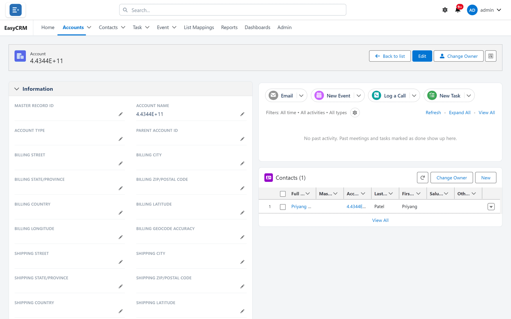

# Records

The part of the portal people spend their day in.

## List views

**What it is.** Saved sets of records with their own columns, filters and sorting.

**What it does.** People switch between views, save their own, and pin one as their default.
Administrators can share a view with everybody. A tab whose **Recently Viewed** list is empty
opens on **All** instead, so nobody starts on a blank screen.

**What you gain:** each person reaches the records they care about in one click instead of
searching every time.

## Filtering, the way Salesforce list views filter

**What it is.** The same Filters panel, field set and operators as a Salesforce list view —
including the owner, creator and last modifier by alias and name, a contact's account fields,
Topics and Campaign Member Status.

**What it does.** Several filters combine with **AND**, **OR**, **NOT** and brackets. Blank
values can be matched, and a filter the list cannot run is refused with a message that says
why.

**What you gain:** genuinely specific questions — "this region, this status, but not these two
owners" — without exporting anything.

## Per-person columns

**What it is.** Each person chooses which fields appear as columns, and in what order.

**What it does.** The choice is remembered and affects nobody else. An administrator can set the
columns everybody starts with.

**What you gain:** no arguments about one shared layout, and no scrolling past twenty
irrelevant columns.

## Editing in a list

**What it is.** Changing values straight in a list, as in a Salesforce list view: one cell at a
time, or one value into up to 200 ticked rows at once.

**What it does.** Changes wait as drafts until **Save**; each record then saves on its own, and
a refused one keeps its draft with the reason beside it. The same permissions, field access and
validation rules apply as on the record page. On a kind of record with several record types,
the list must first be filtered to one.

**What you gain:** clean-ups that took an afternoon of opening records take minutes.

## Sorting

**What it is.** Click a column heading to order by it.

**What it does.** The whole list is sorted, not just the rows on screen. Text, numbers and dates
sort naturally; picklists sort in their defined order; blanks go to the bottom.

**What you gain:** the interesting rows come to the top without building a report.

## Search

**What it is.** Two searches — one across every kind of record and every report and dashboard
you can open, one within the current list. The App Launcher also finds, as you type, any app,
tab or kind of record you may open, A to Z.

**What you gain:** people find things without knowing which tab they live under.

## Row actions and list buttons

**What it is.** A menu at the end of each row, and buttons an administrator adds beside **New**
that start a guided process or open a web page.

**What it does.** As in Salesforce, a list button's flow opens full page in place of the list and
is handed the rows the user ticked; finishing it returns to the list, refreshed.

**What you gain:** acting on records without opening them — one or many at a time — and
company-specific actions where people already work.

## Configurable record pages

**What it is.** An administrator chooses which fields appear, grouped into sections, and which
related records show beside them.

**What it does.** Fields carry the names Salesforce shows on its page layouts, and link formulas
open as links.

**What you gain:** a readable page showing the ten fields that matter instead of the hundred
that exist.

## A layout builder like Lightning App Builder

**What it is.** An optional drag-and-drop editor for record pages, modelled on Salesforce's
Lightning App Builder.

**What it does.** Fields, sections, related lists, the activity panel and Files go anywhere on
the page — in one to three columns, in tabs or an accordion, or placed freely on a grid — and a
field can appear more than once. The header can show chosen fields under the record's name and
the buttons in any order, including **Delete** and **Clone**. Fields of a related record — a
contact's account phone, for example — can sit on the page, read-only and only for people allowed
to see them. Today's layouts open in it as they are, and the classic editor keeps working on the
same layouts.

**What you gain:** record pages arranged the way your teams read them, without a developer.

## Copying a record

**What it is.** A **Clone** button an administrator can put at the top of a record page.

**What it does.** It opens the **New** window filled with the record's values and record type,
copying only what the person could change.

**What you gain:** similar records created in seconds rather than retyped.

## Full and on-the-page editing

**What it is.** An **Edit** button for the whole record, and a pencil beside each field that
opens every field you may change at once, as Salesforce does.

**What it does.** Every editor starts from the value actually stored — a date and time opens
with both — so saving never quietly changes a field you did not touch.

**What you gain:** quick corrections without opening a whole form, and one save when changing
several things.

## Field-level edit control

**What it is.** Permission to edit specific fields rather than the whole record.

**What you gain:** somebody can maintain two fields without being able to touch the rest.

## Record types

**What it is.** One object in several kinds, each with its own fields and options.

**What it does.** Which kinds a company may use is set per company.

**What you gain:** a customer and a supplier can both be accounts without sharing one cluttered
form.

## Ownership and transfer

**What it is.** Every record has an owner, and an Admin or Super Admin can move it — one record
at a time, or several from a related list.

**What it does.** Ownership usually drives who can see the record.

**What you gain:** a clean handover when somebody leaves or an account changes hands.

## Related records

**What it is.** Linked records shown on the page — the contacts at an account, the tasks on a
contact.

**What it does.** Each list can be sorted, refreshed, added to and opened in full. A list a
person may not read shows a padlock, not its contents or even a count. Lists carry the titles
Salesforce gives them where Salesforce passes them to the portal — **Campaign History** rather
than "Campaign Members" — and a list
through a junction object that is master-detail to both sides can show the other record's
fields as columns, as Salesforce's own many-to-many lists do. On a record with very many lists, some fill in a moment after the page
opens, each on its own.

**What you gain:** the whole picture of a customer on one screen.

## Clickable values

**What it is.** Emails, phone numbers, addresses and linked records are all actionable.

**What you gain:** fewer copy-and-paste steps in every single interaction.

## A configurable home page

**What it is.** Record-count tiles, an announcement you write, the open tasks and upcoming
events on the records each person has opened most recently, their recent records and quick
links.

**What it does.** Cards can be turned on or off, each app can have its own home page, and the
**Home** tab can be hidden altogether.

**What you gain:** a landing screen that tells each person what needs their attention today.

## Personal display settings

**What it is.** Top menu or side menu, a colour theme, and comfortable or compact rows.

**What you gain:** people work how they prefer without anybody changing a shared setting.

## Where to do it

- [Records](../use/records/index.md)
- [List views](../use/records/list-views.md)
- [Editing in a list](../use/records/list-editing.md)
- [Filtering a list](../use/records/filtering.md)
- [The layout builder](../admin/layouts/layout-builder.md)
