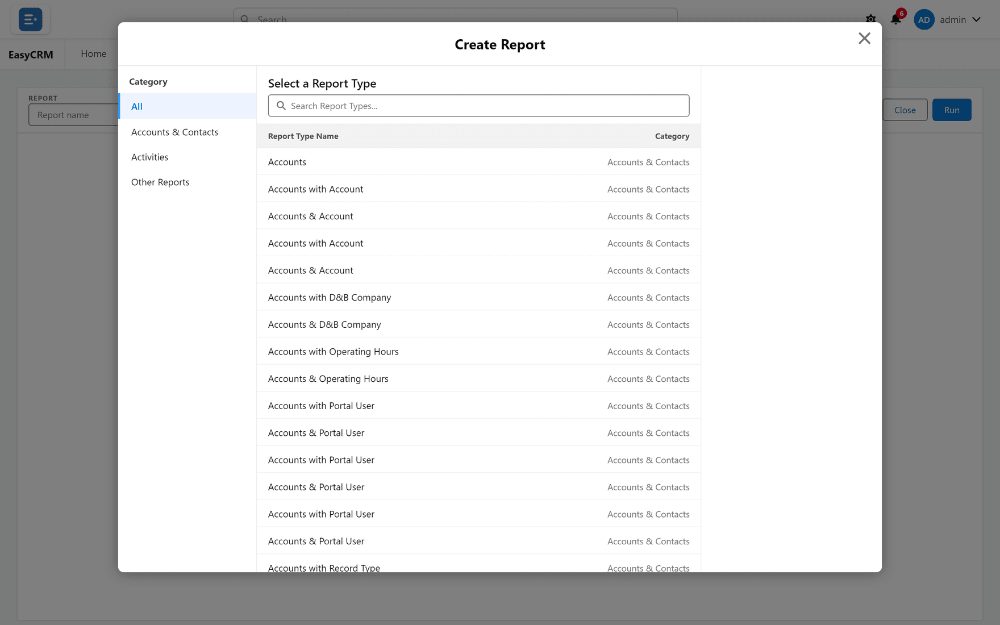

# Reporting

A full report builder, not a list of canned reports.

## Build reports on screen

**What it is.** Choose what the report is about, pick columns, add filters, group and total —
with a preview updating as you work.

**What it does.** Undo and redo throughout; nothing saves until you say so. A report that is
still loading cannot be saved, so a half-loaded report never overwrites the real one.

**What you gain:** anybody who can use a spreadsheet can build a report. No request queue, no
developer.

## Reports across linked records

**What it is.** Report types covering one object, or a record together with the record it
points to — contacts with their account, activities with their contact.

**What it does.** Both forms are available: only records that **have** a match, or **every**
record whether or not it has one. Columns can reach one step further, as Salesforce's do — an
activity report can show the contact's owner and the contact's record type.

**What you gain:** you can report on what exists *and* on what is missing — contacts with no
account, activities with no contact.

## Three report shapes

**What it is.** Tabular, summary and matrix.

**What it does.** The shape follows from what you group: none, rows, or rows and columns.

**What you gain:** one tool covers listing, summarising and cross-tabulating.

## Multi-level grouping

**What it is.** Grouping by any field — up to three levels down the side of a summary report,
and two down and two across on a matrix.

**What you gain:** an answer rather than a list.

## Totals

**What it is.** Sum, average, minimum, maximum and median on any number column, and a unique
count — how many *different* values — on up to three columns.

**What it does.** Subtotals appear per group and a grand total at the bottom.

**What you gain:** the arithmetic is done before anybody reads it.

## Report filters and filter logic

**What it is.** Filters on any field, combined with AND, OR, NOT and brackets — including long
text fields such as a Description, compared exactly as Salesforce's own reports compare them.

**What it does.** On very large reports, long text filters are answered from a prepared copy of
the text, which a Super Admin can switch off.

**What you gain:** the report answers the real question rather than an approximation of it.

## Relative date ranges

**What it is.** The 49 standard date ranges a Salesforce report offers — fiscal and calendar years
and quarters, months, weeks, days, and the last or next 7 to 120 days — with the same names, each
showing the dates it covers today. They apply to any date field on the report, a related record's
included.

**What it does.** Each range covers exactly the days it covers in Salesforce: **Last 7 Days** is
seven days ending today, fiscal ranges follow your organisation's fiscal year.

**What you gain:** "last quarter" stays correct next month without anybody editing the report, and
a report counts the same records as its Salesforce counterpart.

## The same answers as Salesforce

**What it is.** Reports follow Salesforce's own rules for the details that change a number or a
name: columns carry the names Salesforce gives them in that report type (**Phone**, not "Business
Phone"); dates group in date order and numbers in number order; a descending sort reverses the
groups exactly; a blank counts as 0 in an average; a big report's totals count every record while
it shows its first 2,000 rows in Salesforce's order.

**What you gain:** a report built in the portal and the same report in Salesforce read the same,
column for column and total for total.

## Locked filters

**What it is.** Filters the author fixes so readers cannot change or remove them.

**What you gain:** a report scoped to one company stays scoped to it, however it is shared.

## Reader-side filtering

**What it is.** Changing filter values while reading a report, without altering what is saved.

**What you gain:** one report serves many people, each narrowing it to themselves.

## Sorting and reshaping while reading

**What it is.** Click a column's name to sort by it — a grouping's name too, on a matrix as well;
a menu on every heading sorts, groups by that field, or removes the column — on tabular and
summary reports, a matrix's groupings and its Details pane.

**What it does.** Every row is sorted, not just the ones on screen, and later pages carry on in
the same order — on Activities reports too, including by a contact or account column. None of it
is saved.

**What you gain:** readers explore a report their own way without changing it for anybody else.

## Editing values in a report

**What it is.** **Enable Field Editing** on a running report puts a pencil on every value you may
change — on tabular reports, on a summary's detail rows, and in a matrix's Details pane.

**What it does.** You change as many cells as you need, each starting from the value stored on
the record, and save them together. A parent's column writes to the parent; an account name
column re-points the row to a different account.

**What you gain:** a list gets cleaned up in one screen instead of a visit to every record.

## Fields hidden per person

**What it is.** A field somebody may not read is hidden from every report they run — columns,
groupings, totals, formulas and charts built on it.

**What it does.** A filter on a hidden field is left out for them; a report whose filter logic
depends on one refuses to run, as Salesforce's does. Nobody can save their reduced view over the
real report, but they can **Save As** their own copy.

**What you gain:** the same report can be shared widely without showing anybody a field they
should not see.

## Bucket columns

**What it is.** A column you invent, sorting existing values into categories you name — ranges
for numbers, chosen values for text and picklists.

**What you gain:** report by your own categories without adding a field to the database or
waiting for a change request.

## Formula columns, at two levels

**What it is.** Row-level formulas calculate once per record. Summary formulas calculate once
per group from the totals, at whichever grouping level you choose.

**What you gain:** percentages, ratios, ages and rates computed inside the report, so the
report is the finished answer rather than a starting point.

## Charts

**What it is.** Eleven chart types — bar, column, stacked bar, stacked column, line, donut, pie,
funnel, scatter plot, metric and gauge — drawn from the report's groupings.

**What it does.** Where a report has several groupings, the chart can be re-sliced by any of
them. Pointing at a bar or slice shows its exact figures.

**What you gain:** the same report answers more than one question, and trends become visible.

## Opened from a dashboard, already filtered

**What it is.** A report opened from a dashboard tile — or by clicking a bar or slice — opens
narrowed exactly as the tile was.

**What you gain:** the numbers behind a tile are one click away, and **Back** returns to the
dashboard as you left it.

## Fast to open

**What it is.** A report reuses its last result for up to a day; **Refresh** works it out again
from live data.

**What you gain:** large reports open quickly. An administrator can make a company's reports
always run live instead.

## Folders and favourites

**What it is.** Reports live in folders, and the folder decides who can see them. Starred
reports appear under Favorites.

**What you gain:** one library serving several companies, each seeing only its own.

## Clone and Save As

**What it is.** Taking a copy of any report under a new name.

**What you gain:** people improve existing reports without risking them.

## Export

**What it is.** Download as a formatted report (.xlsx), keeping groups and subtotals, or as
plain details (.xlsx, .xls or .csv) for further work.

**What it does.** A details export takes every row — up to Excel's limit of 1,048,575, or
5,000,000 as CSV — with progress shown as it goes. It exports the report as saved.

**What you gain:** numbers leave in whatever form the recipient needs, however large the report.

## Sharing

**What it is.** Reports and folders shared with companies at read or edit level, or with chosen
individuals. Revocable.

**What you gain:** you build it once and decide separately who gets it.

## Importing existing Salesforce reports

**What it is.** Bringing a report that already exists in Salesforce into the portal rather than
rebuilding it.

**What it does.** Record type columns and filters, relative date ranges, multi-select
"includes" and "excludes" filters and activity columns such as Call Duration (minutes) come
across. A column that cannot is named in the sync's message rather than dropped silently — see
[What a report sync brings across](../admin/salesforce/what-syncs.md).

**What you gain:** you start from the reports your company already trusts.

## Formula sync

**What it is.** Formula columns stay aligned between a portal report and its Salesforce
counterpart.

**What you gain:** the same calculation means the same thing wherever somebody reads it.

## Where to do it

- [Starting a new report](../use/reports/report-types.md)
- [The report builder](../use/reports/builder-tour.md)
- [Running a report](../use/reports/running.md)
- [Editing values in a report](../use/reports/editing.md)
- [Date ranges](../use/reports/date-ranges.md)
