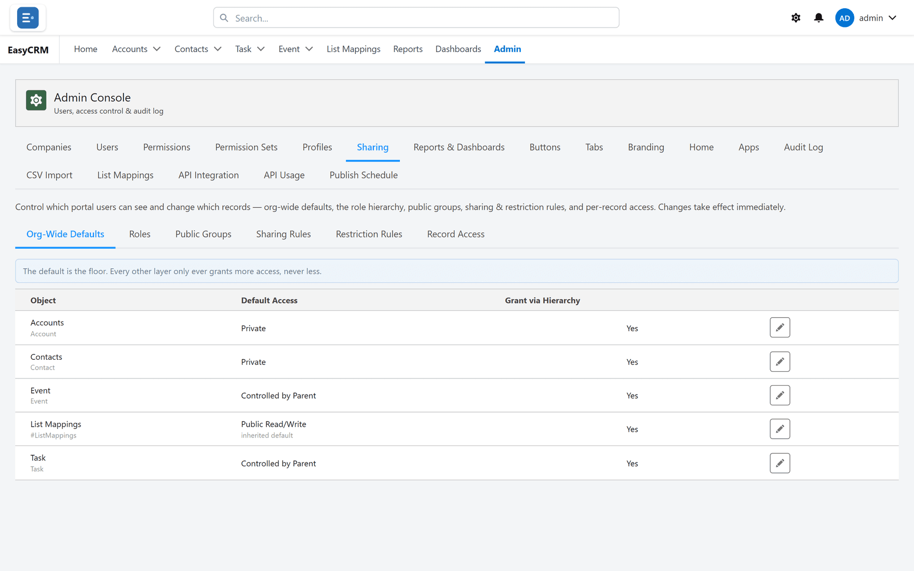

# Security

A complete access model, in two independent halves.

| Half | Decides | Set by |
|---|---|---|
| **Permissions** | What somebody may **do** | Per person, per object |
| **Sharing** | Which **records** they may do it to | Defaults, rules, hierarchy |

## Six permissions per object

**What it is.** Read, create, edit and delete, plus permission to change the page layout for
everybody, plus field-by-field control over which fields a person may edit.

**What you gain:** somebody can maintain two fields on a record without being able to touch the
rest.

## Profiles

**What it is.** A baseline of access for a kind of person.

**What you gain:** new joiners are set up correctly by assigning one thing.

## Permission sets

**What it is.** Extra access handed to particular people, on top of their profile.

**What it does.** A permission set only ever **adds**.

**What you gain:** exceptions handled without widening access for a whole group.

## Org-wide defaults

**What it is.** The starting access for each object — **Private**, **Public Read Only**,
**Public Read/Write**, **Controlled by Parent** (a child record follows the access of the record
it belongs to) or **Field Scoped** (below).

**What you gain:** a floor you set deliberately, rather than one you inherit.

## Field Scoped

**What it is.** An org-wide default under which each person sees only the records whose chosen
field holds one of their values — set per company for all its users, or per user in place of
the company's.

**What it does.** It is strict: a record outside someone's values stays hidden even if they own
it or it is shared with them, and somebody with no values sees none. Saves have to keep the
record inside the person's own values, and the API, reports, lists and record pages all honour
it. Only a Super Admin sets it up, and Super Admins always see everything.

**What you gain:** one setting that splits a shared object between customers — each sees only
their own rows — without a rule per customer.

## Sharing rules

**What it is.** Standing rules that widen access beyond the default, targeting records by owner
or by field criteria, granting to a company, a role or a named group.

**What you gain:** a private-by-default portal where teams still see each other's work,
maintained by rules rather than record by record.

## Public groups

**What it is.** Named lists of people, which can contain roles and other groups.

**What you gain:** add somebody to one group and every relevant rule follows.

## Role hierarchy

**What it is.** A reporting tree where access flows upward.

**What you gain:** managers get visibility automatically as teams change, with no rule per
manager.

## Restriction rules

**What it is.** A rule that **narrows** access — of the records somebody could otherwise see,
keep only those matching your criteria. Together with Field Scoped, it is one of the two things
that take access away rather than add it.

**What you gain:** contractors and partners given broad capability on a deliberately narrow
slice of data.

## Account scoping

**What it is.** Tying a portal user to an Account, so they see only that account's records —
with child records following through a parent field, and an optional user-match field tying
records directly to a person.

**What it does.** Account scoping that is already configured keeps working, but the portal no
longer offers screens to set it up. For a new arrangement of this kind, use **Field Scoped** —
for example, Contacts scoped on their Account.

**What you gain:** the classic customer-portal arrangement. Every client signs in to the same
portal and sees only their own data, with no rule written per client.

## Manual record sharing

**What it is.** Sharing one individual record with a named person or group, at a chosen access
level, with the reason recorded.

**What you gain:** the one-off exception handled without a rule that would also catch a hundred
other records.

## Access diagnostics

**What it is.** Pick any record and see everybody who can access it, with the reason for each —
owner, default, a named sharing rule, the hierarchy, or whether it is inside their field scope.

**What you gain:** access questions answered with evidence in seconds, and you know exactly
which setting to change.

## Where to do it

- [Sharing](../admin/sharing/index.md)
- [Field Scoped sharing](../admin/sharing/field-scoped.md)
- [Permission sets](../admin/access/permission-sets.md)
