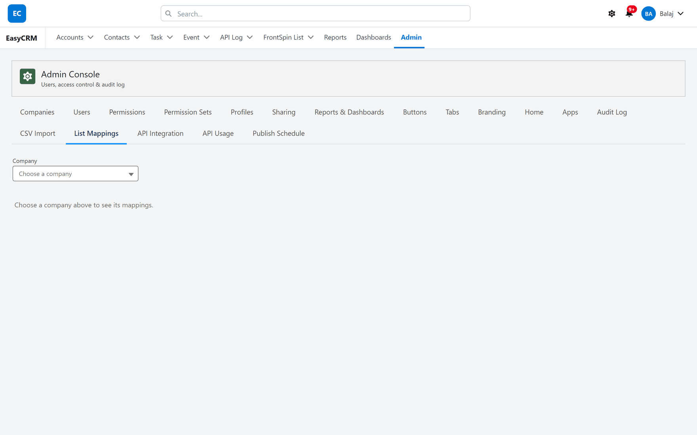
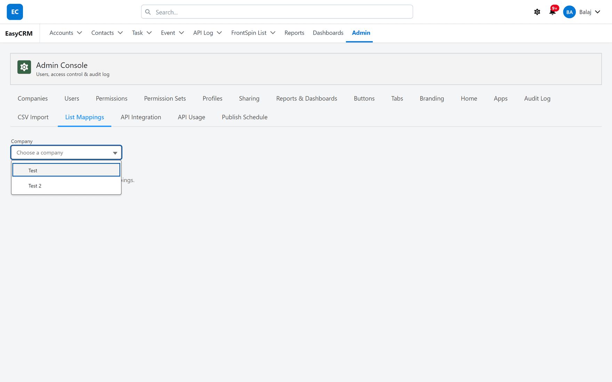
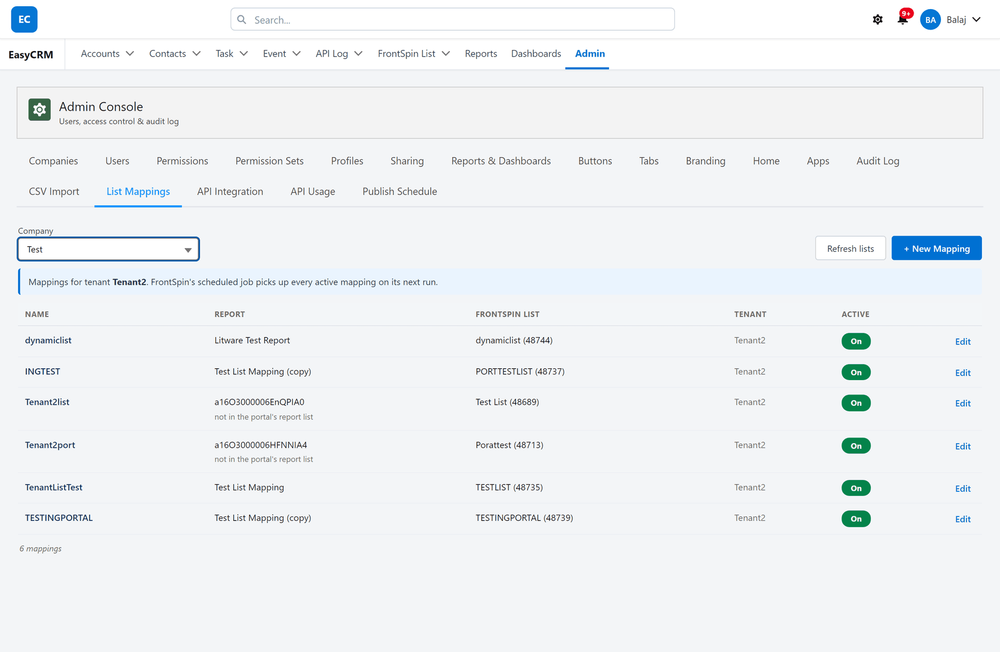
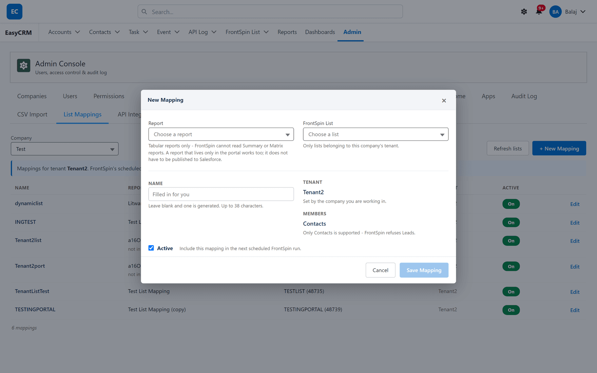
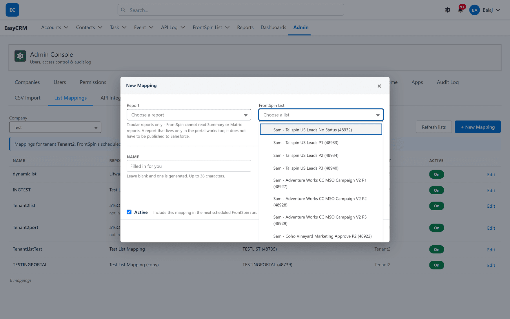
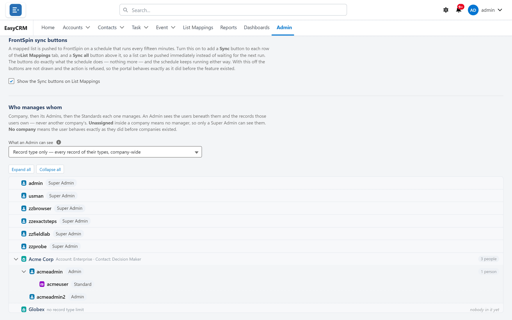

# List Mappings

## What it is

The portal end of [Report to List](../lists/report-to-list.md): which Salesforce report fills
which FrontSpin calling list, for a given company.

## Before it does anything

**It only drives the sync when the switch is set to the Custom Setting.** With the switch off —
which is the default — this tab edits a store the scheduled job does not read.

Check [Setup, or the portal](../lists/where-mappings-live.md) before using it. A mapping added
here while the switch is off looks perfectly correct and does nothing.

## Opening it

**Where:** In the portal → **Admin** → **List Mappings** → choose a company

1. Click **Admin** in the top menu.
2. Click **List Mappings** in the row of tabs.
3. **As a Super Admin**, nothing is shown yet — mappings belong to a company, so one has to be
   chosen first: **Choose a company above to see its mappings.**

4. Click **Choose a company** and pick one.

**As an Admin**, there is no picker: the tab opens on your own company, and you can never see or
change another company's mappings. An Admin who belongs to no company sees **Your user is not
linked to a company, so there are no mappings to show.**

## What you get

The blue line names the **tenant** you are editing: **Mappings for tenant *name*. FrontSpin's
scheduled job picks up every active mapping on its next run.** After a **Refresh lists** it adds
**Lists last pulled *date*.** How often that job runs is covered in
[Report to List](../lists/report-to-list.md).

| Column | Shows |
|---|---|
| **Name** | What the mapping is called |
| **Report** | The Salesforce report that fills the list |
| **FrontSpin List** | The list, with its FrontSpin number in brackets |
| **Tenant** | Which FrontSpin account |
| **Active** | An **On** / **Off** switch |
| *(last column)* | **Edit**, and — when the Sync buttons are switched on — **Sync** and how the last sync went |

The count sits under the table. With none yet: **No mappings yet for this company.**

### "not in the portal's report list"

A row can show a raw report id with **not in the portal's report list** under it.

That means the mapping points at a report the portal cannot see — usually one that lives only in
Salesforce. The mapping still runs; the portal just cannot show you its name. It is a note, not an
error.

A list can show **not in the list catalogue** in the same way: the list's id is shown because the
catalogue does not hold its name.

## Adding a mapping

1. Choose the company.
2. Click **+ New Mapping**.

3. Fill it in:

| Field | Notes |
|---|---|
| **Report** | **Tabular reports only.** See below. |
| **FrontSpin List** | Only lists belonging to this company's tenant are offered |
| **Name** | Leave blank and one is generated. Up to 38 characters. |
| **Tenant** | Not editable — set by the company you are working in |
| **Members** | Contacts. Not editable. |
| **Active** | Include this mapping in the next scheduled FrontSpin run |

4. Click **Save Mapping**. It stays greyed out until a report and a list are chosen. The message
   **Mapping created.** confirms it.

### Tabular reports only

**FrontSpin cannot read Summary or Matrix reports.** Only a tabular report can fill a list, so a
grouped report will not be offered.

If the report you want is grouped, make a tabular copy of it for this purpose.

### A portal-only report works

The report does **not** have to be published to Salesforce. A report that exists only in the
portal can fill a FrontSpin list perfectly well.

That is worth knowing because it removes a step people often assume is required.

### Contacts only

**Members** is fixed at Contacts, because FrontSpin refuses Leads. There is nothing to choose.

## Changing a mapping

Click **Edit** on its row. The **Edit Mapping** dialog has the same fields; click **Save Mapping**,
and **Mapping updated.** confirms it.

If the mapping's report or list is no longer in the pickers, that box opens empty rather than
quietly choosing something else. Choose again before saving.

## The list picker

Each entry shows the list name and its FrontSpin number. **Only this company's tenant's lists are
offered**, so you cannot accidentally point one customer's report at another customer's calling
list.

## Refresh lists

The picker can only offer lists Salesforce already knows about. **Refresh lists** asks FrontSpin
for the current set.

**It can add lists that are new. It cannot update ones already recorded.**

The portal runs as the site's guest user, and a Guest User Licence forbids editing records — no
permission set can change that. So refreshing a list already in Salesforce fails with a duplicate
error on the list's key, which is expected rather than a fault.

Keeping existing entries current is the hourly
[List Catalog job](../lists/index.md)'s work. It runs as a real user and has no such limit.

In practice: use **Refresh lists** when a brand-new list has just been created in FrontSpin and
you do not want to wait an hour. For everything else, the hourly job handles it.

What the refresh reports:

| Message | Means |
|---|---|
| **Pulled the latest lists from FrontSpin.** | It worked. |
| **Already refreshed moments ago - showing the latest catalogue.** | The last pull was under a minute ago, so it was not repeated. |
| **Showing the last catalogue FrontSpin sent. A live pull needs an extension class - add one that implements Callable and name it in Admin, Branding, Extension Class.** | The org has no extension class to make the call. Despite the wording, **Extension Class** is set in Salesforce, not on the portal's Branding tab — see [Settings only Salesforce can change](../../admin/salesforce/switches.md). |
| **Could not reach FrontSpin: … Showing the last catalogue instead.** | The pull failed; the lists already known are still offered. |

## Turning one off

1. Click the row's **On** / **Off** switch. Nothing is saved yet: **Save** and **Cancel** appear on
   the row.
2. Click **Save**. The message confirms it, for example **"Acme Q3" is now inactive.**

Off means the scheduled job skips it; the mapping is kept.

Prefer this to deleting. Nothing can remove people a mapping has already added to a list, so
switching it off is the only way to stop it growing.

## Syncing now

By default a mapping is pushed to FrontSpin only by the scheduled job. A Super Admin can add
buttons that push it immediately, doing exactly what the schedule does.

### Switching the buttons on

**Where:** In the portal → **Admin** → **Users** → **FrontSpin sync buttons**

1. As a Super Admin, scroll below the user list to **FrontSpin sync buttons**.
2. Tick **Show the Sync buttons on List Mappings**.

The message **The Sync buttons now appear on the List Mappings tab.** confirms it. It applies to
every company. Unticking it shows **The Sync buttons are hidden again, and the sync action is
refused.** — the buttons go, and a sync started any other way is refused. The scheduled job keeps
running either way.

The panel's own text says the schedule runs every fifteen minutes. That schedule belongs to the
FrontSpin integration rather than to EasyCRM; [Report to List](../lists/report-to-list.md) covers
how often it runs.

### Syncing

1. Choose the company.
2. Click **Sync** on an active mapping's row, or **Sync all** above the table for every active
   mapping of this company. An inactive mapping has no **Sync** button.
3. A **Sync started** box appears for a few seconds: **Sync started for *N* mappings. You can
   follow the progress at the top of this page.** (**1 mapping** for a single one.)

**Sync all** starts at most **45** mappings per click. Any beyond that are listed as failed with
**Not started this time - over the 45 per click limit.** — click **Sync all** again, or let the
schedule pick them up.

<!-- SHOT: frontspin/list-mappings-sync-progress.png | List Mappings for a company with the Sync buttons on, just after Sync all: the progress panel "Syncing 4 mappings…" with "2 of 4 finished · started 10:42", chips "2 synced", "0 failed", "2 in progress", and the rows showing Syncing… and Synced chips -->

### Following the progress

A panel at the top of the page follows every mapping the click started.

| Part | Shows |
|---|---|
| Title | **Syncing *N* mappings…** while it runs; then **All *N* mappings synced**, or **Sync finished** when any failed or there was only one |
| Under it | ***X* of *Y* finished · started *time*** |
| Chips | ***n* synced**, ***n* failed**, ***n* in progress** |
| Failures | Each failed mapping with its reason |
| **Show synced (*n*)** | Lists the ones that worked: ***k* contacts added, *m* already on the list.**, or **Nothing new to add.** |
| **×** | Dismisses the panel once everything has finished |

Each row also carries a chip while its sync is followed: **Syncing…**, **Synced**, **Failed** or
**No result**.

The panel keeps following the syncs if you leave the tab and come back within the same browser
session. Clicking **Sync** again while it runs adds to the same panel.

Two more lines can appear:

| Line | Means |
|---|---|
| **No result yet after ten minutes - check the org's API log.** | The org never reported back for that mapping. It may have worked; check the log in Salesforce. |
| **This org records failures only, so a mapping with no error after two minutes is shown as synced.** | The org logs only failures, so silence is taken as success — those rows read **No error reported.** |

### When nothing starts

| Message | Means |
|---|---|
| **Syncing from the portal is switched off.** | The Sync buttons are switched off. |
| **This company has no FrontSpin tenant.** | Set the company's **FrontSpin tenant** under [Companies](../../admin/companies/index.md). |
| **No active mappings to sync.** | Every mapping of this company is **Off**. |
| **Syncing needs an extension class - add one that implements Callable and name it in Admin, Branding, Extension Class.** | The org has no extension class. **Extension Class** is set in Salesforce, not on the portal's Branding tab — see [Settings only Salesforce can change](../../admin/salesforce/switches.md). |
| **Could not start the sync. The next scheduled run will still pick it up.** — or **Could not start the sync: *reason*** with the same ending | The org refused to start it. Nothing is lost. |

## What goes wrong

| Symptom | Cause |
|---|---|
| "FrontSpin is not set up in this org" | The integration is not installed. See [the boundary](../index.md#an-important-boundary). |
| A new mapping does nothing | The [switch](../lists/where-mappings-live.md) is off, so Setup is the live source. |
| Your report is not in the picker | It is a Summary or Matrix report. Only tabular reports can be used. |
| A list is missing from the picker | The catalogue has not caught up. Click **Refresh lists**, or wait for the hourly job. |
| "duplicate value found" on refresh | The guest cannot update an existing list. Expected — see above. |
| A row shows a raw id | The report lives outside the portal. Harmless. |
| Contacts added but the list looks short | FrontSpin applies additions asynchronously. Give it a few minutes. |
| There are no **Sync** buttons | A Super Admin has not switched them on, or the mapping is **Off**. |
| Some mappings were **Not started this time** | More than 45 active mappings. Click **Sync all** again. |
| An Admin cannot choose a company | Correct: an Admin works only on their own company. |

## Where this fits

What a mapping actually does is [Report to List](../lists/report-to-list.md). Where mappings are
stored is [Setup, or the portal](../lists/where-mappings-live.md).
