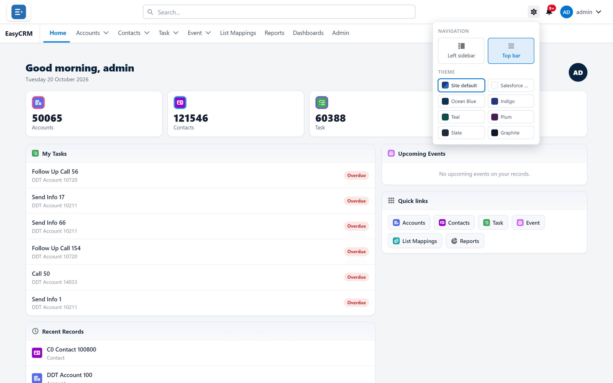

# How the portal looks

## What you can change

Three things, all of which affect **only you**:

| Setting | Options | Where | Kept |
|---|---|---|---|
| Menu position | **Top bar** or **Left sidebar** | The gear, top right | On your account — it follows you to any computer |
| Colour theme | **Site default** and seven presets | The gear, top right | On your account |
| Row spacing | **Comfy** or **Compact** | Your name, top right | In this browser only |

Nobody else is affected and no data changes.

## Changing the menu and theme

**Where:** In the portal → the gear (top right)

1. Click the **gear** symbol in the top right of any page. Its tip says **View settings**.

   

2. Under **Navigation**, choose:
   - **Top bar** — tabs across the top. More width for tables.
   - **Left sidebar** — tabs down the left. Easier when there are many tabs.
3. Under **Theme**, click one: **Site default**, **Salesforce Default**, **Ocean Blue**,
   **Indigo**, **Teal**, **Plum**, **Slate** or **Graphite**.

Each choice applies the moment you click it — there is no **Save** button. Click anywhere
outside the panel to close it.

The theme colours the bars and highlights only; the pages themselves stay light.

## Changing row spacing

**Where:** In the portal → your name (top right) → **Display Density**

1. Click your **name** in the top right.
2. Under **Display Density**, choose **Comfy** or **Compact**. A tick shows the current one.

**Compact** fits noticeably more rows on screen. If you work through long lists, it is worth
the smaller text.

Row spacing is remembered in this browser only. On another computer, or in another browser,
choose it again.

## Which to choose

| Situation | Suggestion |
|---|---|
| Wide tables, few tabs | Top bar |
| Many tabs | Left sidebar |
| You need the **Files** area | Top bar — the App Launcher offers **Files** only there |
| Long lists, big screen | Compact |
| Occasional use | Comfy |

## Your administrator sets the default

The starting layout and theme come from [Branding](../../admin/appearance/branding.md). Without
one, the portal starts with the **Top bar** and the **Salesforce Default** theme. **Site
default** under **Theme** means "whatever the administrator chose". What you choose overrides it
for you — and your choice sticks until you change it.

## What goes wrong

| Symptom | Cause |
|---|---|
| Row spacing went back on another computer | Row spacing is kept per browser. Choose it again there. |
| The theme or menu went back after signing in again | The choice is saved as you click it; if the portal could not be reached at that moment, it was not stored. Choose it again. |
| A colleague's portal looks different | They chose different settings, or a different app. |
| The theme looks different and you changed nothing | You are on **Site default**, and your administrator changed the branding theme. |
