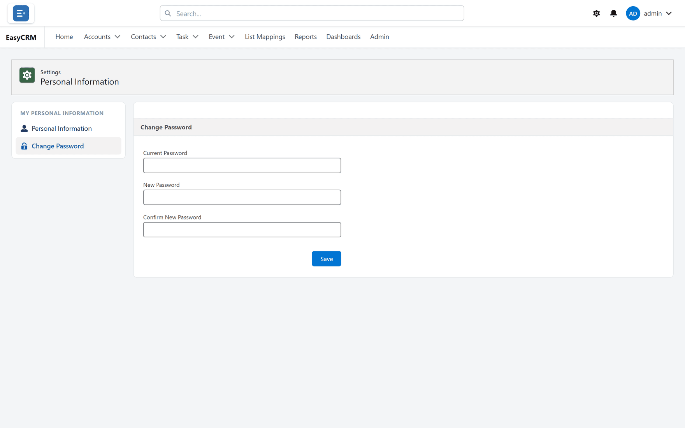

# Changing your password

**What it is.** Setting a new password for yourself.

**Why it matters.** The password your administrator sent arrived by email, which means it has
been sitting in an inbox. Changing it to something only you know is worth doing on your first
day.

## Changing it

**Where:** In the portal → your name (top right) → **Settings** → **Change Password**

1. Click your name in the top right corner.
2. Click **Settings**.
3. Click **Change Password** in the menu on the left.

   

4. Type your current password in **Current Password**.
5. Type your new password in **New Password**.
6. Type the new password again in **Confirm New Password**.
7. Click **Save**.

The portal says **Your password has been updated.** You stay signed in. Use the new password
next time.

## The rule

A new password must be **at least 8 characters** long. That is the only rule the portal
enforces — it does not demand numbers or symbols. See "Choosing a password" below for what
actually makes one strong.

## If it will not save

The message appears in red under the boxes.

| Message | What to do |
|---|---|
| **Enter your current password.** | The **Current Password** box is empty. |
| **New password must be at least 8 characters.** | Make it longer. |
| **The new passwords do not match.** | **New Password** and **Confirm New Password** differ. Retype both. |
| **Your current password is incorrect.** | Check for typing mistakes and Caps Lock. |

## If you cannot remember the current one

You cannot change it from here — you need the old one.

Sign out and use **Forgot password?** on the sign-in page instead. See
[Signing in](../start/sign-in.md).

Your administrator can also set a new one for you.

## Choosing a password

Length matters more than symbols. Three or four unrelated words are both easier to remember
and harder to guess than one short word with a number stuck on the end.

Do not reuse a password from somewhere else.
