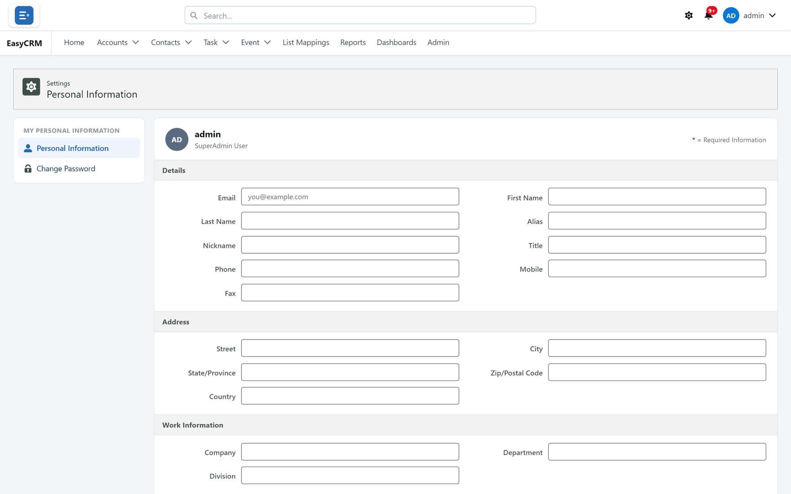
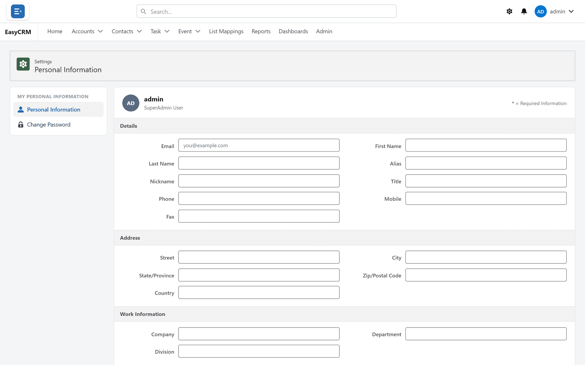

# Your profile

**What it is.** Your own details, on the **Settings** page.

**Why it matters.** Nothing you change here affects anybody else. Your email address matters
most: a forgotten password is sent there.

## Opening it

**Where:** In the portal → your name (top right) → **Settings**

1. Click your name in the top right corner of the screen.
2. Click **Settings**.

<!-- SHOT-RETAKE: ../../img/shots/profile/view.png | The current picture is the Profiles object list, not the user's own settings. Capture Settings → Personal Information for a Standard user, showing the username and "Standard User" under it -->

The page is headed **Settings** — **Personal Information**. On the left, under **My Personal
Information**, are its two parts: **Personal Information** and **Change Password**.

At the top of **Personal Information** are your username and your role — **Standard User**,
for example.

## What you can see

| Section | Fields |
|---|---|
| **Details** | **Email**, **First Name**, **Last Name**, **Alias**, **Nickname**, **Title**, **Phone**, **Mobile**, **Fax** |
| **Address** | **Street**, **City**, **State/Province**, **Zip/Postal Code**, **Country** |
| **Work Information** | **Company**, **Department**, **Division** |

All of these you can change yourself. What you cannot change here:

| Detail | Who changes it |
|---|---|
| Your username | Your administrator. |
| Your role | Your administrator. See [What you can see](../start/what-you-can-see.md). |
| The company you belong to in the portal | Your administrator. The **Company** box under **Work Information** is only text you type — changing it does not move you to another company or change what you can see. |

## Changing a detail

**Where:** In the portal → your name → **Settings** → **Personal Information**

1. Click into the field.
2. Change it.
3. Click **Save** at the bottom.

The portal says **Your personal information has been saved.**

If the email address is not in a valid form, it says **Enter a valid email address.** You can
leave the email empty, but then **Forgot password?** cannot send you anything — keep it filled
in and current.

## Your password

See [Changing your password](./password.md).

## How the portal looks to you

That is not here — it is the **gear** in the top bar, and **Display Density** under your name.
See [How the portal looks](./display.md).
