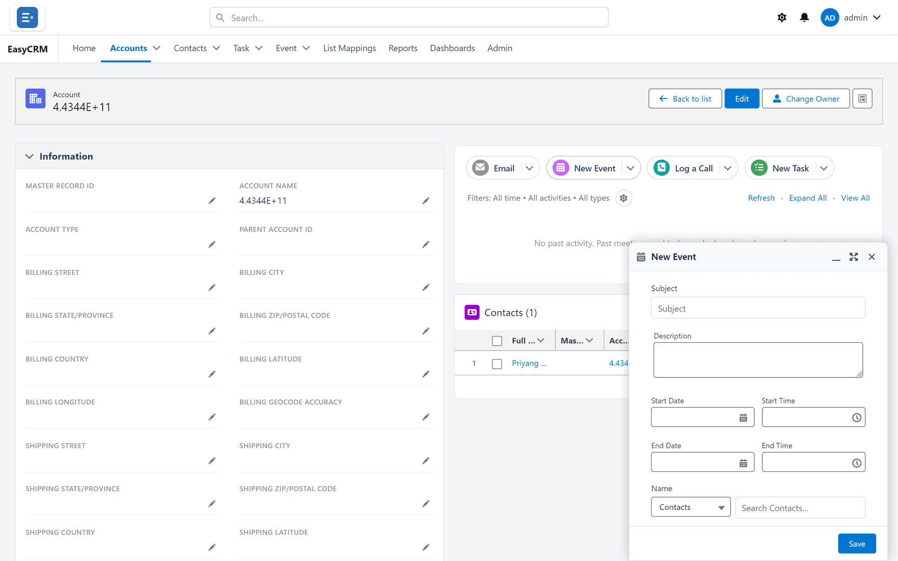

# Events

## What an event is

Something in the diary: a meeting or call with a **start and an end time**, attached to the
record it concerns.

## Event or task?

They are easy to confuse and the difference is simple.

| | Has | Appears under |
|---|---|---|
| **Task** | A due date | **My Tasks** |
| **Event** | A start and an end time | **Upcoming Events** |

A task is something to do by a date. An event occupies a slot in the day. "Send the quote by
Friday" is a task; "Review call, Thursday 2pm" is an event.

## Creating one

**Where:** In the portal → **Accounts** → the record's name → **New Event**

1. Click the tab and open the record.
2. Click **New Event** in the activity panel. A panel opens at the bottom of the screen.

   

3. Fill in:

| Field | Notes |
|---|---|
| **Subject** | What the meeting is about |
| **Description** | Agenda, dial-in, anything the attendee needs |
| **Start Date** and **Start Time** | When it begins |
| **End Date** and **End Time** | When it finishes |
| **Name** | The contact (or lead) it is with |
| **Related To** | Usually starts as the record you are on |
| **Attendees** | Your own name is already there. Add others under **People** (**Search People…**) or **Resources** (**Search Resources…**). |

4. Click **Save**.

The portal says **Activity saved.** and the event appears in the record's timeline. Until it
starts it sits under **Upcoming & Overdue**; afterwards, in its month.

If you leave the dates and times empty, the event is booked for today from 9:00 to 10:00. Left
without an end date, it ends on its start date.

## Why attach it to a record

An event created on the account carries its context. Whoever opens that customer next sees the
meeting happened, when, and what it was about — without asking anybody.

An event in your own calendar and nowhere else is invisible to your colleagues.

## After the meeting

The event stays in the record's history as evidence it happened. If the conversation produced
anything worth keeping, [log a call](./logging-a-call.md) or create a
[task](./tasks.md) for the follow-up.

The event records that you met. The call log records what was said.

## Seeing your events

| Where | Shows |
|---|---|
| **Upcoming Events** on the home page | Up to six events from today onwards on the 20 records you opened most recently |
| The **Event** tab | Every event you can see — see [Lists](../records/lists.md) |
| A record's timeline | Events on that record (and on an account, its contacts' events too) |

Past events drop off **Upcoming Events** but remain in the timeline and the Event tab.

## Times and time zones

There is no time-zone setting on your portal account. The record's timeline shows times by your
computer's clock; the home page and the record page show them in the time zone Salesforce uses
for the portal. When your computer is in a different time zone from the portal, the two can
disagree.

## What goes wrong

| Symptom | Cause |
|---|---|
| Not under **Upcoming Events** | It is in the past, or its record is not one of the 20 you opened most recently. Only six show. |
| The time looks wrong | See **Times and time zones** above. If it is still wrong, tell your administrator what you entered and what the portal shows. |
| It will not save | **End** is before **Start**. |
| A colleague cannot see it | They may not have access to the record it is on. |

## Where this fits

Events sit in the same [timeline](./index.md) as calls, tasks and emails. The
[Event tab](../records/lists.md) lists them like any other record — filter and sort it the
same way.
