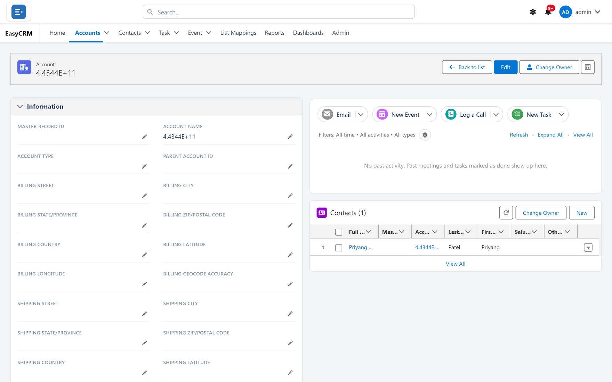
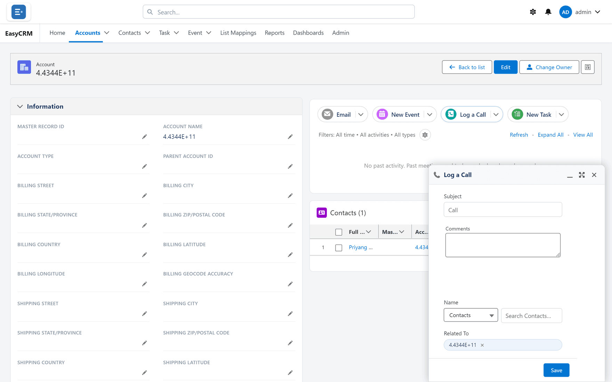
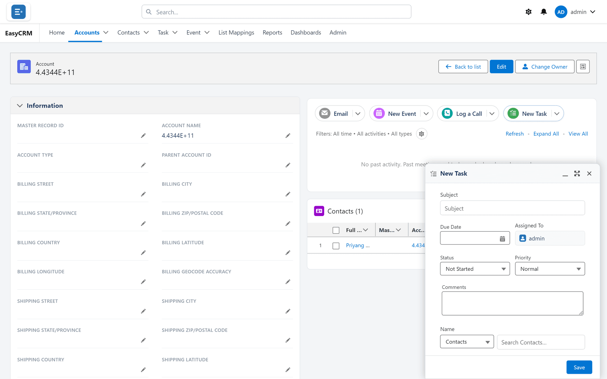
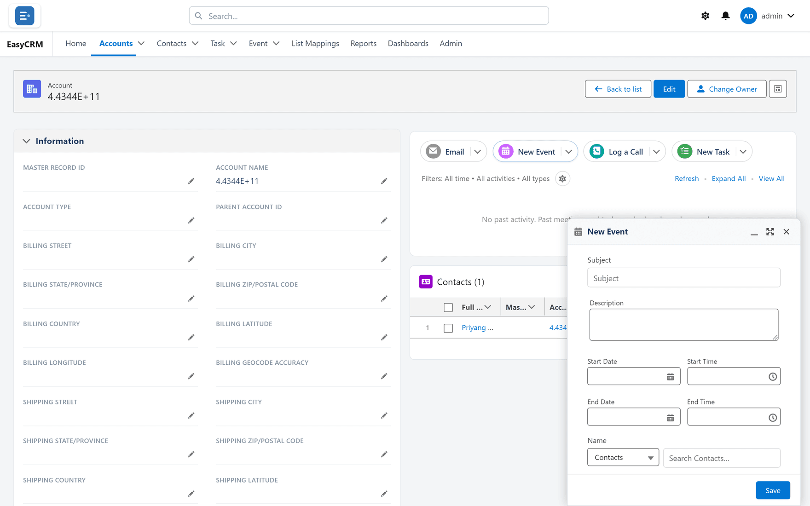
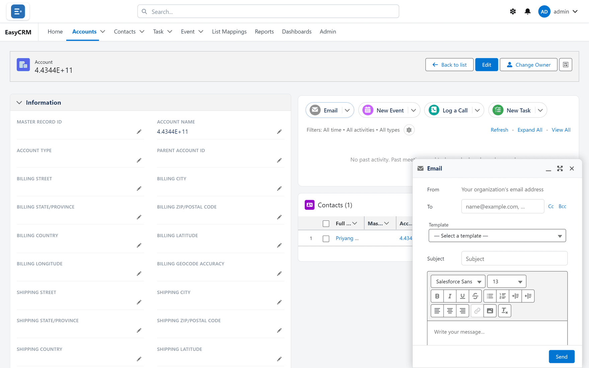
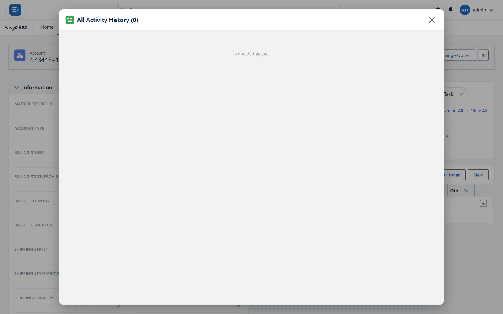

# Calls, tasks and meetings

**What it is.** The activity panel on a record, showing everything that has happened with it.

**What it does.** It keeps calls, tasks, meetings and emails attached to the record they
concern, grouped by date.

**Why it helps.** Anybody who opens the record can see the history straight away.

## Finding the panel

**Where:** In the portal → **Accounts** → the record's name → the panel in the right-hand column

1. Click **Accounts** (or any tab) in the top menu.
2. Click the record's **name** to open it.
3. Look at the right-hand column of the page — the panel is usually at the top of it. The four
   buttons along its top are how you add something.

## The four buttons

| Button | Use it for |
|---|---|
| **Email** | A message about this record, sent from the portal. |
| **New Event** | A meeting, with a start and end time. |
| **Log a Call** | A call that has **already happened**. |
| **New Task** | Something still **to do**. |

The difference between **Log a Call** and **New Task** is time: one is a record of the past,
the other a reminder for the future.

## The panels at the bottom of the screen

Each button opens a small panel docked at the bottom of the screen, not a window over the page —
so you can keep reading the record while you type. You can have several open at once: a call to
log and an email to send, for example.

Each panel has three small buttons on its title bar:

| Button | What it does |
|---|---|
| **Minimize** | Folds the panel down to its title bar. Click the title bar to open it again. |
| **Expand** | Makes the panel larger. |
| **Close** | Closes it. Anything typed in it is lost. |

When you save, the panel closes and the portal says **Activity saved.** — or **Email sent.**

<!-- SHOT: records/activity-docked-panels.png | An Account record with two docked panels open at the bottom: New Task expanded with Subject, Due Date, Assigned To, Status, Priority filled; Log a Call minimised beside it -->

## Logging a call

**Where:** In the portal → a record → **Log a Call**

1. Open the record.
2. Click **Log a Call** in the activity panel.
3. A panel opens at the bottom of the screen.

   

4. Type what the call was about in **Subject**.
5. Add any detail in **Comments**.
6. Click **Save**.

The call appears in the timeline, dated today and already marked as done. More on
[Logging a call](./logging-a-call.md).

## Setting a task

**Where:** In the portal → a record → **New Task**

1. Open the record.
2. Click **New Task**.

   

3. Type a **Subject** — what needs doing.
4. Set a **Due Date**.
5. Click **Save**.

**Assigned To** shows your name and cannot be changed here. More on [Tasks](./tasks.md).

## Scheduling a meeting

**Where:** In the portal → a record → **New Event**

1. Open the record.
2. Click **New Event**.

   

3. Type a **Subject**.
4. Set the **Start Date**, **Start Time**, **End Date** and **End Time**.
5. Click **Save**.

More on [Events](./events.md).

## Sending an email

**Where:** In the portal → a record → **Email**

1. Open the record.
2. Click **Email**.

   

3. Fill in **To** — several addresses separated by commas. Click **Cc** or **Bcc** to add those
   lines.
4. Choose a **Template** if your company has any, or type a **Subject** and your message.
5. To attach something, click **Attach file**.
6. Click **Send**.

**From** shows your company's sending address — or a choice of them, if it has several. Without
a recipient, the portal says **Enter at least one recipient.** The email is sent, and kept in
the timeline as a completed email.

## Reading the timeline

Under the buttons, the record's activities are grouped:

- **Upcoming & Overdue** comes first: tasks not yet done, and events still to come, soonest
  first.
- Then one group per month, newest first — **October • 2026**, for example. The current month
  carries the label **This Month**.

Click a group's heading to fold it away.

<!-- SHOT: records/activity-timeline.png | An Account timeline with an Upcoming & Overdue group and a "This Month" group, one row expanded showing Description, Related To, Name and Assigned To, the ▾ menu open on another row -->

Each entry shows:

- an icon for the kind of activity;
- for an open task, a tick box — **Mark complete**. Ticking it marks the task done straight away;
- the **subject** — click it to open the activity's own page;
- a line saying who did what, with whom (see below);
- the date on the right — **Today**, or **Oct 30, 2026**; an event today shows its time too;
- a ▾ menu with **Edit** and **Delete**.

Click the small arrow at the start of an entry to see its details: **Start** and **End** for an
event, **Description**, **Related To**, **Name** and **Assigned To**.

### The line under each subject

It names the person the activity belongs to in Salesforce, and the contact it was with:

| Kind | Reads like |
|---|---|
| An overdue task | **Ryan Reisert has an overdue task with John Moster** |
| An open task | **Ryan Reisert has an upcoming task with John Moster** |
| A finished task | **Ryan Reisert had a task with John Moster** |
| A call | **Ryan Reisert logged a call with John Moster** |
| An email | **Ryan Reisert sent an email to John Moster** |
| A future event | **Ryan Reisert has an upcoming event with John Moster** |
| A past event | **Ryan Reisert had an event with John Moster** |

The contact's name is a link — click it to open the contact. The person named first is the
activity's owner in Salesforce, which on activities logged through the portal is not
necessarily you.

## On an account: its contacts' activities too

An account's timeline also shows the activities logged on **its contacts** — a call logged on
John Moster's contact record appears on his account as well. That way the account shows the
whole relationship, as it does in Salesforce.

Only activities linked to a contact are added. Activities on the account's opportunities or
cases are not.

Your administrator can switch this off in Salesforce, so that an account shows only the
activities logged on the account itself. See
[Settings only Salesforce can change](../../admin/salesforce/switches.md).

<!-- SHOT: records/activity-account-rollup.png | An Account timeline showing a task that was logged on one of its contacts: the summary line naming the contact as a link -->

## Narrowing what the timeline shows

Under the four buttons is a line reading **Filters: All time • All activities • All types**.

1. Click that line, or the small gear beside it.
2. Under **Time**, click **All time**, **Last 7 days**, **Last 30 days** or **Overdue only**.
3. Under **Activity type**, click **All types**, **Tasks**, **Events**, **Calls** or **Emails**.
4. The timeline changes as you click — there is no **Save**. Click anywhere else to close the
   panel.

<!-- SHOT: records/activity-filters.png | The activity filter panel open under "Filters: Last 30 days • All activities • Calls" with Last 30 days and Calls highlighted -->

The middle words, **All activities**, never change. The filter is not kept: open the record
again and it is back to everything.

## Seeing the whole history

Beside the filter line are three links: **Refresh** • **Expand All** • **View All**.

- **Refresh** reloads the timeline.
- **Expand All** opens every entry's details; it then reads **Collapse All**.
- **View All** opens **All Activity History** with the count, over the page. Each activity is a
  card showing **Subject**, **Type**, **Last Modified**, **Comments**, **Name**, **Due Date**,
  **Related To** and **Assigned To**. Close it with the cross.

The timeline holds the record's 200 most recently created tasks — calls and emails included —
and its 200 most recently created events.

## Changing or deleting an entry

1. Find the entry in the timeline.
2. Click the ▾ at the right of it.
3. Choose **Edit** — it opens in a panel at the bottom of the screen, such as **Edit Task** — or
   **Delete**, which asks **Delete this activity?** and then says **Activity deleted.**

If you are not allowed to change it, the portal says so when you try.

## What goes wrong

| Symptom | Cause |
|---|---|
| **No past activity. Past meetings and tasks marked as done show up here.** | Nothing has been logged on this record yet. |
| An activity is missing | A filter is on — check the **Filters** line — or the record has more than 200 tasks or 200 events and it is an old one. |
| An account shows calls you did not log on it | They were logged on its contacts. That is the roll-up described above. |
| An account no longer shows its contacts' activities | Your administrator has switched the roll-up off. |
| **Enter at least one recipient.** | The email has no **To** address. |
| What you typed in a panel is gone | The panel was closed, or you left the record before saving. |
