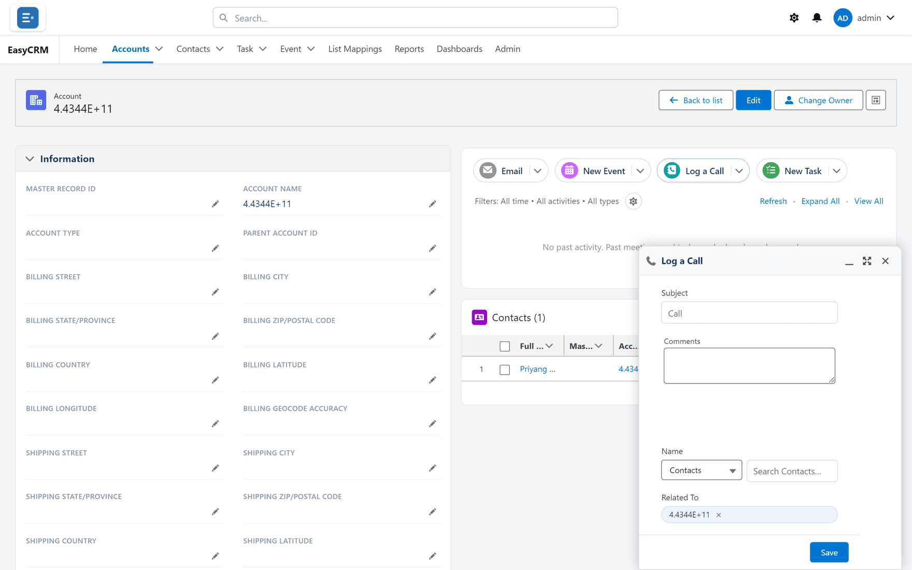

# Logging a call

## What it is

A record of a conversation that has **already happened**, stored against the account or contact
it concerned.

## When to use it

Straight after the call, while you still remember it. The value of a logged call is almost
entirely in the detail, and detail decays within the hour.

**When not to:** for something still to do. That is a [task](./tasks.md). The difference is
tense — a call is past, a task is future.

## Logging one

**Where:** In the portal → **Accounts** → the record's name → **Log a Call**

1. Click the tab and open the record.
2. In the activity panel, click **Log a Call**.
3. A short form opens in a panel at the bottom of the screen.

   

4. Type a **Subject** — what the call was about. Left empty, it is saved as "Call".
5. Add detail in **Comments**.
6. Under **Name**, pick who you spoke to: choose **Contacts** or **Leads**, then type in
   **Search Contacts…**. **Related To** usually starts as the record you are on.
7. Click **Save**.

The portal says **Activity saved.** The call appears in the timeline, dated today and already
marked as done — it is a record of something that happened, not a reminder.

## Writing a subject somebody else can use

The subject is what appears in the timeline. It is read by people scanning months of history,
so it should survive being read alone.

| Good | Poor |
|---|---|
| Agreed renewal terms, sending quote Friday | Call |
| Not ready — revisit after their Q3 | Spoke to them |
| Complained about response times | Follow up |

The test: if you read only the subject in six months, would you know what happened?

## Where to log it

Against the **most specific** record that applies.

| Call about | Log it on |
|---|---|
| One person's situation | Their contact record |
| The company's contract | The account |
| A specific task | The task |

Logging against the account when you spoke to one of five contacts loses who you spoke to.

Logging on the contact loses nothing at account level: an account's timeline also shows the
calls logged on its contacts, unless your administrator has switched that off. See
[Calls, tasks and meetings](./index.md).

## What goes wrong

| Symptom | Cause |
|---|---|
| The call is not in the timeline | Timeline filters may exclude it. Check the **Filters** line. |
| It is on the wrong record | Editing a call cannot move it. Delete it (▾ → **Delete**) and log it again on the right record. |
| You cannot edit it later | The portal refuses with a message when your access does not allow it. |

## Where this fits

Calls, [tasks](./tasks.md), [events](./events.md) and emails share one
[timeline](./index.md) on every record.
