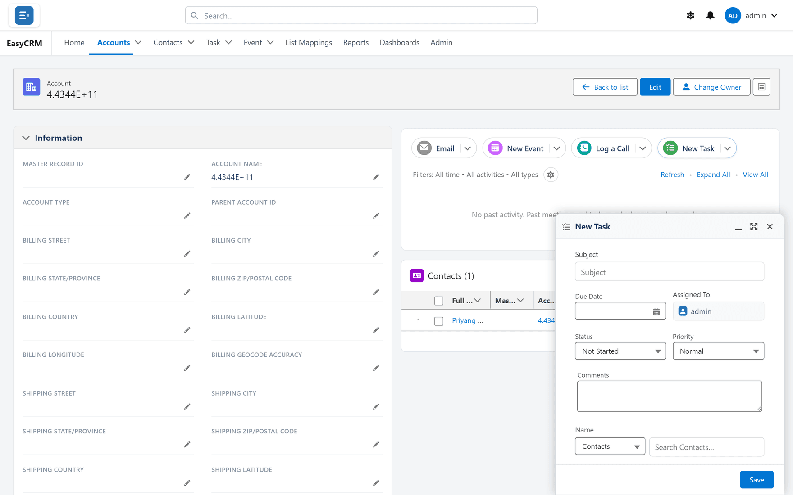

# Tasks

## What a task is

Something still to do, with a due date, attached to the record it concerns.

## When to use it

Any commitment that would otherwise live only in your memory or your inbox. A task on the
record is visible to whoever picks the account up next; a note to yourself is not.

**When not to:** for something that already happened — that is
[logging a call](./logging-a-call.md). And not for a meeting with a start and end time, which
is an [event](./events.md).

## Creating one

**Where:** In the portal → **Accounts** → the record's name → **New Task**

1. Open the record.
2. Click **New Task** in the activity panel. A panel opens at the bottom of the screen.

   

3. Fill in:

| Field | Notes |
|---|---|
| **Subject** | What needs doing. Specific enough to act on. |
| **Due Date** | When. Tasks without one are never shown as overdue. |
| **Assigned To** | Shows your name. It cannot be changed here. |
| **Status** | **Not Started** unless you choose **In Progress**, **Completed**, **Waiting on someone else** or **Deferred**. |
| **Priority** | **Normal** unless you choose **High** or **Low**. |
| **Comments** | Anything the person needs to know. |
| **Name** | The contact (or lead) it concerns. Pick **Contacts** or **Leads**, then type in **Search Contacts…**. |
| **Related To** | Usually starts as the record you are on; click the cross to choose another. If you leave both **Name** and **Related To** empty, the task is still attached to the record you are on. |

4. Click **Save**.

The portal says **Activity saved.** and the task appears in the record's timeline under
**Upcoming & Overdue**.

## Always set a due date

A task with no due date can never be overdue, so it never gets the red flag people actually
look for. On the home page it only ever shows as **Open**. It exists, and it is easy to miss.

If you genuinely do not know when, pick a date to review it rather than leaving it blank.

## Handing a task to somebody else

The portal does not let you choose who a task is assigned to. If somebody else should do it, put
their name in the subject or comments, and tell them — a task appearing silently on a record is
not a handover.

## Completing one

The quickest way:

1. Open the record the task is on.
2. In the timeline, tick the box beside the task — **Mark complete**.

It is marked **Completed** at once, moves out of **Upcoming & Overdue** into its month, and
leaves **My Tasks** on the home page. It stays in the record's history, which is the point: the
record keeps the fact that it was done.

You can also click ▾ beside the task → **Edit**, set **Status** to **Completed**, and click
**Save**.

## Finding them

| Where | Shows |
|---|---|
| **My Tasks** on the home page | Up to six open tasks on the 20 records you opened most recently, soonest first — whoever they are for |
| The **Task** tab | Every task you can see — see [Lists](../records/lists.md) |
| A record's timeline | Tasks on that record (and on an account, its contacts' tasks too) |

**My Tasks** marks each one **Overdue**, **Today**, **Upcoming** or **Open** (no due date).

## What goes wrong

| Symptom | Cause |
|---|---|
| Not in **My Tasks** | It is completed, or you have not opened its record lately — **My Tasks** follows the 20 records you opened most recently. Only six show. |
| In **My Tasks** but not yours | **My Tasks** shows open tasks on your recent records, whoever they are for. |
| Never shown as overdue | It has no due date. |
| Cannot change the assignee | The portal does not offer it. See above. |

## Where this fits

Tasks and [events](./events.md) both appear on the home page — tasks under **My Tasks**, events
under **Upcoming Events** — and in the record's [timeline](./index.md).
