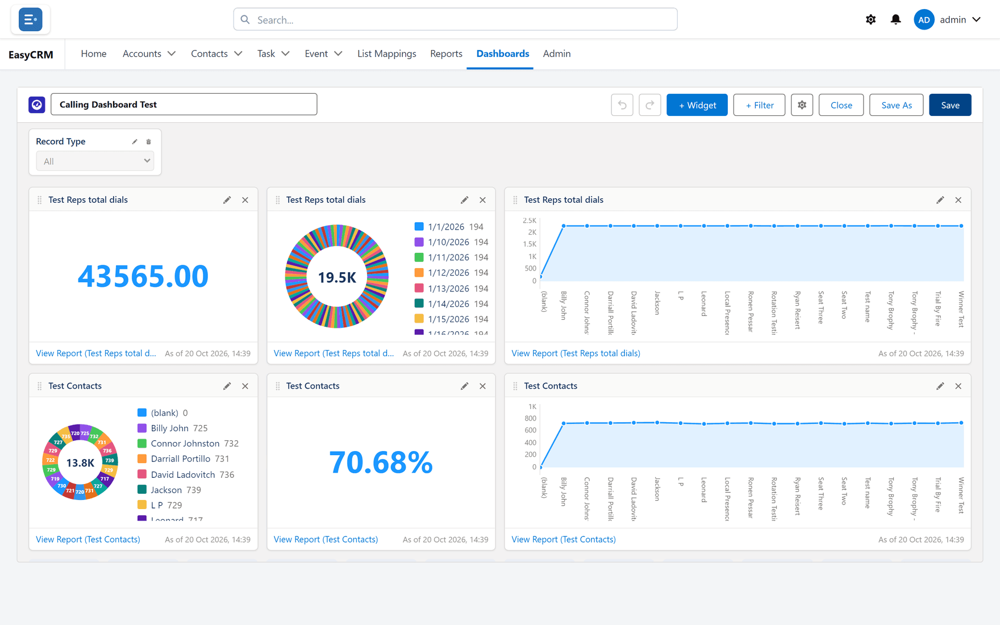
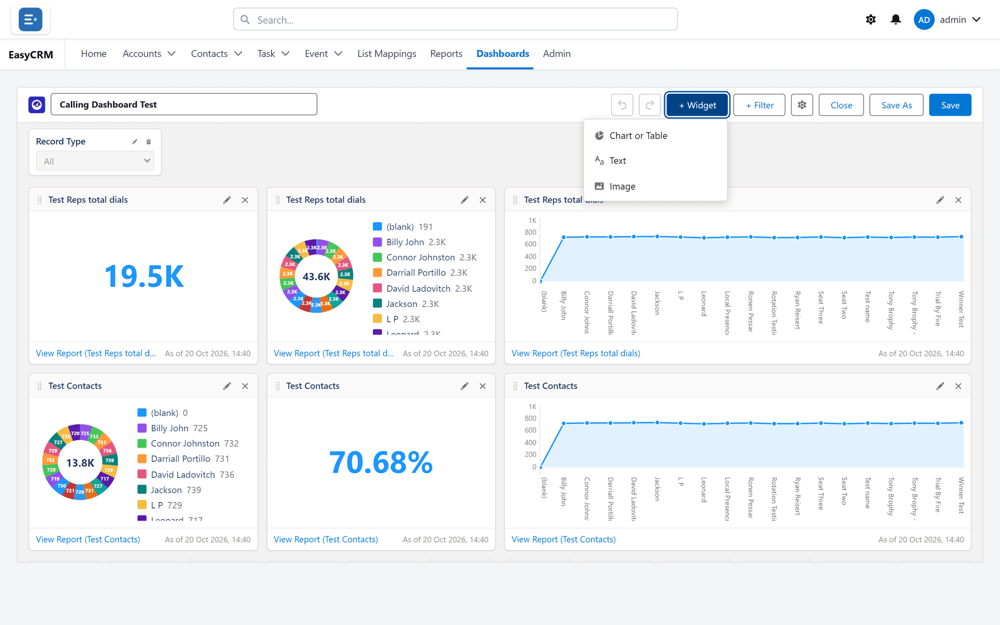
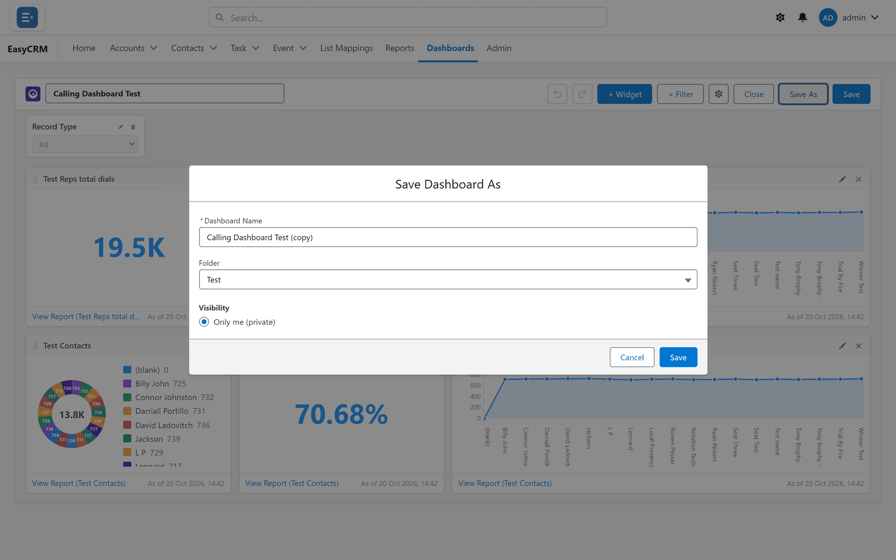

# The dashboard builder

**What it is.** The screen where you arrange a dashboard.

**What it does.** You add tiles, point each one at a report, and lay them out on a grid.

**Why it helps.** One screen answers the questions people ask every morning, instead of five
reports opened one at a time.

## Opening the builder

**Where:** In the portal → **Dashboards** → a folder → the dashboard's name → **Edit**

1. Click **Dashboards** in the top menu.
2. Click the folder, then the dashboard's **name**. It opens and the tiles load.
3. Click **Edit** at the top.

For a new one: **Dashboards** → **New Dashboard**.

If **Edit** is missing you have read-only access. Use **Save As** to take your own copy.

## Adding a tile

**Where:** the dashboard builder → **+ Widget**

1. Click **+ Widget** at the top. A short menu opens.

   

2. Choose what sort of widget you want:

   | | |
   |---|---|
   | **Chart or Table** | reads a report — this is the one you want nearly every time |
   | **Text** | a heading or a note, reading no data at all |
   | **Image** | a logo or a picture, from a web address |

3. For **Chart or Table**, pick the report under **Report**. This is the tile's source, and
   every number on it comes from there.
4. Under **Display As**, choose how to draw it — see [the kinds](#the-kinds-of-tile) below.
5. Fill in the settings for that kind. They change depending on what you picked; every one of
   them is listed in [the settings](#every-setting-and-what-it-does).
6. Click **Save**.

**Every tile reads from a report.** If a number on a tile looks wrong, open its report — that is
where the figure comes from, and the tile is only drawing it.

## The kinds of tile

| Tile | Shows | Good for |
|---|---|---|
| **Metric** | One big number | A single figure people watch daily |
| **Bar** / **Column** | Groups side by side | Comparing |
| **Line** | A value over time | Trends |
| **Pie** / **Donut** | Parts of a whole | A handful of categories |
| **Gauge** | Progress to a target | Targets |
| **Table** | Rows straight from the report | Detail people need to read |

Which one to reach for, and when each misleads, is on [Tiles](./tiles.md).

## Every setting, and what it does

You will not see all of these at once — the panel shows the ones that apply to the kind of tile
you chose.

### What the tile is reading

| Setting | What it does |
|---|---|
| **Report** | The report the tile draws from. **Change** swaps it for another. |
| **Measure** | Which number to plot — a **Record Count**, or the sum or average of a field. |
| **Measure (Y-Axis)** | The same thing on a chart with two axes. |

### How it is grouped

| Setting | What it does |
|---|---|
| **Category (X-Axis)** | Which grouping goes along the bottom — owners, stages, months. |
| **Group By (points)** | On a line chart, what each point represents. |
| **Sliced By** | Which grouping the slices or bars are split by, when the report has more than one. |
| **Color By** | Which grouping decides the colours. |
| **Max Groups Displayed** | Caps how many groups are drawn, so a chart with eighty categories stays readable. |

### How it is sorted

**Sort By** takes one of:

| Option | Order |
|---|---|
| **Label (A–Z)** | alphabetical by group name |
| **Value — high to low** | biggest first — usually what you want on a bar chart |
| **Value — low to high** | smallest first |
| **Report order** | whatever order the report itself returns |

### How the numbers read

| Setting | What it does |
|---|---|
| **Display Units** | **Auto**, **Shortened**, **Hundreds**, **Thousands (K)**, **Millions (M)** or **Billions (B)**. Turns 4,120,000 into 4.12M. |
| **Decimal Places** | How many digits after the point. |

:::tip Units are about the reader, not the data
A revenue figure in full is hard to read at a glance and impossible to compare. **Millions (M)**
on a metric tile usually makes it instantly legible, and changes nothing about the underlying
number.
:::

### What it says

| Setting | What it does |
|---|---|
| **Title** | The heading on the tile. |
| **Subtitle** | A line under it, for context — *"excludes closed-lost"*. |
| **Footer** | A line at the bottom, usually where the figure comes from or when it refreshes. |
| **Display Name** / **Display Text** | The label on a text or image tile. |
| **Image URL** | The picture, on an image tile. |
| **Legend Position** | **Bottom**, **Right**, or **None**. |
| **Widget Theme** | Lets one tile differ from the dashboard's own theme. |

:::tip A subtitle earns its space
"£412,000" tells a reader nothing about whether that is good. *"Target £400,000"* in the subtitle
does, and costs you one line.
:::

## Moving and resizing tiles

- **To move:** drag the tile.
- **To resize:** drag its corner.

Tiles snap to the grid. How fine that grid is comes from **Properties** → **Dashboard Grid Size**
— **9 Columns** or **12 Columns**. Twelve gives finer control; nine gives bigger tiles.

## Changing or removing a tile

Use **Edit** or **Remove** on the tile itself.

Removing a tile does not touch its report. The report stays exactly where it was.

## Dashboard-wide settings

Click **Properties** for the ones that apply to the whole dashboard:

| Setting | What it does |
|---|---|
| **Dashboard Name** | What it is called. |
| **Folder** | Which folder it is saved in — and therefore who can find it. |
| **Visibility** | **Only me (private)** or **My company**. |
| **Company access** | Which companies may open it, where more than one uses this portal. |
| **Dashboard Grid Size** | **9 Columns** or **12 Columns**. |
| **Dashboard Theme** | The look of the whole dashboard. |

More on these in [Dashboard settings](./settings.md).

### View Dashboard As

| Option | Shows the dashboard with |
|---|---|
| **All data** | everything the dashboard's own reports return |
| **The logged-in user** | only what the person looking at it is allowed to see |

:::caution This changes what people see, not just what you see
**The logged-in user** means two people can open the same dashboard and get different figures —
which is usually right, and occasionally a surprise when somebody reports that "the numbers
changed". Decide it deliberately.
:::

## Adding a dashboard filter

1. Click **+ Filter**.
2. Under **Select Field to Filter By**, choose the field.
3. Choose an **Operator** — *equals*, *not equal to*, *contains*, *does not contain*,
   *starts with*, *greater than*, *less than*, *greater or equal*, *less or equal*.
4. Enter a **Value**, or click **Add Filter Value** to offer several.
5. Click **Apply to Each Component** to map the filter onto every tile.
6. Click **Apply**.

A filter only affects a tile it is mapped to. An unmapped tile quietly ignores it — see
[Filters](./filters.md).

Date fields also accept named ranges — **Today**, **Yesterday**, **This Week**, **Last 7 Days**,
**Last 30 Days**, **This Month**, **Last Quarter**, **This Fiscal Year** and so on — so a filter
can mean "this month" permanently rather than a fixed date.

## Undo and redo

**Undo** and **Redo** at the top step through your changes. Nothing is saved until you click
**Save**, so you can rearrange freely.

## Saving

| Button | What it does |
|---|---|
| **Save** | Keeps your changes to this dashboard. |
| **Save As** | Makes a copy under a new name, leaving the original alone. |

**Save As** is the safe way to change somebody else's dashboard.

If you try to leave with unsaved work, an **Unsaved Changes** prompt offers:

| | |
|---|---|
| **Stay** | go back and keep editing |
| **Leave & Discard** | abandon every change since the last save |

## What goes wrong

| Symptom | Cause |
|---|---|
| The number is wrong | Open its **report**. The tile only draws what the report returns. |
| A chart is empty | The report has no grouping. Charts plot groups. |
| A chart is unreadably busy | Set **Max Groups Displayed**, or group the categories in the report with a [bucket column](../reports/buckets.md). |
| A table is cut off | The tile is too small, or the report returns too many rows. |
| The tile ignores a dashboard filter | It is unmapped. See [Filters](./filters.md). |
| Two people see different numbers | **View Dashboard As** is set to **The logged-in user**. |
