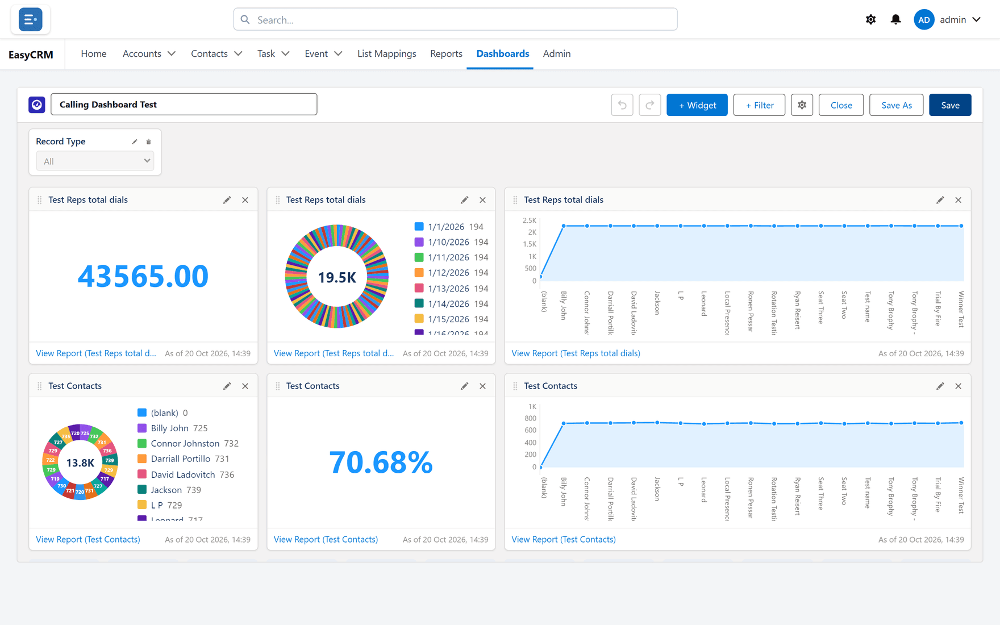
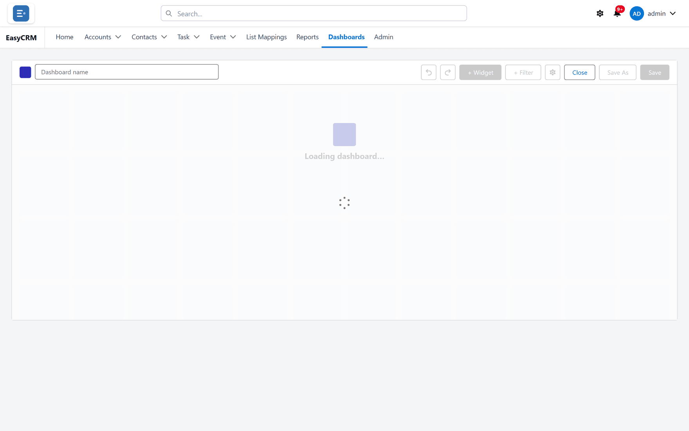
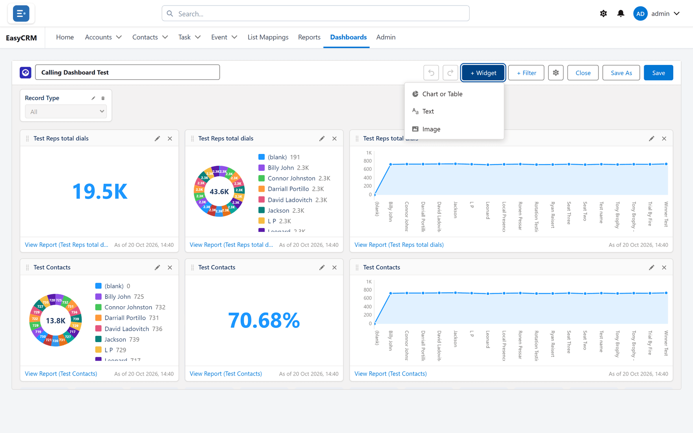
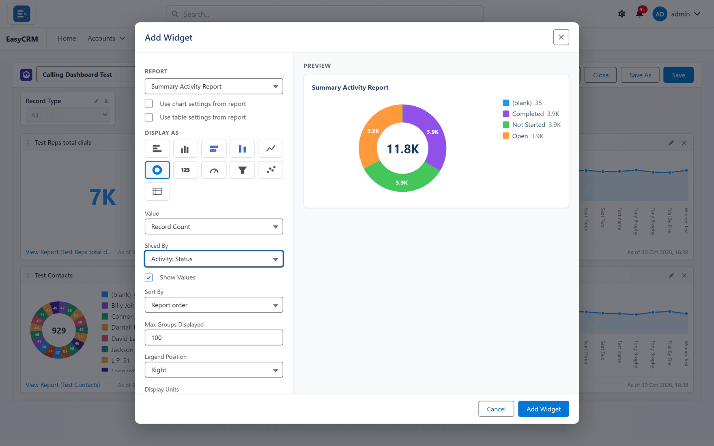
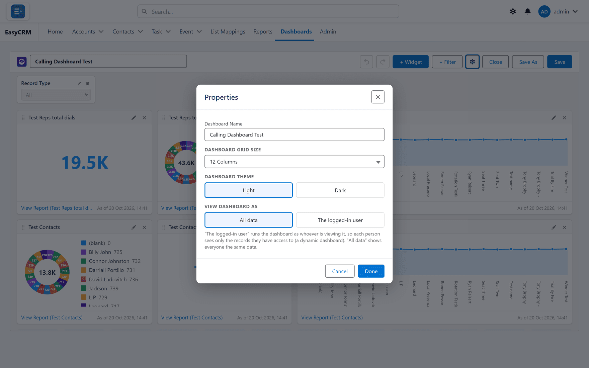
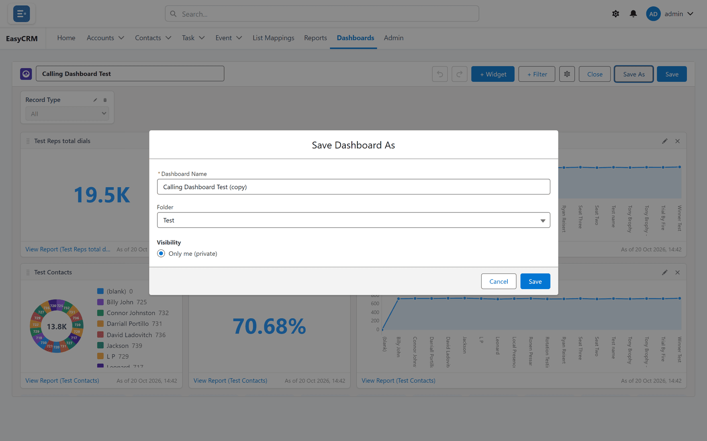
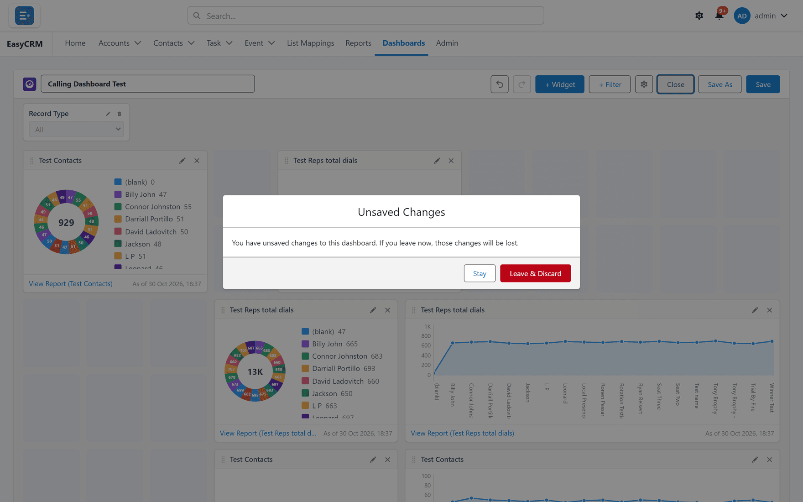

# The dashboard builder

**What it is.** The screen where you arrange a dashboard.

**What it does.** You add tiles, point each one at a report, and lay them out on a grid.

**Why it helps.** One screen answers the questions people ask every morning, instead of five
reports opened one at a time.

## Opening the builder

**Where:** In the portal → **Dashboards** → the dashboard's name → **Edit**

1. Click **Dashboards** in the top menu.
2. Click the dashboard's **name**. It opens and the tiles load.
3. Click **Edit** at the top.

You can also choose **Edit** from the dashboard's row menu (▾) on the list.

**For a new one:** **Dashboards** → **New Dashboard**. The empty canvas says
**Build your dashboard** — *Click + Widget → Chart or Table, then pick a report.*

**If you only have read access,** **Edit** shows a red message and the builder does not open:
**You have read-only access to this dashboard. Ask its owner or a Super Admin for edit access, or
use Save As to make your own copy.** To get a copy you can change, use **Clone** instead. See
[Cloning a dashboard](#cloning-a-dashboard).

## While it loads

A dashboard opens in the builder in two stages, and the toolbar follows them.

| Stage | You see | You can |
|---|---|---|
| The layout is still arriving | **Loading dashboard…** on the canvas | nothing yet. **Save**, **Save As**, **+ Widget**, **+ Filter** and **Properties** are greyed out. **Close** works. |
| The tiles' data is still arriving | the tiles in place, each with a spinner | **Save** and **Save As**. Editing waits: adding, changing, moving, resizing and removing tiles and filters, **Undo**, **Redo** and typing in text tiles are all off until every tile has drawn. |

This protects your dashboard. A save made before the layout had arrived used to store an empty
dashboard. Now it is refused:

| Message | What it means |
|---|---|
| **The dashboard is still loading. Save again in a moment.** | You clicked Save before the layout arrived. Wait, then save. |
| **This dashboard had not finished loading, so saving it would have removed all of its widgets. Nothing was saved. Wait for the widgets to appear, then save again.** | The save would have emptied a dashboard that has widgets, so nothing was written. This usually means an old copy of the page was still open. |

Removing every widget yourself and then saving is fine. That save goes through.

## Adding a tile

**Where:** the dashboard builder → **+ Widget**

1. Click **+ Widget** at the top. A short menu opens.

   

2. Choose what sort of widget you want:

   | | |
   |---|---|
   | **Chart or Table** | reads a report — this is the one you want nearly every time. Opens the **Add Widget** dialog. |
   | **Text** | a heading or a note, reading no data at all. It goes straight onto the canvas with no dialog. Click in it (**Add text…**) and type. |
   | **Image** | a logo or a picture. Opens a short dialog asking only for an **Image URL** (a web address) and a **Title**. |

3. For **Chart or Table**, pick the report under **Report** (**Select a report**). This is the
   tile's source, and every number on it comes from there. The **Title** fills in with the
   report's name if it is empty.
4. Under **Display As**, choose how to draw it — see [the kinds](#the-kinds-of-tile) below.
5. Fill in the settings for that kind. They change depending on what you picked. Every one of
   them is listed in [the settings](#every-setting-and-what-it-does). The **Preview** on the right
   follows your choices.
6. Click **Add Widget** at the bottom of the dialog.

Clicking **Add Widget** without a report gives **Pick a source report.**

**Every tile reads from a report.** If a number on a tile looks wrong, open its report — that is
where the figure comes from, and the tile is only drawing it.

## The kinds of tile

**Display As** offers eleven:

| Tile | Shows | Good for |
|---|---|---|
| **Horizontal Bar** | Groups as bars across. This is the default. | Comparing, especially with long names |
| **Vertical Bar** | Groups as columns | Comparing a few groups |
| **Stacked Horizontal Bar** / **Stacked Vertical Bar** | Each bar split into its series — the column groups of a matrix report, or the measures when the report's chart has several | How a total is made up |
| **Line** | A value across ordered groups | Trends over time |
| **Donut** | Parts of a whole, with the total in the middle | A handful of categories |
| **Funnel** | Stages narrowing down | A sales or recruitment pipeline |
| **Metric** | One big number | A single figure people watch daily |
| **Gauge** | One number on a dial | A single figure, at a glance |
| **Scatter** | One point per group, placed by two measures | Whether two figures move together |
| **Table** | Rows from the report | Detail people need to read |

There is no **Pie** in the list. A tile shows a pie only when it uses the report's own pie chart,
through **Use chart settings from report**.

Which one to reach for, and when each misleads, is on [Tiles](./tiles.md).

## Every setting, and what it does

You will not see all of these at once — the dialog shows the ones that apply to the kind of tile
you chose.

### What the tile is reading

| Setting | What it does |
|---|---|
| **Report** | The report the tile draws from. Pick another to swap it. |
| **Use chart settings from report** | Draw the tile as the report's own chart type (for example its pie) instead of the **Display As** choice. |
| **Use table settings from report** | Draw the tile as a table. |
| **Display As** | How the tile is drawn — see [the kinds](#the-kinds-of-tile). |

### What it is grouped and measured by

The labels change with **Display As**:

| Display As | Settings |
|---|---|
| any bar, and **Line** | **Category (X-Axis)** — the grouping along the axis. **Measure (Y-Axis)** — the number plotted. |
| **Donut** | **Value** — the number. **Sliced By** — the grouping that makes the slices. |
| **Funnel** | **Value** — the number. **Color By** — the grouping that makes the stages. |
| **Scatter** | **Group By (points)** — one point per group. **X-Axis** and **Y-Axis** — the two measures that place it. |
| **Metric**, **Gauge** | **Measure** — the number shown. It is the report's grand total of that measure. |
| **Table** | none |

The grouping lists offer the report's own groupings, starting with **(Report default chart)**,
which keeps the report's own chart grouping. The measure lists offer the report's own measures:
**Record Count**, totals of its number columns, and its formulas.

### How it is sorted and trimmed

**Sort By** takes one of:

| Option | Order |
|---|---|
| **Report order** | whatever order the report itself returns. This is the default. |
| **Value — high to low** | biggest first — usually what you want on a bar chart |
| **Value — low to high** | smallest first |
| **Label (A–Z)** | alphabetical by group name |

**Max Groups Displayed** caps how many groups are drawn, so a chart with eighty categories stays
readable. It starts at 100. The cap applies after sorting, so with **Value — high to low** you get
the top ones.

**Sort By** and **Max Groups Displayed** are not offered on **Metric**, **Gauge** or **Table**.

### How the numbers read

| Setting | What it does |
|---|---|
| **Show Values** | Writes each value on the chart. Not on **Metric**, **Gauge** or **Table**. |
| **Display Units** | **Auto**, **Full**, **Shortened**, **Hundreds**, **Thousands (K)**, **Millions (M)** or **Billions (B)**. **Millions (M)** turns 4,120,000 into 4.12M. Not on **Table**. |
| **Decimal Places** | How many digits after the point, 0 to 6. Leave it blank (**Auto**) to let the tile decide. Not on **Table**. |
| **Legend Position** | **Right** (the default), **Bottom** or **None**. On bars, lines, **Donut**, **Funnel** and **Scatter**. |

:::tip Units are about the reader, not the data
A revenue figure in full is hard to read at a glance and impossible to compare. **Millions (M)**
on a metric tile usually makes it instantly legible, and changes nothing about the underlying
number. Hover over the tile and the exact figure is still there.
:::

### What it says

| Setting | What it does |
|---|---|
| **Title** | The heading on the tile. |
| **Subtitle** | A line under it, for context — *"excludes closed-lost"*. |
| **Footer** | A line at the bottom, usually where the figure comes from or what it includes. |
| **Widget Theme** | **Light** or **Dark**, for this tile alone. See [Settings](./settings.md#themes). |
| **Image URL** | The picture's web address, on an image tile. |

:::tip A subtitle earns its space
"£412,000" tells a reader nothing about whether that is good. *"Target £400,000"* in the subtitle
does, and costs you one line.
:::

## Moving and resizing tiles

- **To move:** drag the tile by its title bar and drop it where you want it. Tiles in the way are
  pushed aside, and gaps close up.
- **To resize:** drag any edge or corner. Each tile has eight handles.

Tiles snap to the grid. How fine that grid is comes from **Properties** → **Dashboard Grid Size**
— **12 Columns** (the default) or **9 Columns**. Twelve gives finer control; nine gives bigger
steps.

## Changing or removing a tile

Use the buttons on the tile's title bar:

- the **pencil** (**Edit**) reopens its dialog, now titled **Edit Widget**. Its confirm button is
  labelled **Edit Widget** too. Text tiles have no pencil, so type straight into them.
- the **✕** (**Remove**) takes it off the canvas at once. **Undo** brings it back.

Removing a tile does not touch its report. The report stays exactly where it was.

## Dashboard-wide settings

Click the gear (**Properties**) in the toolbar. The **Properties** dialog holds:

| Setting | What it does |
|---|---|
| **Dashboard Name** | What it is called. You can also type it in the box at the top left of the builder. |
| **Dashboard Grid Size** | **12 Columns** or **9 Columns**. |
| **Dashboard Theme** | **Light** or **Dark**, for the whole dashboard. |
| **View Dashboard As** | **All data** or **The logged-in user**. See below. |

Changes take effect as you click them. **Done** and **Cancel** both just close the dialog —
**Cancel** does not undo anything. Use **Undo** to take back a grid, theme or **View Dashboard As**
change.

The folder and who can see the dashboard are **not** here. They are asked when you save (see
[Saving](#saving)). The description is set from the list: the dashboard's row menu (▾) →
**Edit Properties**.

More on these in [Dashboard settings](./settings.md).

### View Dashboard As

| Option | Shows the dashboard with |
|---|---|
| **All data** | the same data for everybody |
| **The logged-in user** | only the records the person looking at it is allowed to see |

The dialog puts it like this: *“The logged-in user” runs the dashboard as whoever is viewing it, so
each person sees only the records they have access to (a dynamic dashboard). “All data” shows
everyone the same data.*

:::caution This changes what people see, not just what you see
**The logged-in user** means two people can open the same dashboard and get different figures —
which is usually right, and occasionally a surprise when somebody reports that "the numbers
changed". Admins and Super Admins always see all the data either way. So you cannot check it by
looking at it yourself as an admin. Decide it deliberately.
:::

## Adding a dashboard filter

Click **+ Filter**, pick the field, add the values viewers can choose from, check
**Apply to Each Component**, then click **Add**. A dashboard can have up to five filters.

[Dashboard filters](./filters.md) walks through it step by step, with every operator and the
relative date ranges.

A filter only affects a tile whose report is set up for it. A report left on
**— Not filtered —** quietly ignores it.

## Undo and redo

**Undo** and **Redo** at the top step back and forward through your changes — tiles, filters,
the grid, the theme and **View Dashboard As**. Typing the name is not a step. Nothing is saved
until you click **Save**, so you can rearrange freely.

## Saving

| Button | What it does |
|---|---|
| **Save** | Keeps your changes to this dashboard. The first time a new dashboard (or a clone) is saved, it asks for a name and folder first. |
| **Save As** | Makes a copy under a new name, leaving the original alone. It appears only on a dashboard that has already been saved. |

After either one, the builder closes and the saved dashboard opens.

### The Save Dashboard dialog

The first **Save** of a new dashboard opens **Save Dashboard**. **Save As** opens
**Save Dashboard As** with the name filled in as the current name plus " (copy)". Both ask:

| Field | |
|---|---|
| **Dashboard Name** | Required. |
| **Folder** | **— No folder —**, or one of the dashboard folders you can see. See [Folders](../reports/folders.md). |
| **Visibility** | **Only me (private)**, or **My company**. **My company** appears only if you belong to a company. |
| **Company access** | Appears with **My company**: **Read** or **Edit**. Under it: *Your company's admins can see it; you can then re-share it to your team on the Dashboards tab. Applied when you Save.* |

<!-- SHOT: dashboard-builder/save-dashboard-company.png | first Save of a new dashboard by a user who belongs to a company: the "Save Dashboard" dialog with a name, a folder, Visibility set to My company and Company access set to Read, the note under it -->

**My company** gives your company's Admins that level of access. Standard users at your company
get it only when an Admin shares it on to them, under **Admin** → **Reports & Dashboards**. See
[Sharing a report](../reports/sharing.md), which works the same way for dashboards.

Only the owner or a Super Admin can change **Visibility**. This dialog is the only place it is
asked, so to change it on an existing dashboard, use **Save As** and set it on the copy.

**Save As** is the safe way to change somebody else's dashboard. The copy is yours.

### Name rules

| Message | What it means |
|---|---|
| **Enter a name.** | The name in the dialog is blank. |
| **Give the dashboard a name.** | You clicked **Save** with the name box at the top empty. |
| **A dashboard named "…" already exists. Choose a different name.** | You can already see a dashboard with that name. Case does not count: "Sales" and "sales" clash. |
| **You have read-only access to this dashboard. Ask its owner or a Super Admin for edit access, or use Save As to make your own copy.** | Your edit access was taken away while you worked. Use **Save As**. |

## Cloning a dashboard

**Where:** In the portal → **Dashboards** → the dashboard's row menu (▾) → **Clone**

**Clone** opens the builder on a new, unsaved copy named after the original plus " (copy)", in the
original's folder. You only need to be able to open the original, not edit it.

- The copy starts **Only me (private)** and unshared, whatever the original had.
- It counts as unsaved work from the start. Leaving warns you.
- **Save As** is not offered until the copy has been saved. The first **Save** opens the
  **Save Dashboard** dialog for its name, folder and visibility.

## Leaving with unsaved changes

Click **Close** with unsaved work and the **Unsaved Changes** dialog asks:
*You have unsaved changes to this dashboard. If you leave now, those changes will be lost.*

| | |
|---|---|
| **Stay** | go back and keep editing |
| **Leave & Discard** | abandon every change since the last save |

Any other way out asks first too:

- Clicking another tab, the App Launcher, a global search result, a notification, or **Settings**
  or **Log Out** on your profile menu opens a browser box: **You have unsaved changes that will be
  lost. Leave anyway?** **OK** leaves. **Cancel** keeps you in the builder.
- The browser's **Back** and **Forward** buttons ask the same question. **Cancel** keeps the
  builder open with your edits.
- Reloading or closing the browser tab shows the browser's own leave-page warning.

## What goes wrong

| Symptom | Cause |
|---|---|
| The number is wrong | Open its **report**. The tile only draws what the report returns. |
| A chart is empty | The report has no grouping. Charts plot groups. |
| A chart is unreadably busy | Set **Max Groups Displayed**, or group the categories in the report with a [bucket column](../reports/buckets.md). |
| A table is cut off | The tile is too small, or the report returns too many rows. |
| The tile ignores a dashboard filter | Its report is set to **— Not filtered —**. See [Filters](./filters.md). |
| Two people see different numbers | **View Dashboard As** is set to **The logged-in user**, or they have different filters set. |
| **Save** and **+ Widget** are greyed out | The dashboard is still loading. Wait for **Loading dashboard…** to clear. |
| I can save but cannot move or edit tiles | Tiles are still loading their data. Editing comes back once every tile has drawn. |
| **Edit** says I have read-only access | Use **Clone** from the list. |
| **Cancel** in **Properties** did not undo my change | It only closes the dialog. Use **Undo**. |
| I cannot find where to set the description | It is not in the builder. Use **Edit Properties** in the list's row menu. |
| There is no **Save As** | The dashboard has never been saved — it is new, or a fresh clone. Use **Save**. |
