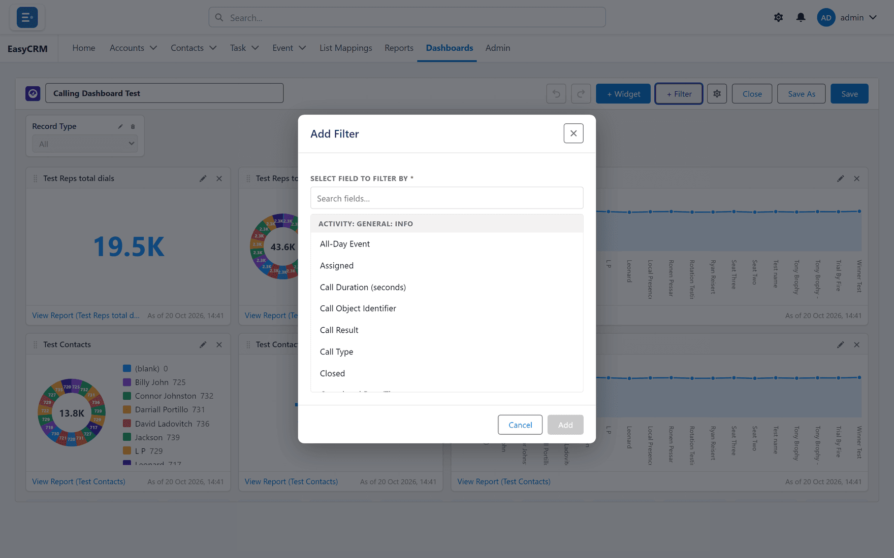
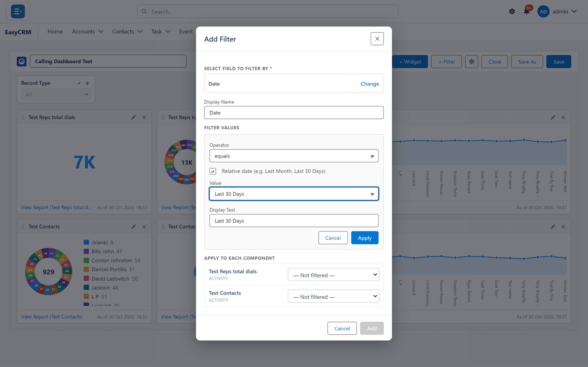
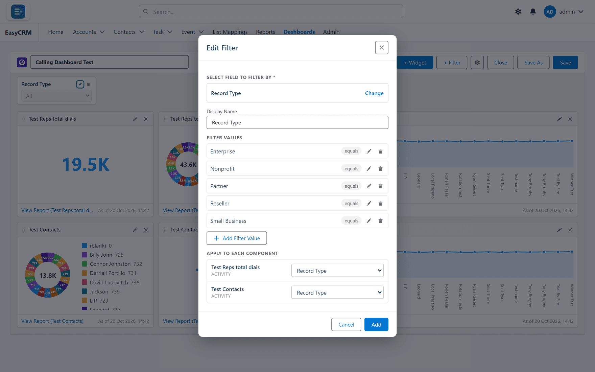

# Dashboard filters

**What it is.** A control at the top of a dashboard that changes every tile at once.

**What it does.** You tick one or more values — owners, regions, record types — and all the
tiles narrow to them together.

**Why it helps.** One dashboard serves everybody. Without filters you would need a separate
copy per team.

## Using one

**Where:** In the portal → **Dashboards** → the dashboard → the filter bar under its name

1. Click the box under a filter's name. It reads **All** until something is ticked.
2. Tick one or more values. The list stays open so you can tick several. A record matching
   **any** of them counts.
3. Click outside the list to close it. The tiles reload a moment after your last click.

The box then reads the one value with its operator (for example **equals Prospect**), or how many
you ticked (for example **2 selected**).

Click **Clear all** at the end of the bar to put every filter back to **All**. It only appears
while something is ticked.

Each filter offers only the values its author set up. You cannot type your own. A record-type
filter lists only the record types you can reach. A filter on a field you are not allowed to see
is not shown to you at all.

See [Viewing a dashboard](./viewing.md#narrowing-the-whole-dashboard-at-once) for how the box reads.

## Your selection is remembered

What you leave ticked on a dashboard is saved for you. The next time **you** open that dashboard,
it opens with the same values ticked, on any computer.

- It is yours alone. Nobody else's view changes, and the dashboard itself is not changed.
- **Clear all**, or unticking everything, forgets it.
- Only values the filter still offers come back. If the author has since removed a value or
  changed its operator, that value is quietly dropped. The rest still apply.
- Coming **Back** from a report you opened off the dashboard restores the filters exactly as you
  left them.
- If the remembered selection cannot be read, the dashboard simply opens unfiltered.

There are limits on what is kept, though everyday use will not reach them:

- Up to 200 ticked values per filter are remembered. A value longer than 1,000 characters is not.
- Each person's remembered selections, across every dashboard, share about 120,000 characters.
  When that fills up, the selections on the dashboards you used longest ago are forgotten first.
- A single selection too large to keep is not saved, and the one you had before on that
  dashboard is forgotten too.

## Filters carry into the report behind a tile

When you open a report from a tile — with **View Report (…)**, a click on a Metric or Gauge tile,
or a click on a chart — the report opens narrowed by the values you have ticked. Only filters
set up for that report under **Apply to Each Component** travel. See
[Opening the report behind a tile](./viewing.md#opening-the-report-behind-a-tile).

## Adding a filter

**Where:** In the portal → **Dashboards** → the dashboard → **Edit** → **+ Filter**

Add the tiles first. The fields on offer come from the reports the dashboard's tiles read, so
a dashboard with no report tiles offers none.

1. Click **Dashboards** in the top menu.
2. Open the dashboard, then click **Edit**.
3. Click **+ Filter** at the top. The **Add Filter** dialog opens.

   

4. **Step 1 — the field.** Under **Select Field to Filter By**, find the field. Type in
   **Search fields…** to narrow the list. Fields are grouped by object and section. A field
   Salesforce cannot filter on, such as an encrypted one, is not offered.
5. **Step 2 — the values.** The field you picked shows at the top, with **Change** to go back.
   - **Display Name** is the name viewers see above the box. It starts as the field's name.
   - Under **Filter Values**, click **Add Filter Value**. Choose an **Operator**, a **Value** and
     the **Display Text** viewers will see. Click **Apply**.
   - Repeat for each value you want to offer. Each value has its own pencil and bin.
6. Check **Apply to Each Component**. See [below](#apply-to-each-component).
7. Click **Add** at the bottom of the dialog. It stays greyed out until you have picked a field
   and added at least one value.
8. Click **Save** on the builder. Nothing is stored until you save the dashboard.

### The value box

What you type the value into depends on the field:

| Field | Value |
|---|---|
| Picklist, record type, multi-select picklist | a list of its values (**Select…**) |
| Checkbox | **True** or **False** |
| Number | a number |
| Date, date/time | a date, or tick **Relative date (e.g. Last Month, Last 30 Days)** and pick a range |
| Anything else | typed text |

**Display Text** fills itself in from the value until you change it. Then it stays as you typed it.

### Relative dates

A relative date always means the current period, so a filter value of **This Month** never needs
editing. The 24 choices are:

**Today**, **Yesterday**, **Tomorrow**, **This Week**, **Last Week**, **Next Week**,
**This Month**, **Last Month**, **Next Month**, **Last 7 Days**, **Last 14 Days**, **Last 30 Days**,
**Last 90 Days**, **Next 30 Days**, **This Quarter**, **Last Quarter**, **Next Quarter**,
**This Year**, **Last Year**, **Next Year**, **This Fiscal Quarter**, **Last Fiscal Quarter**,
**This Fiscal Year**, **Last Fiscal Year**.

### Operators by field type

| Field | Operators |
|---|---|
| Number, date, date/time, time | **equals**, **not equal to**, **less than**, **greater than**, **less or equal**, **greater or equal** |
| Picklist, checkbox, lookup, record type, multi-select picklist | **equals**, **not equal to** |
| Record ID | **equals**, **not equal to**, **starts with** |
| Text, long text | **equals**, **not equal to**, **contains**, **does not contain**, **starts with** |

On the dashboard, **less or equal** and **greater or equal** read as **at most** and **at least**,
and **does not contain** reads as **doesn't contain**.

## Apply to Each Component

This is the part that is easy to miss, and the reason a filter sometimes seems not to work.

Each tile reads from a **different report**, and those reports are not always about the same
thing. A filter on an account's type means nothing to a report on activities unless you say which
field on that report leads to the account's type.

**Apply to Each Component** lists each report on the dashboard once, with its object. Beside each
is the field that report should filter on.

- The field is filled in for you when the report is on the same object as the filter, or has a
  lookup straight to it.
- Anything else starts as **— Not filtered —**. Pick the right field from the list, which shows
  every field the report can filter on, grouped by object and section.
- **A report left on — Not filtered — ignores the filter** and keeps showing everything.

That last point is what makes a dashboard look broken: nine tiles narrow and one does not.
If that happens, this is where to look.

## Editing or removing a filter

**Where:** the dashboard builder → the filter's card at the top of the canvas

In the builder each filter shows as a card with its name and a greyed-out **All** box.

- **To change it:** click the pencil (**Edit**). The dialog opens as **Edit Filter** on step 2.
  The button at the bottom is still labelled **Add**. Click it to keep your changes.
- **To remove it:** click the bin (**Remove**). It goes at once, with no question. **Undo** brings
  it back.

Then **Save** the dashboard.

## Limits

- **Five filters** per dashboard. **+ Filter** greys out at five.
- The filters and their cards can only be changed once the dashboard has finished loading in the
  builder.

## What goes wrong

| Symptom | Cause |
|---|---|
| One tile ignores the filter | Its report is set to **— Not filtered —** under **Apply to Each Component**. |
| **+ Filter** is greyed out | The dashboard already has five filters, or it is still loading. |
| **Select Field to Filter By** lists nothing | The dashboard has no tiles reading a report yet. Add the tiles first. |
| **Add** stays greyed out | Pick a field and add at least one value. |
| **Apply** on a value closed the editor but added nothing | The **Value** was empty. Click **Add Filter Value** again and fill it in. |
| The dashboard opens already filtered | That is your remembered selection. Click **Clear all**. |
| A value I ticked last time is no longer ticked | The author removed it, or changed its operator. |
| A filter is missing for one person | It is on a field that person is not allowed to see. |
| My new filter vanished | The dashboard was closed without **Save**. |

## Where this fits

| | |
|---|---|
| [Viewing a dashboard](./viewing.md) | using the filter bar, and the report behind a tile |
| [The dashboard builder](./builder.md) | the rest of the builder |
| [Report filters](../reports/filters.md) | filters inside a single report |
