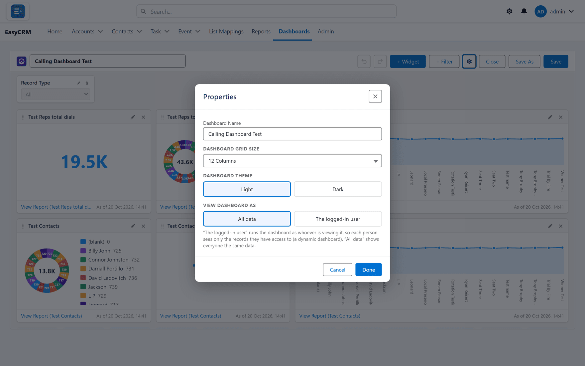

# Dashboard settings

**What it is.** The settings that apply to the whole dashboard rather than to one tile.

**What it does.** Name, layout, colours, and — most importantly — how far each tile is scoped to
the person looking at it.

**Why it matters.** That last one is the setting people most often misread, and it is not obvious
from looking at the dashboard what anybody else sees.

## Opening the settings

**Where:** In the portal → **Dashboards** → the dashboard's name → **Edit** → **Properties**

1. Click **Dashboards** in the top menu.
2. Open the dashboard, then click **Edit**.
3. Click the gear (**Properties**) at the top.

The **Properties** dialog holds four settings: **Dashboard Name**, **Dashboard Grid Size**,
**Dashboard Theme** and **View Dashboard As**.

Each change takes effect the moment you click it. **Done** and **Cancel** both just close the
dialog, so **Cancel** does not take anything back. Use **Undo** in the toolbar for that. Nothing
is stored until you **Save** the dashboard.

Three things you might expect here live elsewhere:

| Setting | Where it is |
|---|---|
| Folder, **Visibility**, **Company access** | the **Save Dashboard** dialog, when you first save and on **Save As**. See [Saving](./builder.md#saving). |
| Description, the **Shared** box | the Dashboards list → the dashboard's row menu (▾) → **Edit Properties**. See [Name and description](#name-and-description). |
| A tile's own theme | **Widget Theme**, in that tile's **Add Widget** / **Edit Widget** dialog |

## View Dashboard As

This decides how far each tile is scoped to the person looking at it.

| Setting | What people see |
|---|---|
| **All data** | The records each person has access to. |
| **The logged-in user** | The same, with every tile also scoped to the person viewing it — a dynamic dashboard. |

The dialog explains it: *Either way, each person sees only the records they have access to: the
portal never shows a viewer records their sharing hides, so it has no “run as one person”
(Salesforce's “Me” or “Another person”). “The logged-in user” also scopes every widget to the
viewer (a dynamic dashboard).*

So **All data** never shows somebody records they could not open themselves. A dashboard cannot
be set to show everybody one person's view of the data, as a Salesforce dashboard running as a
named user can.

Use **The logged-in user** for a dashboard each person uses for their own work — "my pipeline",
"my tasks".

**Admins and Super Admins are never narrowed by The logged-in user.** It only scopes the figures
for Standard users.

**Two people can see different figures.** Each person's tiles count the records that person may
see, so a Standard user's numbers can be smaller than yours with no error anywhere. Because you,
as an admin, see more, checking the dashboard yourself tells you little. Ask a Standard user what
they see.

## Grid size

How many columns the dashboard is divided into: **12 Columns** (the default) or **9 Columns**.

Tiles snap to the columns. Twelve gives finer control over widths. Nine gives bigger steps, which
can be quicker to line up.

## Themes

| Setting | Where | Changes |
|---|---|---|
| **Dashboard Theme** | **Properties** | The whole dashboard — **Light** or **Dark**. On **Dark**, every tile is dark too. |
| **Widget Theme** | each tile's **Add Widget** / **Edit Widget** dialog | That one tile — **Light** or **Dark**. |

**Widget Theme** lets you pick out single tiles: a dark tile or two on a light dashboard draws the
eye to the figures that matter most. It cannot do the reverse. On a **Dark** dashboard every tile
is dark, whatever its own **Widget Theme** says.

## Name and description

The name is what people see in the dashboards list. Set it in **Properties** → **Dashboard Name**,
or in the box at the top left of the builder. The builder will not save a name that matches
another dashboard you can see. Case does not count.

The description is not in the builder. Set it from the list:

1. Click **Dashboards**, then ▾ at the end of the dashboard's row.
2. Click **Edit Properties**.
3. Fill in **Description**, and click **Save**.

A short description helps whoever finds it in six months work out whether it is the one they
want. It shows in the list's **Description** column, and the list's search looks in it.

## What goes wrong

| Symptom | Cause |
|---|---|
| A Standard user sees smaller numbers than I do | Each person's tiles count only the records they may see, whichever **View Dashboard As** says. As an admin you see more. |
| I want everybody to see the same company-wide figures | The portal has no "run as one person" setting. Every viewer sees only what their own sharing allows. |
| I set a tile to **Light** and it is still dark | The dashboard's theme is **Dark**, which darkens every tile. |
| **Cancel** did not undo my change | **Cancel** only closes the dialog. Use **Undo**. |
| There is no folder or visibility setting in **Properties** | Those are asked when you save. See [Saving](./builder.md#saving). |

## Where this fits

| | |
|---|---|
| [The dashboard builder](./builder.md) | everything else in the builder |
| [Sharing a report](../reports/sharing.md) | who can open the dashboard at all, as against what it counts |
