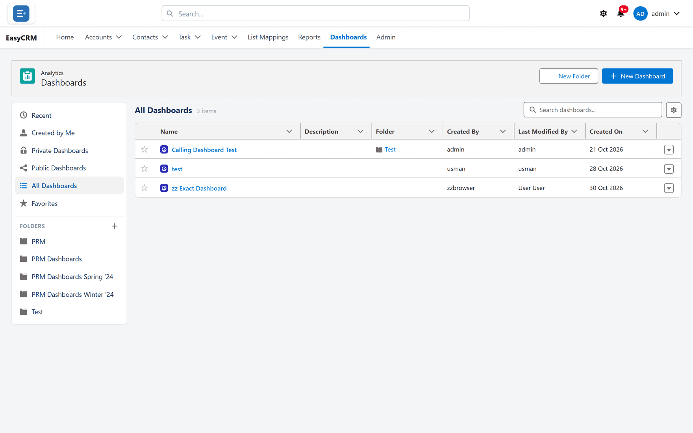
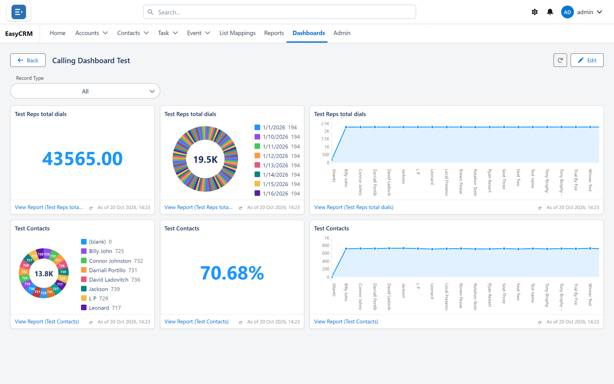

# Dashboards

**What a dashboard is.** One screen holding several charts and numbers.

**What it does.** Each tile reads from a report and draws its result.

**Why it helps.** The questions people ask every morning get answered at a glance, instead of
five reports opened one after another.

## Opening a dashboard

**Where:** In the portal → **Dashboards** in the top menu → a view or folder → the dashboard's name

1. Click **Dashboards** in the row of tabs across the top.
2. The list opens, laid out the same way as Reports: views and folders on the left, dashboards on
   the right. It works exactly as described in [Finding a report](../reports/finding.md).

   
   <!-- SHOT-RETAKE: ../../img/shots/analytics/dashboards-list.png | the list now has a gear (Select Fields to Display) beside the search box, which this capture lacks. Retake: Dashboards tab, All Dashboards, two or three dashboards, one starred, gear visible -->

3. Click a view or folder, then the dashboard's **name**.
4. It opens. Tiles appear at once from their last stored result. A tile that has none yet shows a
   spinner while it is worked out.

## What you are looking at

**Along the top:** **Back** (to the list), the dashboard's name, a refresh button (tooltip
**Refresh dashboard**) and **Edit**.

**Below that:** the filter bar, if the dashboard has filters.

**Each tile** shows, from the top:

- its title, and a subtitle if the author gave one
- the chart, number, table, text or picture
- a footer line, if the author wrote one
- for a tile that reads a report, a last line holding **View Report (…)** with the report's name
  in the brackets, a small refresh button (tooltip **Refresh**) and **As of** with a date and time

If a figure looks wrong, open the report behind the tile. That is where the number comes
from, and the dashboard is only drawing it.

## How old the numbers are

Each tile shows the result it last worked out. Results are stored so that even a dashboard with
thirty tiles opens without waiting. **As of** on each tile says when its result was worked out.

**Opening a dashboard does not update a tile that already has a stored result.** A stored result
does not expire, so **As of** can be hours or days old. Only a refresh brings it up to date:

| To | Click |
|---|---|
| Recalculate every tile now | the refresh button at the top (**Refresh dashboard**). Tiles are worked out a few at a time, and each one's **As of** updates as it lands. |
| Recalculate one tile | the small refresh button on that tile (**Refresh**) |

A tile also starts again from scratch, showing a spinner, when there is no stored result for it
yet. That happens the first time anybody picks a particular combination of filter values, and
after the dashboard or the tile's report has been edited.

Stored results are kept per person and per filter selection. A colleague looking at the same
dashboard may have a different **As of**, and so different numbers.

## Narrowing the whole dashboard at once

If the dashboard has filters, they sit in a bar across the top. Each one has a name and a box
that reads **All**.

1. Click the box. A list opens: **All**, then the values the author offered.
2. Tick one value, or several. The list stays open so you can tick more. A record that matches
   **any** ticked value counts.
3. Click anywhere outside the list to close it.

The tiles reload a moment after your last click, so ticking three values reloads them once.

<!-- SHOT: analytics/dashboard-filters-selected.png | a dashboard with two filters, one box reading "2 selected" with its list open and two values ticked, "Clear all" visible at the end of the bar, tiles showing their View Report / As of lines -->

The box tells you what is set:

| The box reads | Meaning |
|---|---|
| **All** | not filtered |
| one value, such as **equals Prospect** | that one value. The first word is the operator: **equals**, **not equal to**, **less than**, **greater than**, **at most**, **at least**, **contains**, **doesn't contain** or **starts with**. |
| **2 selected** | that many values, any of which counts |

**Clear all** appears at the end of the bar whenever a filter is set. It puts every filter back to
**All**.

**Your selection is remembered.** The next time you open this dashboard, on any computer, it opens
with the same values ticked. **Clear all** forgets it. Nobody else is affected, and the dashboard
itself does not change. See [Dashboard filters](./filters.md#your-selection-is-remembered).

## Reading an exact value

Rest the pointer on a bar, slice, point or number. A dark box appears beside it with the exact
figure.

<!-- SHOT: analytics/chart-hover-box.png | a dashboard Donut tile with the pointer resting on one slice, the dark hover box showing the group, Record Count with its full value and the "(…% of …)" share -->

| Chart | The box shows |
|---|---|
| Bars and lines | the group's name and label (for example **Call Result** / **Connected**), then the measure and its full value (**Record Count** / **1,151**, not "1.2K") |
| Donut, Pie and Funnel | the same, plus its share of the whole, for example **(25.88% of 4.4K)** |
| Stacked bars, and charts from a matrix report | the same, plus the series the segment belongs to |
| Metric | the measure and its full value, for example **43,327.00** |
| Gauge | the same, plus where it sits on the dial, for example **(43% of 100K)** |
| Scatter | the point's group, then its X value and its Y value |

On a chart you can click, the same box appears when you move to a segment with the Tab key. The
box also appears on report charts and in the builder's previews.

## Opening the report behind a tile

There are three ways in:

| Click | Opens the report |
|---|---|
| **View Report (…)** under a tile | narrowed by the dashboard's filters |
| the body of a **Metric** or **Gauge** tile | narrowed by the dashboard's filters |
| a bar, slice, point, axis label or legend entry on a chart | narrowed by the dashboard's filters **and** to the group you clicked |

What you see:

- The portal switches to the **Reports** tab. The spinner stays up until the narrowed result is
  ready, so you never see the whole report's numbers first.
- The back button reads **Back to** followed by the dashboard's name. It returns you to the
  dashboard with the filters as you left them.
- **Filters** shows how many are applied, for example **Filters (3)**. Click it, and under
  **Custom** you find:
  - **one card per dashboard filter** that was applied, with a dashboard icon. It shows the
    filter's name, the values (for example *Prospect, Direct*) and **from** the dashboard's
    name. These cannot be changed here. The ✕ on any of them (tooltip
    **Remove the dashboard's filters and show the whole report**) removes them all.
  - **the chart click**, with a chart icon. It shows the field, **equals** and the value you
    clicked, and **from** the tile's title. Click the card to change its operator or value. The ✕
    (tooltip **Remove this filter and show the whole report**) removes it.

<!-- SHOT: report-viewer/opened-from-dashboard.png | a report opened by clicking a donut slice on a dashboard with one filter set: "Back to <dashboard>" at top left, "Filters (n)" clicked, the panel showing the chart-click card and the dashboard filter card above the report's own numbered filters -->

These filters belong to this visit only. The report itself is not changed. Open it again from the
Reports list and it is whole. The address bar keeps them, though, so a page refresh, the browser's
Back and Forward, or a copied link all reopen it narrowed the same way.

**Export does not use them.** It exports the report as saved, without the dashboard's filters or
the chart click. See [Exporting](../reports/exporting.md).

### Which dashboard filters travel

- Only the values you have ticked. If you ticked several on one filter, a record matching any of
  them counts. Each filter narrows on top of the report's own filters.
- Only filters set up for this report under **Apply to Each Component**. A report set to
  **— Not filtered —** gets nothing from that filter.
- A filter on a field you are not allowed to see is not passed on.
- A filter that cannot be applied to this report is left out, without a card. The cards are the
  honest list of what was applied.

### Which charts you can click

- **You can click:** **Horizontal Bar**, **Vertical Bar**, **Stacked Horizontal Bar**,
  **Stacked Vertical Bar**, **Line**, **Donut**, **Funnel**, and a **Pie** taken from the report's
  own chart. The pointer turns into a hand over anything clickable.
- **You cannot click into:** **Metric** and **Gauge** (clicking them opens the report instead),
  **Table**, **Scatter**, a chart with no grouping, or a chart grouped by a bucket column. Use
  **View Report (…)** on those.
- **From the keyboard:** press Tab to move to a bar or slice, then Enter or Space.

### When a click cannot be turned into a filter

Some groups cannot be written as one exact filter. Rather than show you the wrong records, the
report opens **whole**, with a pale yellow note above it saying why. Click ✕ on the note to dismiss it.

<!-- SHOT: report-viewer/drill-refused-note.png | a report opened by clicking the "(blank)" slice of a dashboard donut: the info note "Showing the full report — an empty group on a chart cannot be written as a filter." above the report -->

| The note says **Showing the full report —** … | Because |
|---|---|
| **an empty group on a chart cannot be written as a filter.** | you clicked **(blank)** |
| **“Others” stands for several values, not one.** | **Others** is everything that did not fit, not a value |
| **this chart is grouped by something the report cannot filter on directly.** | the grouping is not a field the report can filter on |
| **a date/time grouping cannot be written as one filter value.** | a date-and-time group stands for more than one moment |
| **this date group could not be read as a single date.** | the label could not be read back as a date |
| **two values on this field share the label “…”.** | two picklist values look the same, so the portal cannot tell which you meant |
| **this group is not a plain number.** | a number grouping's label is not a plain number |
| **a value containing a comma is read as a list of values.** | a comma would turn one value into several |

On a **stacked** chart, the click narrows to the bar's group but not to the coloured part you
clicked. The note then says, for example: **Filtered by Call Result only — the "Inbound" series
cannot be filtered from a chart yet, so this shows the whole group.**

## Changing a dashboard

Click **Edit** at the top to open the builder. See [The dashboard builder](./builder.md).

**Edit** is always shown. If you only have read access, clicking it opens nothing and shows:
**You have read-only access to this dashboard. Ask its owner or a Super Admin for edit access, or
use Save As to make your own copy.**

<!-- SHOT: analytics/dashboard-read-only-edit.png | a Standard user with Read access to a dashboard clicks Edit: the red read-only message under the dashboard header -->

**Save As** is inside the builder, which you cannot open. To make your own copy, go back to the
list and choose **Clone** from the dashboard's row menu (▾). See
[Cloning a dashboard](./builder.md#cloning-a-dashboard).

## Deleting a dashboard

There is no Delete button on an open dashboard. Delete it from the list:

1. Click **Dashboards**, then ▾ at the end of the dashboard's row.
2. Click **Delete**. The browser asks **Delete this dashboard?**
3. Click **OK**.

It is deleted for everybody. The reports its tiles read are not touched. You need edit access.
Otherwise you see **You have read-only access to this dashboard, so it cannot be deleted. Ask its
owner or a Super Admin.**

## What goes wrong

| Symptom | Cause |
|---|---|
| **As of** is days old | Stored results do not expire. Click the refresh button at the top. |
| A tile spins for a while | Nobody had worked it out yet for this filter selection, or the dashboard or its report was just edited. It fills in on its own. |
| A tile stopped spinning and is empty | Its report failed to run. Click **View Report (…)** to see why. |
| The dashboard opened with filters already set | That is your selection from last time. Click **Clear all**. |
| A colleague sees different numbers | They have different filters set, or an older **As of**, or the dashboard is set to **The logged-in user**. See [Settings](./settings.md). |
| Clicking a chart opened the whole report, with a note | That group cannot be written as one filter. The note says why. |
| Clicking a chart does nothing | That kind of chart cannot be clicked into. Use **View Report (…)**. |
| **View Report (…)** shows **You do not have access to this report.** | The dashboard was shared with you, but the report behind the tile was not. The tile still shows its figures. Ask for the report to be shared too. |
| The report opened from a tile shows more than the tile did | One of the dashboard's filters was not set up for that report, or could not be applied to it. The cards under **Filters** list what was applied. |
| The exported file has more rows than the screen | Export uses the report as saved, without the dashboard's filters or the chart click. |
| There is no Export on the dashboard | A dashboard cannot be exported. Open the report behind a tile and export that. |
| **Edit** says I have read-only access | Use **Clone** from the list to make your own copy. |

## Where this fits

| | |
|---|---|
| [Dashboard filters](./filters.md) | setting up filters, and the selection the portal remembers |
| [Tiles](./tiles.md) | which kinds of tile can be clicked into |
| [The dashboard builder](./builder.md) | changing, cloning and saving |
| [Running a report](../reports/running.md) | the report you land in |
