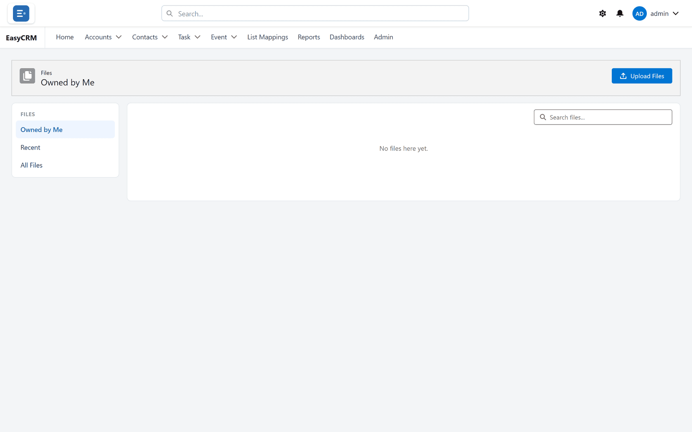
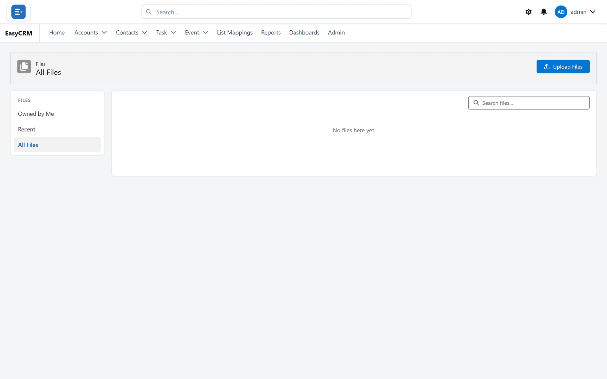
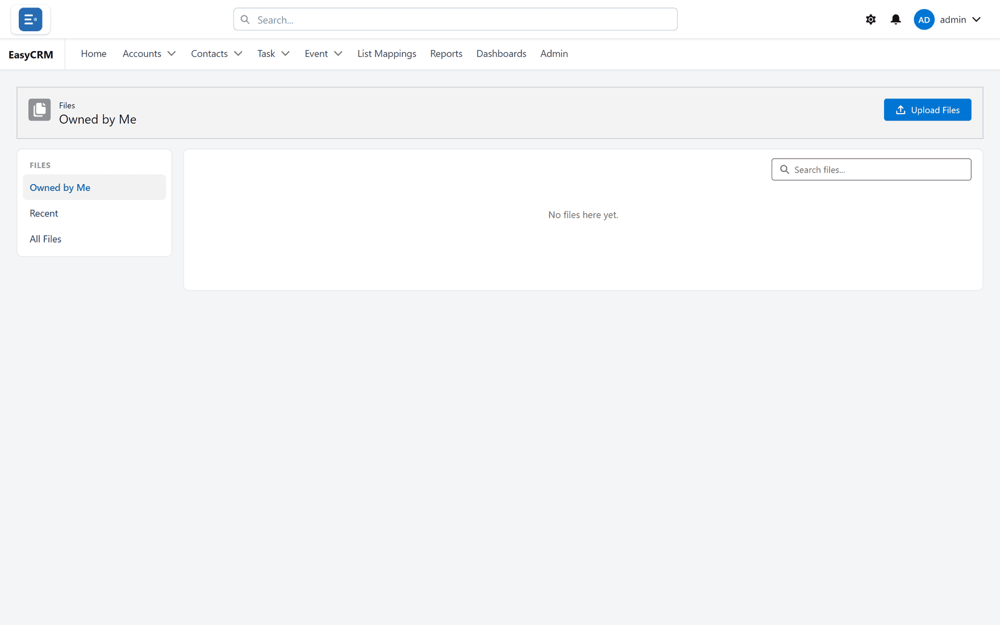
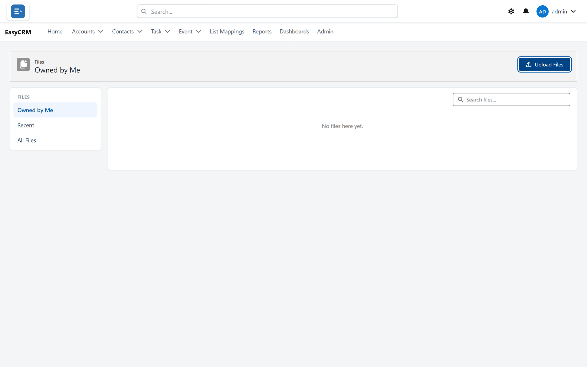

# Files

**What it is.** Documents stored in the portal.

**What it does.** You upload a file once, and anybody allowed to see it can open it.

**Why it helps.** Contracts and signed paperwork sit with the customer they belong to, instead
of in somebody's inbox.

Files live in two places: on a record, in its **Files** card, and in the **Files** area, which
lists files across the portal.

## Opening the files area

**Where:** In the portal → the App Launcher (nine-dot square) → **Files**

1. Click the **App Launcher** — the square of nine dots at the start of the tab row.
2. Under **Files**, click **Files**.

The App Launcher only appears when your administrator has given you at least one app, and it
offers **Files** only in the **Top bar** layout (choose it under the gear). Without it, use the
**Files** card on each record instead — see below.

## The three views

Choose in the menu on the left, under **Files**:

| View | Shows |
|---|---|
| **Owned by Me** | Files you uploaded through the portal. This is where the area opens. |
| **Recent** | The 25 files changed most recently, out of everything in **All Files**. Not the ones you opened — the portal does not track that. |
| **All Files** | Up to 200 files, most recently changed first: yours, **every file anybody has uploaded through the portal**, and files attached to records you are allowed to open. |

**Owned by Me** is the quickest way back to something you added yourself.

Type in **Search files...** to narrow the view you are on by file name. Each view lists **Title**,
**Size**, **Owner** and **Last Modified**. An empty view says **No files here yet.**

## Uploading a file

**Where:** In the portal → **Files** → **Upload Files**

1. Open the files area.
2. Click **Upload Files** at the top right.
3. Choose a file from your computer.

   

4. Wait for it to finish. The portal says **“Price list.pdf” uploaded.**, with your file's
   name.

A file uploaded here is not attached to any record. See [Uploading a file](./uploading.md) for
which to choose.

## Attaching a file to a record

This is usually better, because the file then sits with the customer it concerns.

**Where:** In the portal → **Accounts** → the record's name → the **Files** card

1. Open the record. The **Files** card is usually at the bottom of the right-hand column, headed
   **Files** and the number of files.
2. Click **Add Files** and choose a file — or drag a file from your computer onto the card. It
   says **Drop files to upload** while you hold it there.
3. Wait for **“…” uploaded.**

An empty card shows **Upload Files** — **Or drop files**; click it or drop a file on it.

The card shows the three most recently changed files. **View All**, or the card's heading, opens all of the
record's files on their own page, with **Back** and **Upload Files**. **Refresh** reloads the
card.

<!-- SHOT: files/record-files-card.png | An Account's Files card with 4 files (3 shown + View All), the ▾ menu open on one file showing View File Details, Download, Public Link, Upload New Version, Edit File Details, Delete -->

The record's **Files** card is only shown to people who can open the record. But a file
uploaded **through the portal** is also listed under **All Files** and **Recent** for every
portal user — including people who cannot open that record. Only files that reached the record
some other way (for example, added in Salesforce) stay limited to the people who can see the
record. Do not upload anything through the portal that every portal user may not see.

## What you can do with a file

Click a file's **name** to preview it, or use the ▾ beside it:

| Item | What it does |
|---|---|
| **View File Details** | Opens the preview — the same as clicking the name. |
| **Download** | Saves the file to your computer. |
| **Public Link** | Makes a web link to the file — see below. |
| **Upload New Version** | Replaces the file's contents with a file you choose. It stays the same file, in the same places; its name becomes the new file's name. The portal says **New version uploaded.** |
| **Edit File Details** | Renames it: change **File Name**, then **Save**. The portal says **File renamed.** |
| **Delete** | Asks **Delete “Contract.pdf”?**, then deletes it and says **File deleted.** |

### Previewing

Pictures and PDFs open in a preview window, with **Open in new tab**, **Public Link**,
**Download** and **Close**. Other kinds of file say **Preview isn't available for this file type.
Use Download to open it.**

### Public links

**Public Link** opens a window with the link, the warning **Anyone with this link can view** and
the file's name, and a **Copy** button (**Link copied.**).

Anybody who has that link can open the file — without signing in to the portal, and with no
expiry date. Use it only for files you would happily email to the person.

## Deleting

Deleting removes the file for everybody, not just you. If it is attached to a record, it
disappears from that record too — and from every other record it is on.

The portal does not check who uploaded a file before deleting it: anybody who can see it can
delete it. Check whether anybody else is using it first — there is no undo.

## What goes wrong

| Message or symptom | What it means |
|---|---|
| **That file is too large (max ~4.5 MB in the portal).** | The portal takes files up to about 4.5 MB. Make it smaller — compress a PDF or a photo — or ask your administrator to add it in Salesforce. |
| **Could not read that file.** | Your browser could not open it. Try again, or choose another copy. |
| Only one of several dropped files arrived | The portal uploads one file at a time. Drop or choose them one by one. |
| **This file could not be opened for preview. Use Download to open it.** | The preview did not load. **Download** still works. |
| There is no App Launcher, or no **Files** in it | You have no app, or you use the **Left sidebar** layout. Use the record's **Files** card, or switch to **Top bar** under the gear. |
| A file is missing from **All Files** | It is on a record you cannot open, or it is not among the 200 most recently changed files. For each kind of record, **All Files** also only looks at the 200 records changed most recently — open an older record to find its files on its card. |
