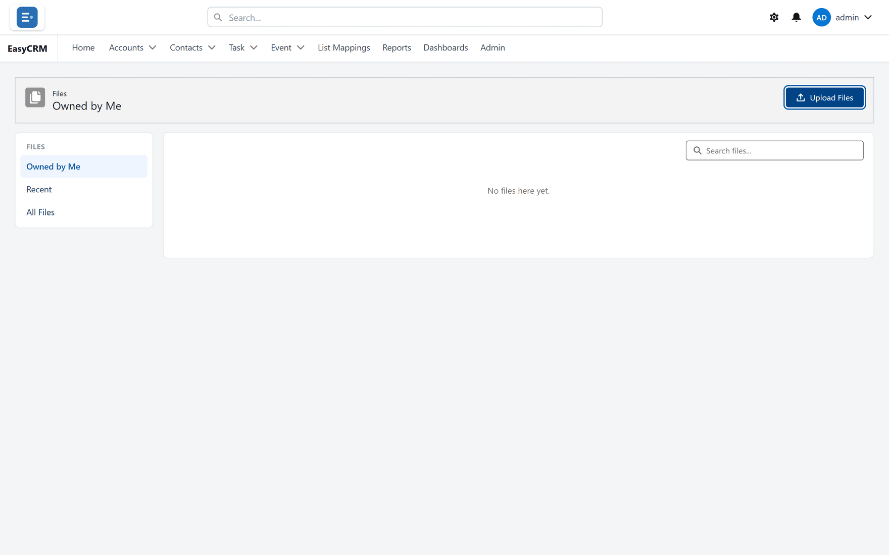

# Uploading a file

## Two places a file can go

This is the decision that matters, and it is made at upload time.

| Upload from | The file is | Who sees it |
|---|---|---|
| The **Files** area | Standalone — on no record | You, under **Owned by Me**. Not protected by any record's access: other portal users can see it under **All Files**. |
| A **record** | Attached to that record | On the record: anybody who can see the record. Under **All Files**: every portal user. |

**Attaching to a record is usually right.** The contract sits with the customer it belongs to,
and anyone working on that record finds it there.

**Either way, every portal user can find it.** Every file uploaded through the portal is listed
under **All Files** and **Recent** for all portal users, whether or not they can open the
record it is attached to. Do not upload anything through the portal that every portal user may
not see.

## Uploading to a record

**Where:** In the portal → **Accounts** → the record's name → the **Files** card

1. Open the record.
2. Find the **Files** card — usually at the bottom of the right-hand column.
3. Click **Add Files** and choose a file, or drag a file from your computer onto the card.
4. Wait for the portal to say the file was uploaded — **“Contract.pdf” uploaded.**, for example.

Anybody who can see the record now sees the file on it. Like every portal upload, it is also
listed under **All Files** for every portal user — see above.

## Uploading to the Files area

**Where:** In the portal → App Launcher → **Files** → **Upload Files**

1. Open the **App Launcher** (the nine-dot square) and click **Files**.
2. Click **Upload Files**.
3. Choose a file from your computer.

   

4. Wait for it to finish. Large files take a moment.

Use this for things that do not belong to one record — a price list, a template, a policy.
Nothing confidential: see the table above.

## Size and number

- Up to about **4.5 MB** per file. Anything larger is refused with **That file is too large
  (max ~4.5 MB in the portal).**
- **One file at a time.** If you drop several at once, only the first is uploaded.

## Replacing a file with a newer version

Do not upload the new copy as a second file. Instead:

1. Click the ▾ beside the existing file.
2. Click **Upload New Version**.
3. Choose the new file.

The portal says **New version uploaded.** It is still the same file, on the same records, with
the new contents. Its name changes to the new file's name.

## Naming files

The file name is all anybody has to go on in a list of hundreds.

| Good | Poor |
|---|---|
| Acme — signed MSA — 2026-03.pdf | scan001.pdf |
| Price list v4 (2026).xlsx | final final.xlsx |

Put the date in the name if the file will have successors. "Latest" stops being true.

A badly named file can be renamed afterwards: ▾ → **Edit File Details**.

## What goes wrong

| Symptom | Cause |
|---|---|
| **That file is too large (max ~4.5 MB in the portal).** | Make it smaller, or ask your administrator to add it in Salesforce. |
| Upload fails with another message | A blocked type, or the portal could not store it. The message says which. |
| A colleague cannot open it | They cannot see the record it is on. |
| Two versions exist | Uploading again adds a second file. Use **Upload New Version** to replace one. |
| The file is on the wrong record | Delete it and upload it again in the right place. |

## Where this fits

Files attached to a record appear in the record's **Files** card — see
[Opening a record](../records/opening-a-record.md) and [Files](./index.md). Whether the card is
on the page is set by an administrator in [Page layouts](../../admin/layouts/index.md).
