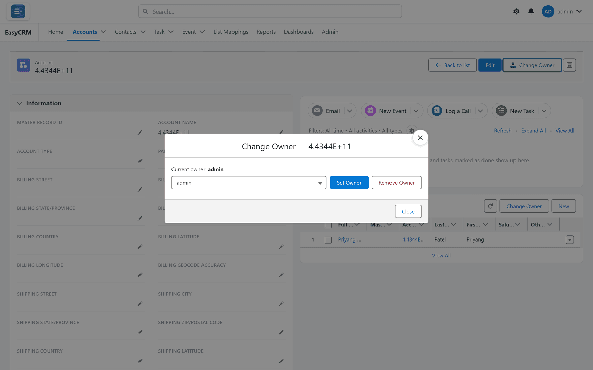

# Changing who owns a record

**What it is.** Moving a record from one portal user to another.

**What it does.** It changes who the record belongs to in the portal — the person shown as its
**Record Owner**.

**Why it matters.** The owner usually decides who can see the record. Changing the owner can
change who has access, so this is not just a label.

**Who can do it.** Admins and Super Admins. Other people do not see the **Change Owner** button
at all.

## Changing the owner

**Where:** In the portal → **Accounts** → the record's name → **Change Owner**

1. Click **Accounts** (or any tab) in the top menu.
2. Click the record's **name** to open it.
3. Click **Change Owner** at the top right of the record.
4. A window opens, titled **Change Owner —** and the record's name. It shows
   **Current owner:** and who that is — **— none —** if nobody owns it.

   

5. Open the **Choose portal user** drop-down and pick the new owner. It lists the active portal
   users by username.
6. Click **Set Owner**.

The window closes, the portal says **Owner updated.**, and the record shows the new owner.

Clicking **Set Owner** without choosing anybody says **Pick a portal user.** **Close** leaves
without changing anything.

The small owner symbol beside the **Record Owner** field, where it is on the page, opens the
same window.

## Leaving a record with no owner

In the same window, **Remove Owner** takes the owner off the record. The portal says
**Owner removed.** It only appears when the record has an owner.

As its tip warns — **Leaves the record unowned — under a Private default only View All reaches
it** — nobody may then be able to see the record except people with access to everything.
Use it rarely.

## Changing the owner of several records at once

**Where:** In the portal → a record → a related list → tick rows → **Change Owner**

1. Open the record whose related list holds them — an account, for the contacts at it.
2. Tick the records in the related list.
3. Click that list's **Change Owner** button.
4. A window opens: **You’ve selected 3 records.**
5. Under **Select New Owner**, type part of a username in **Search Users...** and pick the
   person.
6. Click **Submit**.

The list says **Owner changed.** If you click **Change Owner** with nothing ticked, it says
**Select at least one record first.**

<!-- SHOT: records/change-owner-several.png | An Account with several contacts: two ticked in the Contacts related list, the "Change Owner" window open showing "You’ve selected 2 records." and a portal user chosen under Select New Owner -->

## The Salesforce owner

Records also have an owner in Salesforce, a Salesforce user. If your page layout shows the
**Owner** field, the small owner symbol beside it opens **Change Account Owner** (or the name of
the kind of record), where **Search Users...** finds Salesforce users and **Submit** changes the
owner in Salesforce. It says **Owner changed.**

That is a different owner from the portal's. It does not change who can see the record in the
portal — the portal owner does.

## When you would do this

- Somebody leaves and their accounts need a new home.
- A deal moves to a different rep.
- A record was created by the wrong person.

## What else changes

This is the part people miss.

Under **Private** sharing, the new owner can now see the record — and the previous owner may
no longer be able to. If access came from a sharing rule or from a manager relationship, that
follows the new owner too.

So if a colleague says a record has "disappeared", a change of owner is the first thing to
check. An administrator can see exactly who has access and why, under
[Checking who can see a record](../../admin/sharing/record-access.md).

## If the button is missing

Only Admins and Super Admins can change owners. Ask one of them.
