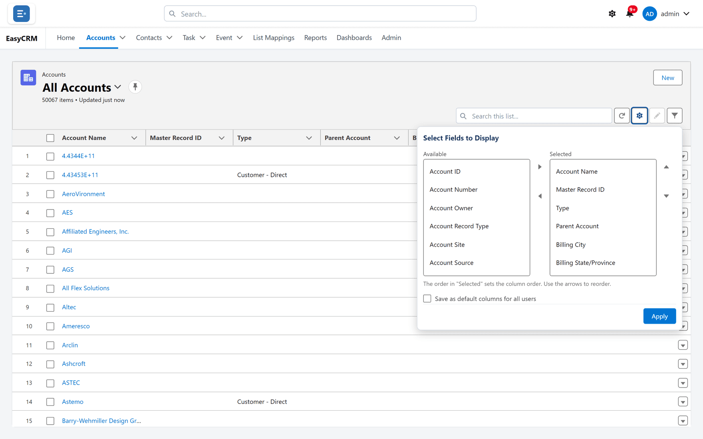

# Choosing columns

**What it is.** Control over which fields the list shows as columns, and in what order.

**What it does.** You move fields into and out of the table, and arrange them left to right.

**Why it helps.** Each person sees the fields that matter to their job, instead of scrolling
sideways past twenty they never use. Your choice is remembered for next time.

## Changing the columns

**Where:** In the portal → **Accounts** → the gear button (top right of the list)

1. Click the tab for the records you want — **Accounts**, for example.
2. Above the table on the right there is a row of small buttons. The gear is **Select Fields to
   Display**. Click it.
3. A panel opens with two lists side by side.

   
   <!-- SHOT-RETAKE: ../../img/shots/lists/choose-columns.png | Field names now follow the Salesforce page layout ("Parent Account" rather than "Parent Account ID") and the toolbar has the Edit List pencil between the gear and the funnel; same state otherwise (Select Fields to Display open, admin user so "Save as default columns for all users" shows) -->

   - **Available** on the left — fields not currently shown, in alphabetical order.
   - **Selected** on the right — the columns in your list now, top to bottom matching left to
     right in the table.

4. To add a column: click a field on the left, then click the right-pointing arrow between
   the lists.
5. To remove one: click a field on the right, then click the left-pointing arrow.
6. To reorder: click a field on the right, then use the up and down arrows. As the panel says,
   **The order in "Selected" sets the column order. Use the arrows to reorder.**
7. Click **Apply**.

The table redraws with your columns.

There is no search box in this panel — scroll the **Available** list to find a field. Field
names are the ones your Salesforce page layout uses, so they read the same as on the record.

At least one column must stay. If **Selected** is empty, the list says **Select at least one
field to display.**

## Column widths

Drag the edge of a column heading to make it wider or narrower. The widths are remembered in
this browser, for that tab.

## Who this affects

| You are on | The columns you apply |
|---|---|
| **Recently Viewed** or **All Accounts** | Are yours alone, remembered in this browser. On another computer you start from the default. |
| A list view you saved | Are saved into that view. |
| A list view shared with everybody | Are saved into the view **for everybody** if you are an Admin or Super Admin; otherwise they apply now but are not kept. |

See [List views](./list-views.md).

## Setting the default columns for everybody

**Where:** In the portal → a tab → **Recently Viewed** or **All** → the gear → **Save as default columns for all users**

Admins and Super Admins can set the columns everybody starts with on **Recently Viewed** and
**All**:

1. Choose the columns as above.
2. Tick **Save as default columns for all users**.
3. Click **Apply**.

The list confirms **Default columns saved for all users.** People who have already chosen
their own columns in their browser keep them.

To change what **everybody** sees on the record page itself, an administrator uses
[Page layouts](../../admin/layouts/index.md) instead.

## What goes wrong

| Symptom | Cause |
|---|---|
| Your columns are different on another computer | Columns on **All** and **Recently Viewed** are kept per browser. Save a [list view](./list-views.md) to have them everywhere. |
| A field is not in **Available** | You cannot read it, or it is not a field of this kind of record. |
| Your columns on a shared view went back | Only its owner and administrators can change a shared view. |
| **Select at least one field to display.** | **Selected** was empty when you clicked **Apply**. |
