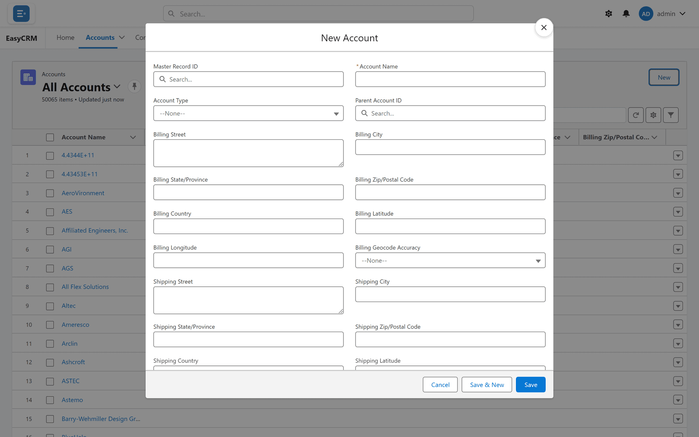

# Adding a record

**What it is.** Creating a record that did not exist before.

**When to use it.** For one or two records. To add many at once, use a spreadsheet instead —
see [CSV Import](../../admin/data/csv-import.md).

## Adding one

**Where:** In the portal → **Accounts** (or any tab) → **New**

1. Click the tab for the kind of record you want to add — **Accounts**, for example.
2. The list opens.
3. Click the **New** button at the top right of the list.
4. A window opens with empty fields, titled **New Account**.

   

5. Fill in the fields.

   Required fields have a red asterisk (**\***) before their name. You cannot save without them.

6. Click **Save**.

The window closes, the portal says **Record saved.**, and the list refreshes with the new
record in it. You own the record you create.

**Other ways to the same window:**

- The small arrow beside the tab → **New Account**.
- **New** on a related list inside another record — the new record comes already linked to it.

## Adding several in a row

Click **Save & New** instead of **Save**. The record is saved, **Record saved.** appears, and the
window clears for the next one. When you are adding from a related list, each new record is
linked to the same parent.

## If you are asked to pick a kind first

Some records come in more than one kind, and you are asked which before the form appears:
**Select a record type**, then **Next**. Choose, then carry on. The window's title then names
the kind — **New Account: Partner**, for example. See [Kinds of record](./record-types.md).

## If Save is refused

| Message | What it means |
|---|---|
| **Please fill required fields: Account Name** | The named fields are required and empty. |
| **Invalid value for Annual Revenue: abc** | A date, number or time is in the wrong format. |
| Your company's own message | A validation rule set up in Salesforce refused the record. |
| **Choose a Region: you can only create records with one of your values.** | You have several values for that field and the portal cannot pick for you. Fill it in with one of yours. |
| **Region must be one of your values: North, South.** | You chose a value that is not one of yours. |
| **You have no Region values assigned, so you can't save records here.** | You have no values for that field at all. Ask your administrator. |
| **You can't create a record with that record type.** | That kind of record is not available to your company. |

The **Region** messages come from [Field Scoped sharing](../../admin/sharing/field-scoped.md):
some companies limit each person to their own values of one field. If you have exactly one
value and leave the field empty, the portal fills it in for you.

## If the New button is missing

You do not have permission to create that kind of record. Ask your administrator — it is set
under [Permissions](../../admin/access/permissions.md).

## Adding many at once

For more than a handful, a spreadsheet is far faster. An administrator can load hundreds of
records in one go — see [CSV Import](../../admin/data/csv-import.md).
