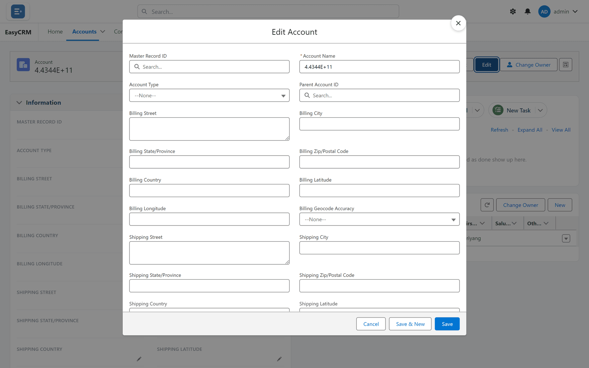

# Changing a record

**What it is.** Changing the information stored on a record.

**What it does.** Your change is saved straight away, and everybody who can see the record
sees the new value.

**Why it matters.** There is no draft and no approval step. When you click **Save**, it is
live for everybody.

There are three ways in, and they all save under the same rules:

| Way | Best for |
|---|---|
| **Edit** at the top of the record | Going through the whole record in a form. |
| A pencil beside a field on the record page | Changing one or a few fields where they are. See [Editing one field](./inline-editing.md). |
| The list itself | The same change on many records. See [Editing in a list](./list-editing.md). |

## Changing a record in the edit window

**Where:** In the portal → **Accounts** → the record's name → **Edit**

1. Click the tab for the kind of record — **Accounts**, for example.
2. Click the record's **name** to open it.
3. Click the blue **Edit** button at the top right.
4. A window opens, titled **Edit Account**, with the fields as boxes you can type in.

   

5. Click into any field and change it.
6. Click **Save** at the bottom.

The window closes, the portal says **Record saved.**, and the record shows the new values.

To abandon your changes, click **Cancel**. Nothing is saved.

**Save & New** saves this record and opens a blank **New Account** window straight away, for
adding another.

The same window opens from **Edit** in a list's row menu.

## If a field will not change

Some fields cannot be edited. There are three reasons:

| Reason | What it looks like | What to do |
|---|---|---|
| The system works it out | No pencil appears; it shows a padlock while you edit on the page | Nothing — it updates itself. |
| You do not have permission | No pencil appears; a padlock while you edit | Ask your administrator. |
| The record is read-only to you | **Edit** is missing | Ask your administrator. |

Which one it is comes down to [permissions](../../admin/access/permissions.md) and
[sharing](../../admin/sharing/index.md).

## If Save shows an error

A message appears at the top of the window, or as a red notice on the page. The usual causes:

| Message | What to do |
|---|---|
| **Invalid value for Annual Revenue: abc** | A date, number or time is in the wrong format. Correct the field it names. |
| **You don't have permission to edit this record.** | You can see this record but not change it. |
| Your company's own message | A validation rule set up in Salesforce refused the change. The message is the rule's own and usually names the field. |
| **Region must be one of your values: North, South.** | Your access is limited to certain values of one field (here, Region). Choose one of yours. |
| **You have no Region values assigned, so you can't save records here.** | You have no values for that field at all. Ask your administrator. |
| **This object is restricted by a field scope that is not set up correctly.** | A setup problem. Tell your administrator. |

The last three come from [Field Scoped sharing](../../admin/sharing/field-scoped.md), which some
companies use to limit people to their own region, team or product line.

Fix the field the message names, then click **Save** again. Your other changes are still
there — nothing is lost.

## Where this fits

Adding a new record uses the same window — see [Adding a record](./creating.md). Who may change
what is set by an administrator under [Permissions](../../admin/access/permissions.md).
