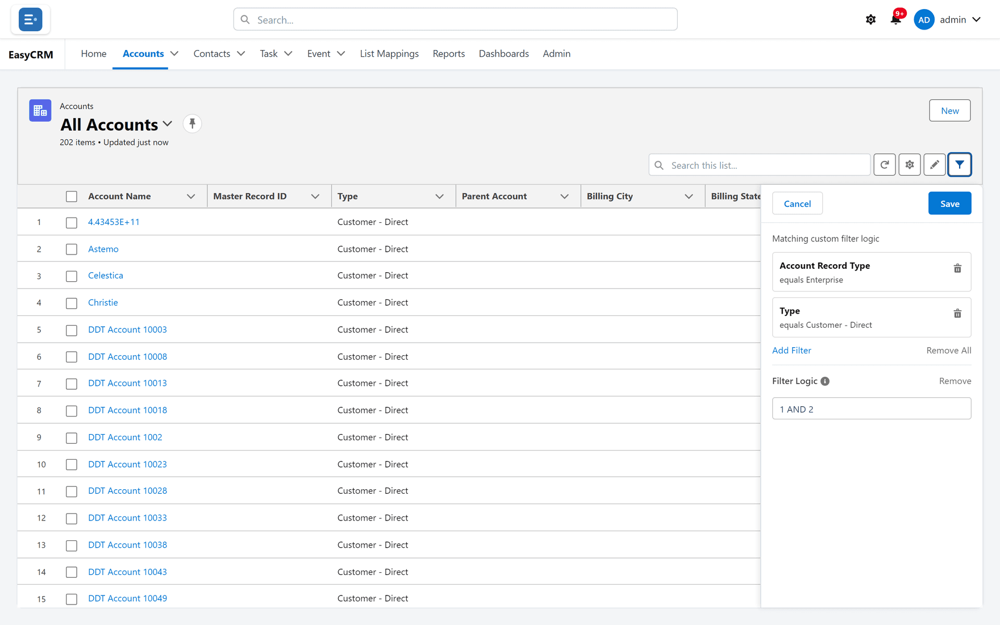
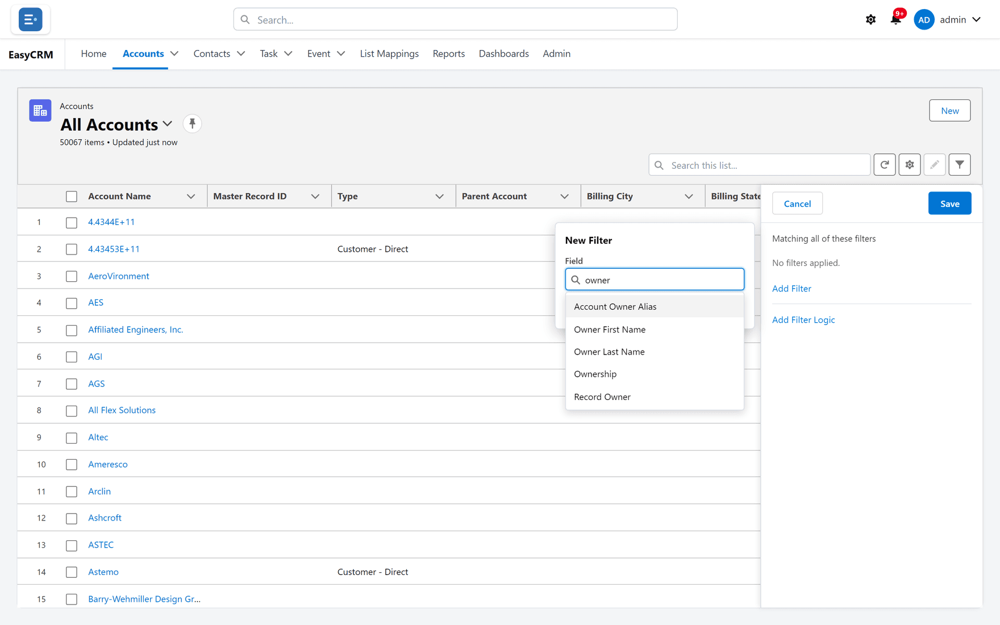

# Filtering a list

**What it is.** Rules that hide the records you are not interested in.

**What it does.** Only records matching your rules stay on screen. Nothing is deleted — the
rest are just hidden from this view.

**Why it helps.** A list of fifty thousand records answers nothing. A filtered list of twelve
answers a question.

The panel works the way the Filters panel on a Salesforce list view does, with the same fields
and the same operators.

## Adding a filter

**Where:** In the portal → **Accounts** → the filter button (top right of the list) → **Add Filter**

1. Click the tab for the records you want — **Accounts**, for example.
2. Look at the small buttons above the table on the right. The last one, shaped like a funnel,
   is **Filter**. Click it.
3. The Filters panel opens on the right of the list, with **Cancel** and **Save** at the top.

   

4. Click **Add Filter**. A small box titled **New Filter** opens.
5. Under **Field**, click the **Search Fields...** box and type part of the field's name — for
   example `city`. Click the field you want, or use the arrow keys and Enter.
6. Under **Operator**, choose how to compare — such as **equals** or **contains**.
7. Under **Value**, enter what to compare with — such as London.
8. Click **Save** in the small box. The filter appears in the panel as a card.
9. Click **Save** at the top of the panel.

The list now shows only matching records, and the count at the top changes.

Until you click **Save** at the top, nothing has changed. **Cancel** at the top throws away
everything you did since you opened the panel.

In a zoomed-in browser window, where the small box no longer fits, it scrolls and keeps its own
**Cancel** and **Save** in view.

## Which fields you can filter on

The panel offers the fields a Salesforce list view offers for that kind of record, in
alphabetical order — not every field there is.

- **Your company's own fields** are all offered.
- **Standard fields** are offered as Salesforce offers them. System fields such as
  **System Modstamp**, **Last Viewed Date** and the latitude and longitude parts of an address are
  never offered, and on the standard kinds of record nor are the record's ID and the people fields
  as IDs.
- **People by name.** Instead of the owner's ID, you filter on the owner's alias and name:
  **Account Owner Alias** (the first word is the kind of record), **Owner First Name**,
  **Owner Last Name**, **Created By Alias** and **Last Modified By Alias**. On tasks and events
  these are **Assigned Alias**, **Assigned First Name**, **Assigned Last Name** and
  **Assigned Role**. Opportunities add **Owner Full Name** and **Account Site**.
- **Contacts** add their account's fields, named like **Account: Industry**, and **Account ID**,
  **Account Owner Alias**, **Account Owner: First Name**, **Account Owner: Last Name**,
  **Account Parent Account**, **Account Site**, **Reports To First Name**,
  **Reports To Last Name** and **Campaign Member Status**.
- **Tasks** add **Name ID** and **Related To ID**.
- **Topics** is offered on accounts, contacts, opportunities, tasks and events where your
  company uses Topics.
- **Tasks and events** use Salesforce's list names for some fields: **Create Date**,
  **Last Modified Date/Time**, **Subtype**, **Recurring Parent**, **All-day**, **Start Date**,
  **Start Date & Time** and **End Date & Time**.

Field names follow your Salesforce page layout — **Parent Account** and **Account Record Type**,
for example, rather than the technical names.

The search box matches any part of a field's name. If nothing matches, it says
**No fields match.**

**Long text and encrypted fields are never offered.** Salesforce list views cannot filter them
either.

## Operators for each kind of field

| Field | Operators | Value |
|---|---|---|
| Text, phone, email, web address | **equals**, **not equal to**, **contains**, **does not contain**, **starts with** | Typed |
| A lookup to another record | The text operators | Typed — compared with the other record's name |
| Number, currency, percent | **equals**, **not equal to**, **less than**, **less or equal**, **greater than**, **greater or equal** | Typed |
| Date, date and time | **equals**, **not equal to**, **before**, **on or before**, **after**, **on or after** | Picked from a calendar |
| Time of day | The date operators | Picked as a time |
| Checkbox | **equals**, **not equal to** | **True** or **False** |
| Picklist | **equals**, **not equal to** | Picked from its values |
| Record type | **equals**, **not equal to** | **--None--** or one of the active record types |
| Multi-select picklist | **equals**, **not equal to**, **includes**, **excludes** | Picked from its values |
| Record ID | **equals**, **not equal to** | Typed — a full 15- or 18-character ID |

**Leaving the value empty means "blank".** **equals** with no value finds records where the
field is empty; **not equal to** with no value finds records where it has something in it. The
other operators need a value.

## Using more than one filter

Add as many as you need, the same way.

By default a record must match **every** filter. The panel says **Matching all of these
filters**.

## Changing that with filter logic

**Where:** In the portal → the filters panel → **Add Filter Logic**

Each filter has a number — 1, 2, 3 — in the order the cards appear. Filter logic lets you
combine them differently.

1. Click **Add Filter Logic** at the bottom of the panel.
2. A box appears, already filled in with every filter joined by AND — **1 AND 2 AND 3**, for
   example.
3. Change it to the rule you want:

| Rule | Means |
|---|---|
| 1 AND 2 | Both must be true. This is the default. |
| 1 OR 2 | Either will do. |
| 1 AND (2 OR 3) | Filter 1, plus either 2 or 3. |
| 1 AND NOT 2 | Filter 1, but not filter 2. |

4. Click **Save** at the top of the panel.

Brackets work the way you would expect from arithmetic. The small information symbol beside
**Filter Logic** reminds you: **Use AND, OR, NOT with filter numbers, e.g. 1 AND (2 OR 3)**.

With logic in use, the panel says **Matching custom filter logic**. To go back to "all of
these", click **Remove** beside **Filter Logic**. A logic box left empty also counts as "all".

If you remove a filter, the numbers of the ones after it move up — check the logic still says
what you mean.

## Changing or removing a filter

1. Open the filters panel.
2. To change a filter, click its card. The box opens again, titled **Edit Filter**.
3. To remove one, click the bin symbol on its card (**Remove**). To remove them all, click
   **Remove All**.
4. Click **Save** at the top of the panel.

With no filters, the panel says **No filters applied.**

## Where your filters are kept

| You are on | Your filters are |
|---|---|
| A list view you created | Saved into that view, for next time. |
| A list view shared with everybody | Saved into the view **for everybody** if you are an Admin or Super Admin. Otherwise they apply now but are not kept. |
| **Recently Viewed** or **All Accounts** | Remembered in this browser for this tab, until you change them. Another computer starts without them. |

See [List views](./list-views.md).

## What goes wrong

| Message or symptom | What it means |
|---|---|
| **"Description" can't be used to filter a list - Salesforce list views don't filter long text fields. Remove that filter and try again.** | An older saved view filters on a long text field. Remove that filter. Encrypted fields give the same message with "encrypted". |
| **The filter on "Call Time" has "2.30", which isn't a time. Use a time such as 08:30 or 2:15 PM.** | Retype the time. |
| **The filter on "Account ID" has "001ABC", which isn't a record ID (15 or 18 characters long).** | Paste the whole ID. |
| **A list can filter on Topics and Campaign Member Status in at most 4 filters.** | Use four or fewer filters on those two fields together. |
| **Too many records match the "Topics" filter to list them. Narrow it with another filter and try again.** | The topic is on too many records. Add another filter. |
| A field you expected is not in the list | It is a system field, long text, or one Salesforce list views do not offer. A [report](../reports/index.md) can filter on more. |
| The count did not change | You saved the small filter box but not the panel. Click **Save** at the top. |
| Your filters were gone on another computer | Filters on **All** and **Recently Viewed** are kept in the browser. Save them as a [list view](./list-views.md) instead. |

## Where this fits

Filters, [columns](./columns.md) and [sorting](./sorting.md) are the three things you change
about a list. To keep a set of them under a name, save a [list view](./list-views.md).
