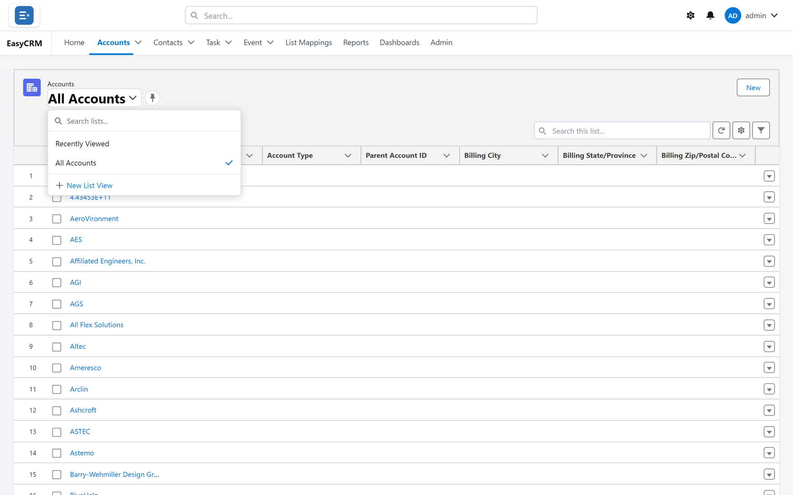

# List views

## What a list view is

A saved set of records with its own columns, filters and sorting. One tab holds several, and
you switch between them.

"All Accounts" and "Recently Viewed" are both list views of the same tab. They differ only in
which records they contain. Any others are views that you, or an administrator, saved.

## Why Recently Viewed can be empty

**Recently Viewed** is exactly what it says — records *you* have opened recently. On a new
account, or after a long gap, there is nothing to show.

So that the first screen is never blank, a tab that opens on an empty **Recently Viewed**
switches to **All Accounts** (or **All Contacts**, and so on) by itself. If you choose
**Recently Viewed** yourself, it stays on it, empty or not — and an empty list says
**No records found.**

**This is the single most common "the portal is broken" report, and it is not a fault.** The
records are there; this particular view has no history to list yet.

## Switching view

**Where:** In the portal → a tab → the list name at the top → choose

1. Click the tab — **Accounts**, for example.
2. Click the **list name** in large text at the top (it will say "Recently Viewed" or similar).
3. A menu opens. **Recently Viewed** and **All Accounts** are at the top; views that have been
   saved are under **All Other Lists**. Type in **Search lists...** to find one by name.

   

4. Click the one you want. A tick marks the view you are on.

**All Accounts** shows every record you are allowed to see. That is the view to reach for when
Recently Viewed is empty or you are looking for something specific.

## Saving a list view

**Where:** In the portal → a tab → the list name → **New List View**

Set the list up first: the columns, filters and sort you want. Then:

1. Click the list name at the top.
2. Click **New List View** at the bottom of the menu.
3. The **New List View** window opens.

   <!-- SHOT: lists/new-list-view.png | Accounts list with a filter applied, New List View window open: List View Name filled in, "Who sees this list view?" set to "Only I can see this list view", the hint line underneath -->

4. Type a **List View Name**.
5. Under **Who sees this list view?**, choose **Only I can see this list view** or **All users
   can see this list view**.
6. Click **Save**.

The new view opens. As the window says, **The current columns, filters, and sort are saved with
this view. Only admins can share with Everyone.**

If you are not an Admin or Super Admin and choose **All users can see this list view**, the view
is saved as private to you — there is no message to say so.

A view needs a name: without one, the list says **Give the list view a name.**

## Renaming or deleting a view

Your own views — and, for administrators, any view shared with everybody — have two small icons
beside their name in the menu.

| Icon | What it does |
|---|---|
| The pencil (**Rename / re-save**) | Opens **Edit List View**, where you change the name and who sees it. **Save** also stores the columns, filters and sort currently on screen into that view. |
| The bin (**Delete**) | Asks **Delete this list view?**, then removes it for everybody who could see it. |

**Open the view before you rename it.** The pencil re-saves whatever is on screen, so renaming
a view while another one is showing gives it that other view's columns and filters.

## Making one open by default

Click the **pin** symbol next to the view name — its tip says **Pin as the default list view**.
Next time you open this tab, it starts there. Click it again (**Unpin this list view**) to undo.

Pin the view you use every morning. It removes two clicks from every single visit.

The pin is kept in this browser. On another computer, pin it again.

## What happens to your changes

When you change the columns, filters or sort, where the change goes depends on the view:

| You are on | Your change |
|---|---|
| A view you saved | Is saved into the view straight away. |
| A view shared with everybody, as an Admin or Super Admin | Is saved into the view — **for everybody who uses it.** |
| A view shared with everybody, as a Standard user | Applies now, but is not kept. Next time the view opens as it was. |
| **Recently Viewed** or **All Accounts** | Columns and filters are remembered in this browser for this tab. The sort is not kept. |

To keep your own version of a shared view, set it up and save it as a **New List View**.

## What the header tells you

| What you see | Means |
|---|---|
| The kind of record, in small grey text | Which tab you are on |
| The view name, large | Which *set* you are looking at |
| "N items" | How many records are in this view |
| "Updated just now" | Always says this — it is not a timestamp. Click the refresh button to fetch the latest. |

If the count looks wrong, check the view name before anything else. People usually assume they
are on "All" when they are on something narrower.

## Views are not permissions

A view decides what is *displayed*. [Sharing](../../admin/sharing/index.md) decides what you
are *allowed* to see.

**All Accounts** does not mean every account in the company — it means every account **you**
can see. Two people opening the same view can legitimately see different numbers.

## What goes wrong

| Symptom | Cause |
|---|---|
| The list is empty | Recently Viewed with no history, or a filtered view with no matches. |
| "All" shows fewer records than a colleague sees | Sharing, not the view. |
| A view you used has gone | Its owner, or an administrator, deleted it — or it is private to somebody else. |
| Your columns changed | Each view has its own columns. You switched view — or an administrator changed a shared view. |
| Your changes to a shared view did not stick | Only its owner and administrators can change it. Save your own copy with **New List View**. |
| A view you made "for all users" is private | Only Admins and Super Admins can share a view with everybody. |
| You renamed a view and its columns changed | The pencil re-saves what is on screen. Open the view first, then rename it. |
| **You can only edit your own list views.** / **You can only delete your own list views.** | The view belongs to somebody else. |

## Where this fits

A view carries your [column](./columns.md), [filter](./filtering.md) and
[sorting](./sorting.md) choices together.
