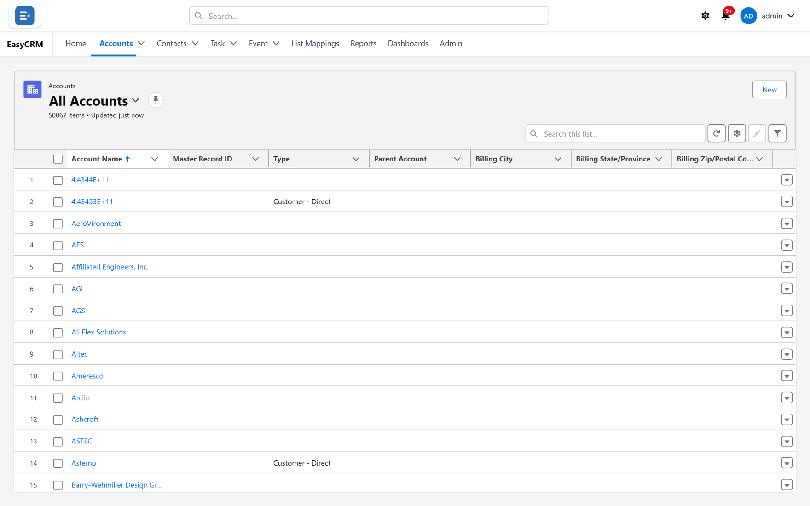
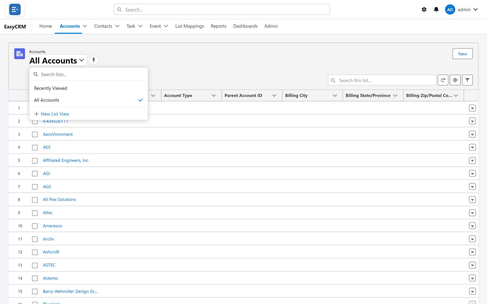
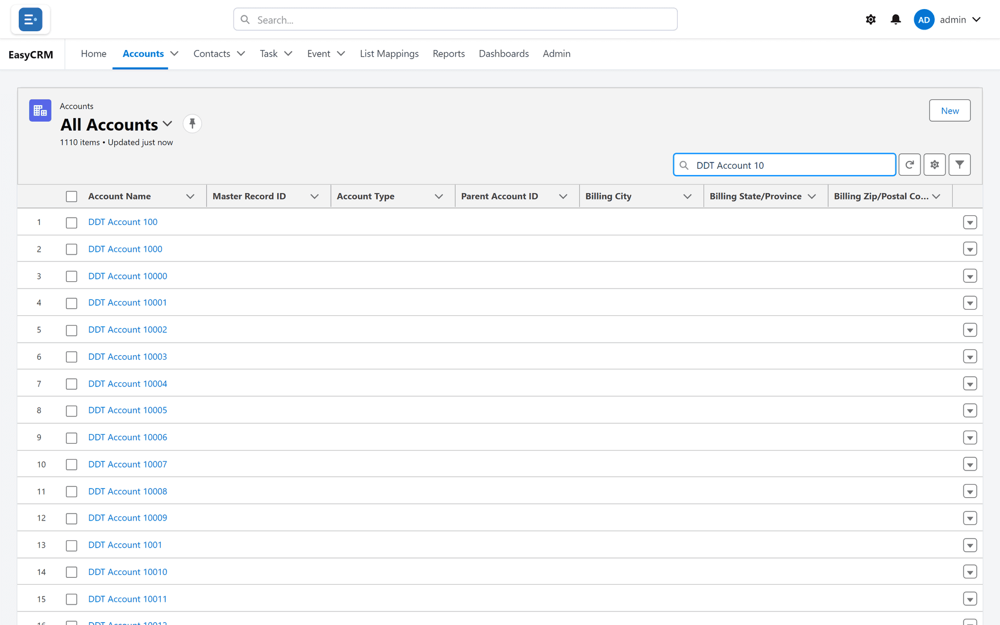
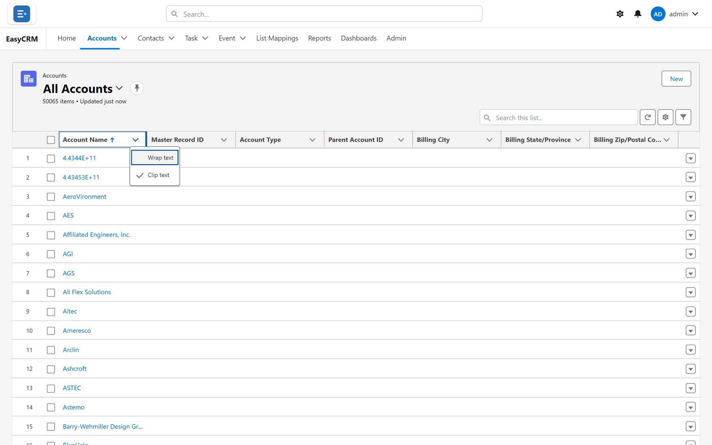
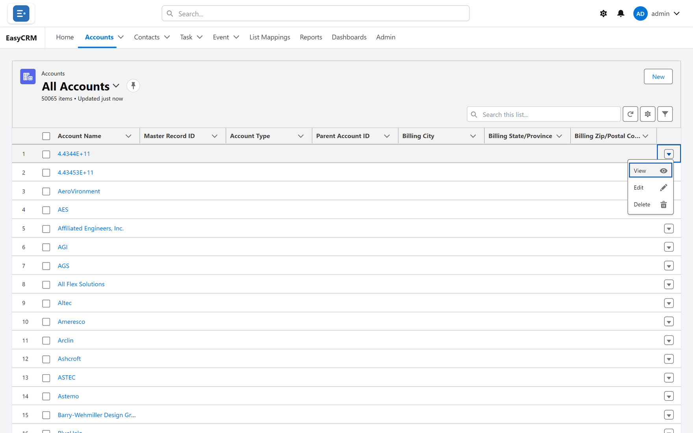

# Looking at a list

**What it is.** A table showing many records of one kind — all your accounts, for example.

**What it does.** It shows them in rows, and lets you narrow, sort, search and edit them.

**Why it helps.** It is the fastest way to find a record, and the starting point for most work
in the portal.

## Opening a list

**Where:** In the portal → the tab for the records you want — for example **Accounts**

1. Look at the row of tabs across the top of the screen.
2. Click the tab for the kind of record you want: **Accounts**, **Contacts**, **Task** or
   **Event**.
3. The list opens.

## What you are looking at

Reading the screen from the top:

- The **kind of record** in small grey text, for example "Accounts".
- The **name of the list** in large text, for example "All Accounts". This is which *set* of
  records you are looking at — see below. The **pin** beside it makes it your default.
- **How many records** are in it — "50065 items", for example — followed by "Updated just
  now", which is always the same words, not a timestamp.
- **New** on the right, to add a record. It is missing if you may not create this kind of
  record. Your administrator may have added more buttons beside it — see below.
- **Search this list...**, and a row of small buttons: **Refresh**, the gear (**Select Fields to
  Display**), the pencil (**Edit List**, only when you may edit something here) and the funnel
  (**Filter**).
- The table itself. The first column is the record's name, in blue. Blue means clickable.

The list loads the first 200 records; more load as you scroll down, all the way to the end.

Column names are the ones your Salesforce page layout uses — **Parent Account**, for example,
rather than a technical name.

## Switching to a different list

A tab can hold several lists. **Recently Viewed** is only what you opened lately. When it is
empty, the tab opens on **All Accounts** instead, so the first screen is not blank.

**Where:** In the portal → a tab → the list name at the top → choose a list

1. Click the list name at the top (for example **Recently Viewed**).
2. A menu opens showing every list you can use.

   

3. Click the one you want. **All Accounts** shows every account you are allowed to see.

To make a list open by default, click the **pin** symbol next to its name. Next time you open
this tab in this browser, it starts there. Saving lists of your own is covered in
[List views](./list-views.md).

## Searching inside a list

**Where:** In the portal → a tab → **Search this list...**

1. Click the **Search this list...** box above the table on the right.
2. Type part of a name.
3. The table narrows as you type.

This searches **only the list you are on**, and only the record's name. To search everything,
use **Search...** in the top bar instead.

## Sorting

1. Click a column heading — for example **Account Name**.
2. The list sorts by that column. A small arrow appears showing the direction.
3. Click the same heading again to reverse it.

The small arrow on the right of each heading opens **Wrap text** and **Clip text**, which decide
how long values fit in the column. More on [Sorting](./sorting.md).

## Changing values in the list

You can change values straight in the table — one cell at a time, or the same value into many
ticked rows at once. Changes stay as yellow drafts until you click **Save**. See
[Editing in a list](./list-editing.md).

## Doing something to one row

**Where:** In the portal → a tab → the arrow at the end of a row

1. Find the row you want.
2. Click the small arrow at the far right of that row.
3. A short menu opens with the things you can do to just that record:

   | Item | What it does |
   |---|---|
   | **View** | Opens the record. |
   | **Edit** | Opens the edit window. Only if you may edit this kind of record. |
   | **Delete** | Asks **Delete this record? This cannot be undone.**, then deletes it and says **Record deleted.** Only if you may delete this kind of record. |

## Buttons your administrator added

Your administrator can put buttons of their own beside **New** — to start a guided process or
open a web page, for example.

- A button that runs a process opens a window titled **Action**. When it finishes, the window
  closes, the list says **Done.** and reloads.
- A button that opens a web page opens it in a new browser tab.
- Some buttons ask first — **Are you sure?** unless your administrator wrote another question.

Which buttons you see can depend on your role. See [Buttons](../../admin/appearance/buttons.md).

<!-- SHOT: lists/list-button-action.png | Accounts list with an admin-added list button beside New, clicked: the "Action" window showing the first screen of a flow -->

## Opening a record from the list

Click the record's **name** — the blue text in the first column. See
[Opening a record](./opening-a-record.md).

Other blue values are links too: a lookup opens the linked record, and a link set up by your
administrator as a formula opens its web page in a new browser tab.

## What goes wrong

| Message or symptom | What it means |
|---|---|
| **You have access to a very large number of records here, so this list shows a subset. Use search or filters to narrow it down.** | More than 5,000 records reach you through ownership or sharing — more than the list can work through — so it shows some of them. Search or filter to find what you need. |
| **No records found.** | Nothing matches the list, its filters or your search — or you chose **Recently Viewed** before opening any records. |
| The list is empty although colleagues see records | Sharing decides what you may see. See [What you can see](../start/what-you-can-see.md). |
| **New** is missing | You may not create this kind of record. |
| An error appears instead of rows | Often a filter that no longer works. Open the filters panel — see [Filtering a list](./filtering.md). |
