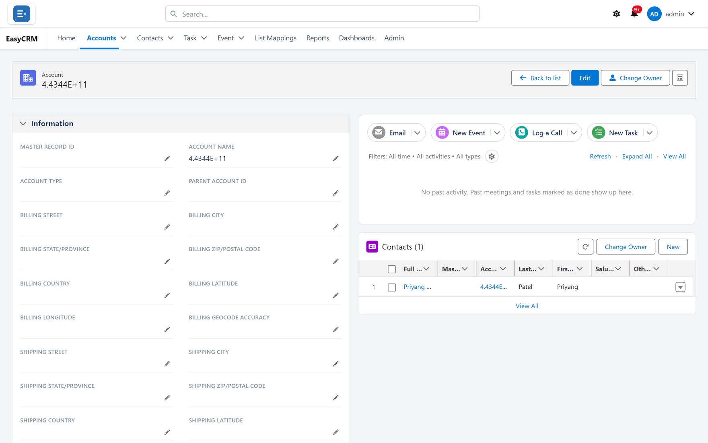

# Opening a record

**What it is.** The page for one single record, with everything known about it.

**What it does.** It shows the record's fields, plus the calls, tasks, files and linked
records that belong to it.

**Why it helps.** Everything about one customer sits in one place, so you are not piecing it
together from email and memory.

## Getting to a record

**Where:** In the portal → **Accounts** (or any tab) → click the record's **name**

1. Click the tab for the kind of record you want — **Accounts**, for example.
2. The list opens. If it is empty, switch to the **All ...** list — see
   [Looking at a list](./lists.md).
3. Find the record you want. Use **Search this list...** if there are many.
4. Click the record's **name** in the first column. It is blue, which means it is a link.

The record opens.

<!-- SHOT-RETAKE: ../../img/shots/records/accounts-detail.png | Field labels now follow the Salesforce page layout (e.g. "Parent Account" rather than "Parent Account ID"); retake the same Account in the same state, showing both columns -->

**A faster way:** if you know the name, type it into **Search...** in the top bar and click the
result. That skips the list entirely. The small arrow beside each tab also lists the records of
that kind you opened lately.

Opening a record adds it to your **Recently Viewed** list and to **Recent Records** on the home
page.

## What you are looking at

Across the top of the record:

| What you see | What it does |
|---|---|
| The kind of record, and its name | Tells you where you are. |
| **Back to list** | Returns to the list you came from. |
| **Edit** | Opens the record in an edit window — see [Changing a record](./editing.md). Missing if you may not edit this kind of record. |
| **Change Owner** | Gives the record a new owner. Admins and Super Admins only — see [Changing who owns a record](./changing-owner.md). |
| A small layout symbol (**Edit Page Layout**) | Changes which fields and sections this page shows. Only if your administrator has given you permission to edit layouts. |
| Other buttons | Buttons your administrator added — see [Buttons](../../admin/appearance/buttons.md). |

Below that the page is in two columns of equal width.

**On the left: the fields.** All the fields on this record, in sections — **Information** and
**System Information**, or the sections your administrator set up. Click a section's heading
to fold it away, and again to open it.

**On the right: everything linked to the record.**

- The **activity panel** — calls, tasks, meetings and emails. See
  [Calls, tasks and meetings](../activities/index.md).
- The **related lists** — other records linked to this one, such as the contacts at this
  account. See [Related records](./related-records.md).
- **Files** attached to the record. See [Files](../files/index.md).

By default the activity panel is at the top of the right-hand column and Files at the bottom;
your administrator can move them.

On a narrow screen — under about 1,024 pixels wide, such as a tablet held upright — the two
columns stack, and the right-hand column follows the fields.

## Field names

Fields carry the names Salesforce shows on its own page layout — **Account Name** rather than
"Account ID", **Contact Record Type** rather than "Record Type ID". Hovering over a field's name
shows its technical name, which is useful when an administrator asks exactly which field you
mean.

## Blue text is clickable

Anywhere on the record, blue text does something:

| Blue text | What clicking it does |
|---|---|
| Another record's name | Opens that record. |
| An email address | Starts an email to it. |
| A phone number | Starts a call, on a device that can make them. |
| A web address | Opens it in a new tab. |
| A link your administrator built as a formula | Opens its web page in a new tab. |
| An address | Opens it in Google Maps in a new tab. A small map is shown under it too. |

## How values are shown

- **Dates** read the way people write them, with no stray "00:00:00".
- **Dates with times** show the date and the time, such as **9/21/2026, 8:55 AM**.
- **Times of day** show as **9:30 AM**.
- **Checkboxes** show as a tick box — ticked or empty. Hover over it to read **Checked** or
  **Not Checked**. Clicking it does not change it; to change it, edit the record.

## Going back

Click **Back to list** at the top right, or your browser's back button. Both work.

## Scrolling through everything

A record can be long. Scroll to see the rest of either column — nothing is hidden behind a
click, apart from sections you folded away.

Empty fields are still shown, with nothing beside their name. If a field you expect is missing
altogether, your administrator has left it off this layout, or you do not have permission to
read it. See
[Page layouts](../../admin/layouts/index.md).

## What goes wrong

| Message or symptom | What it means |
|---|---|
| **Record not found.** | The record was deleted, or you are not allowed to see it. The portal does not say which. |
| **Could not load the record.** | Something went wrong loading it. Try **Back to list** and open it again. |
| There is no **Edit** button | You may not edit this kind of record. |
| There is no **Change Owner** button | Only Admins and Super Admins can change owners. |
