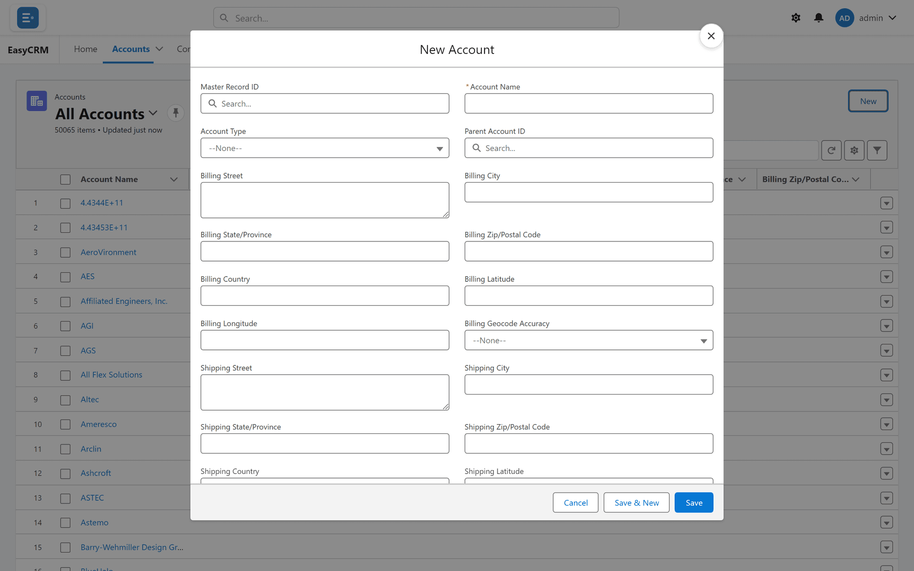

# Kinds of record

**What it is.** Some records come in more than one kind, and you choose which when you create
one.

**What it does.** The kind decides which fields you see on the form and which options the
drop-downs offer.

**Why it helps.** One screen does not have to carry every field for every situation. A
customer and a supplier can both be accounts without sharing one cluttered form.

## Choosing a kind

**Where:** In the portal → **Accounts** → **New** → pick a kind

1. Click **Accounts** (or any tab) in the top menu.
2. Click **New** at the top right of the list.
3. If there is more than one kind available, you are asked to choose before the form appears:
   **Select a record type**.

   

4. Pick the kind, then click **Next**.

   

5. Fill in the form — its title now names the kind, such as **New Account: Partner** — and
   click **Save**.

## If you are not asked

Then there is only one kind, or only one you are allowed to create. Nothing is wrong — the
portal skips the question rather than showing you a list of one.

## Changing the kind later

The portal cannot change a record's kind once it exists. The record type is shown on the record
but has no pencil, and the edit window does not offer it. Ask your administrator, who can change
it in Salesforce.

Changing the kind can change which fields are shown, so a value may stop being visible. It is
not deleted — it just is not on the new layout.

## The kind and lists

On a kind of record with several record types, a list can only be edited in place once it is
filtered to one record type. See [Editing in a list](./list-editing.md).

## Who decides which kinds are available

A Super Admin, under **Assign Record Types** in [Users](../../admin/users/index.md). It is set
per company, so two companies on the same portal can offer different kinds.
