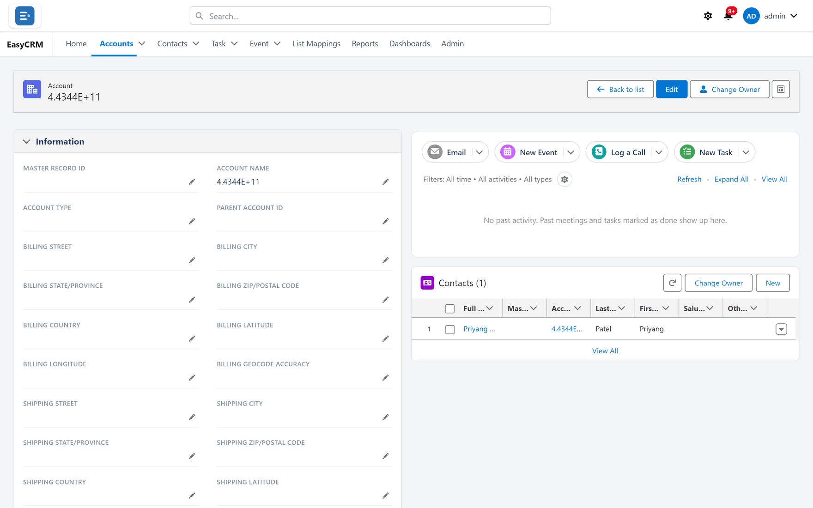
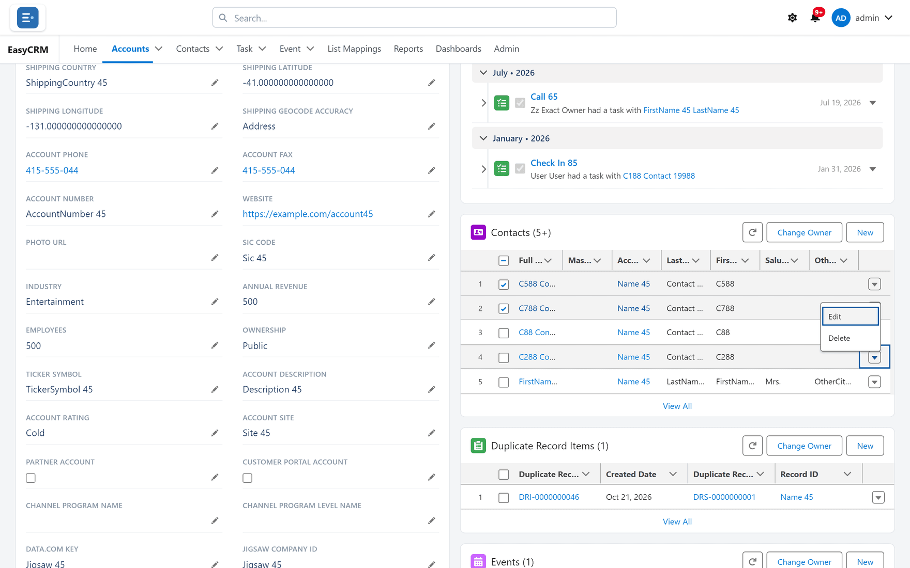

# Related records

**What it is.** The small tables on a record showing other records linked to it.

**What it does.** An account shows its contacts. A contact shows its cases. You move between
connected records without searching for them.

**Why it helps.** It answers "who else works at this company?" without you going to
**Contacts** and filtering.

## Finding them

**Where:** In the portal → **Accounts** → the record's name → the right-hand column

1. Click **Accounts** (or any tab) in the top menu.
2. Click the record's **name** to open it.
3. Look at the right-hand column, under the activity panel. On a narrow screen, scroll down
   past the fields.

Each related list is a small table with its own heading, such as **Contacts (3)**.

## Reading the heading

| Heading | Means |
|---|---|
| **Contacts (3)** | Three linked records, all shown. |
| **Contacts (5+)** | The table shows the first five and there are more. Use **View All**. |
| **Contacts (0)** | Nothing is linked yet — not that something is broken. |
| **Contacts** with a padlock, and no number | You may not see this kind of record. See below. |

Your administrator sets how many rows each table shows; five is the usual.

## Using them

| Control | What it does |
|---|---|
| A **name** in the table | Opens that record. A linked record in another column opens too. |
| A column heading | Sorts the table by that column — across all the linked records, not just the ones shown. |
| The heading itself, or **View All** at the bottom | Opens the full list on its own page. |
| **Refresh** (the circular arrow) | Reloads just this table. |
| **New** | Adds a new record already linked to this one — a new contact with this account filled in, for example. |
| **Change Owner** | Admins and Super Admins: gives the ticked rows a new owner. See [Changing who owns a record](./changing-owner.md). |
| The ▾ at the end of a row | **Edit** or **Delete** that record. Each appears only if you may do it to that kind of record. |

**Delete** asks **Delete "Jane Smith"? This cannot be undone.** and then says **Record deleted.**
in the table. You stay on the record you were on.

**Change Owner** needs at least one ticked row first; otherwise the table says **Select at
least one record first.**

## The full list

**View All**, or a click on the heading, replaces the record with the whole related list:

- The heading reads **Related list** and the list's name with its count.
- 25 records a page, with **Previous** and **Next** at the bottom.
- Click a column heading to sort.
- **New** adds a linked record; **Back** returns to the record you came from.

An empty full list says **No records.**

## When a list is locked

If your administrator placed a related list on the page but you may not see that kind of record,
the table is replaced by a padlock and:

> You don’t have access to Contacts.
> Contact your administrator if you need it.

<!-- SHOT: records/related-list-locked.png | A record whose layout has a related list for an object the Standard user cannot read: the locked card with the padlock and "You don’t have access to …" -->

Nothing from that list is sent to your screen — not even how many there are.

## If a related list is missing

| Reason | Who fixes it |
|---|---|
| It is not on the page layout. | An administrator, under [Page layouts](../../admin/layouts/index.md). |
| The page has no layout, and the list is empty. | Nobody needs to — see below. |
| You have no permission for that kind of record, and it was not placed on the layout. | An administrator, under [Permissions](../../admin/access/permissions.md). |

**Pages without a layout.** When nobody has set up a layout for a kind of record, the portal
picks the related lists itself: up to eight, and only the ones that have something in them.
Once an administrator sets up a layout, it shows exactly the lists chosen, empty or not.

An administrator chooses which related lists appear, their columns, and how many rows each
shows — see [Related lists](../../admin/layouts/related-lists.md).
