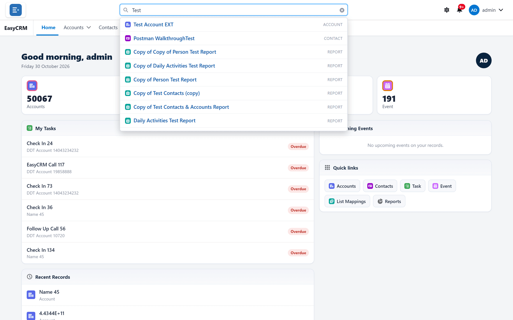
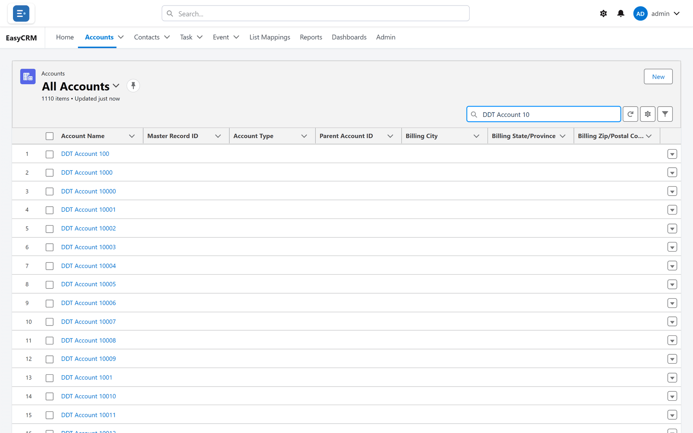

# Searching

## Two different searches

The portal has two, and reaching for the wrong one wastes time.

| | Where | Searches |
|---|---|---|
| **Global search** | The box at the very top of the screen | Every kind of record you can see, plus your reports and dashboards |
| **Search this list** | Above a list, on the right | Only the list you are on |

Both search **names**: an account's name, a contact's name, a task's subject.

## Global search — when you do not know where it lives

**Where:** In the portal → the **Search...** box at the top of any page

1. Click **Search...** in the middle of the top bar.
2. Type at least **two** letters. Any part of the name will do — `cme` finds "Acme".
3. Results appear underneath as you type. Each shows the name, with its kind on the right —
   **Account**, **Contact**, a report or a dashboard.

   
   <!-- SHOT-RETAKE: ../../img/shots/shell/search.png | Global search now also returns reports and dashboards; retake with a term that matches an account, a contact and a report (e.g. "pipe" or a customer name used in a report title) so all three kinds show -->

4. Click a result to open it — or move with the arrow keys and press Enter.

While it works it says **Searching…**; if nothing matches, **No matches**.

Use this when you know the name but not which tab it is under — or when you are not sure
whether "Acme" is an account or a contact.

### What global search covers

- Every kind of record that has a tab in the portal and that you may read — and within each,
  only the records you are allowed to see.
- Up to 10 matches of each kind, and up to 50 records in all, in alphabetical order.
- Then the reports and dashboards whose names match, as long as you could open them.

If a name is common, type more of it: the first matches of each kind are all you get.

## Search this list — when you are already there

**Where:** In the portal → a tab → **Search this list...**

1. Open a tab and its list.
2. Click **Search this list...** above the table on the right.
3. Type part of a name. The table narrows as you type.

   

This only looks at the records in the current view, and only at their names. If you search
"Acme" in a view filtered to one region, you will not find Acme in another region — the view
excluded it before the search ran.

## Finding a kind of record

The **App Launcher** — the nine-dot square at the start of the tab row — has its own search box,
**Search apps and items...**. That one finds *kinds* of record and apps, not records. See
[Getting around](../start/the-screen.md).

## Which to use

| You want | Use |
|---|---|
| One record, name known | Global search |
| Not sure which tab it is on | Global search |
| A report or dashboard by name | Global search |
| To narrow a list you are working through | Search this list |
| Everything matching a condition, not a name | Not search — use a [filter](./filtering.md) |

That last row matters. Search finds by **name**. "Every account in London" is not a search, it
is a filter.

## What goes wrong

| Symptom | Cause |
|---|---|
| Nothing happens after one letter | Global search needs at least two. |
| No results for something you know exists | Searching a list that excludes it. Try global search. |
| Nothing found at all | Sharing — you may not have access to that record. Or that kind of record has no tab in your portal. |
| Searching an email address or phone number finds nothing | Search looks at names only. Use a [filter](./filtering.md). |
| Too many results, and the one you want is missing | Only the first 10 of each kind show. Add more of the name, or filter the list instead. |
| A record you expected is missing | Search covers what you are allowed to see, nothing more. |

## Where this fits

Search finds one record. [Filtering](./filtering.md) finds a *set*. [Reports](../reports/index.md)
answer questions about a set. Those three cover almost everything people try to use search for.
