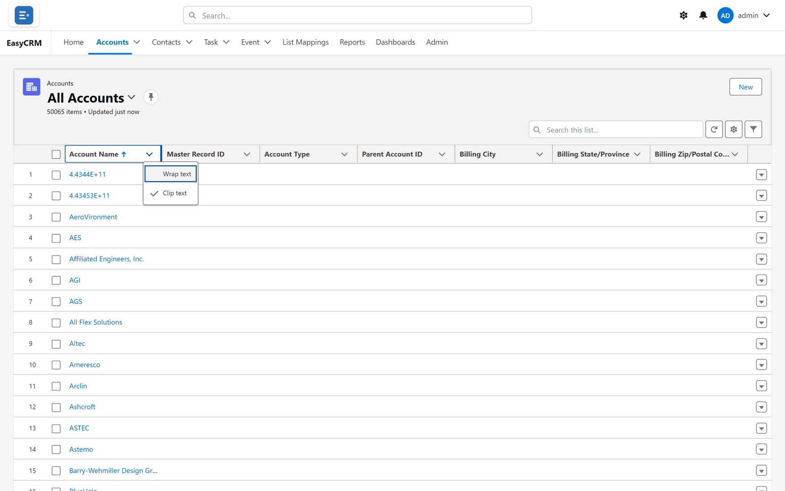

# Sorting

## What it does

Puts the rows of a list in order by one column. It changes nothing about the records — only
the order you see them in.

## Sorting a list

**Where:** In the portal → a tab → click a column heading

1. Open a tab and its list.
2. Click a **column heading** — **Account Name**, for example.
3. The list sorts by that column. A small arrow beside the heading shows the direction.
4. Click the same heading again to reverse it.

The sort covers the whole list, not just the rows on screen: the portal fetches the records
again in the new order, and more load as you scroll.

Each heading also carries a small arrow on its right. That menu is not for sorting: it offers
**Wrap text** and **Clip text**, which decide whether long values in that column run onto
several lines or are cut short.

## How different fields sort

| Field type | Order |
|---|---|
| Text | A to Z, then reversed |
| Number | Smallest to largest |
| Date | Oldest to newest |
| Picklist | The order the options were defined in — **not** alphabetical |
| A lookup to another record | By that record's name |

The picklist one surprises people. A Stage picklist sorts Prospect, Qualified, Closed because
that is the order it was built in, which is usually more useful than alphabetical.

## Empty values

Records with nothing in the sorted column always go to the **bottom** of the list, whichever
direction you sort in. If a sort looks like it has "lost" records, scroll to the end — they are
sitting in a block of blanks.

## Is the sort kept?

| You are on | The sort |
|---|---|
| A list view you saved | Is saved into the view. |
| A list view shared with everybody, as an Admin or Super Admin | Is saved into the view, for everybody. |
| A list view shared with everybody, as a Standard user | Applies now, but is not kept. |
| **Recently Viewed** or **All Accounts** | Is not kept. Switching view or reloading puts the default order back — by name. |

See [List views](./list-views.md) for saving your own.

## When sorting is not the right tool

Sorting puts the interesting rows at the top. It does not remove the rest.

| You want | Use |
|---|---|
| The ten biggest at the top | Sorting |
| **Only** records over a threshold | [Filtering](./filtering.md) |
| A count or total per group | A [report](../reports/index.md) |

Scrolling a sorted list of forty thousand records to find a subset is a filter waiting to be
written.

## What goes wrong

| Symptom | Cause |
|---|---|
| Numbers sort as 1, 10, 2 | The field is text, not a number. Ask your administrator. |
| A picklist is not alphabetical | Correct — it sorts in defined order. |
| The sort resets | You switched view, or reloaded **All** or **Recently Viewed**, where the sort is not kept. |
| Sorting by a long text column shows an error instead of rows | Salesforce cannot sort long text. Sort by another column. |
| The sort did not stick on a shared view | Only its owner and administrators can change it. |

## Where this fits

Sorting, [columns](./columns.md) and [filtering](./filtering.md) are the three things you
change about a list. Save them together as a [view](./list-views.md).
