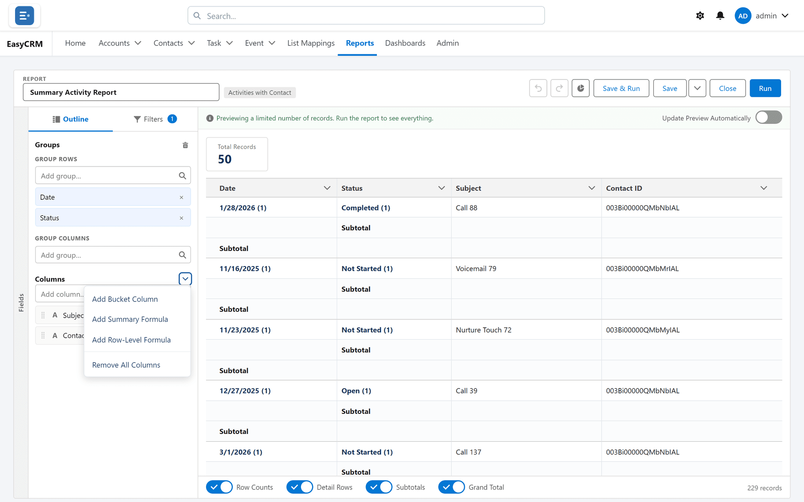

# Bucket columns

**What it is.** A column you invent, which sorts existing values into groups you name
yourself.

**What it does.** You take a field and say "these values are Small, these are Medium, these
are Large". The report then has a column holding those names.

**Why it helps.** You can group and total by categories that matter to your business without
anybody adding a field to the database. No developer, no waiting.

## Creating one

**Where:** In the portal → **Reports** → a folder → the report's name → **Edit** → **Outline** → the arrow beside **Columns** (**Column actions**) → **Add Bucket Column**

1. Click **Reports** in the top menu.
2. Click the folder, then the report's **name**, then **Edit**.
3. In the **Outline** tab, click the arrow beside the **Columns** heading (**Column actions**).
4. Choose **Add Bucket Column**. The **New Bucket Column** box opens.

   

5. Under **Field**, search for and pick the field whose values you want to sort.
6. Type a **Bucket Name** — the column's name.
7. Make the buckets and put values into them — see below.
8. Click **Apply**.

The new column appears in the preview straight away.

A quicker start: in the preview, click the chevron beside a column's heading
(**Column options**) and choose **Bucket This Column**. The box opens with that field already
picked.

## How values are sorted depends on the field

| Field type | How you define the buckets |
|---|---|
| **Picklist** or **text** | Click **Add Bucket** and name it. Tick values in the list on the right (**Search Values** narrows it), then use **Move To** to put them in a bucket. **Enter Values** lets you type or paste values, one per line, straight into a bucket. |
| **Number** | Set ranges. Each row is a limit and a bucket name: a record whose value is at or below the limit falls in that bucket. **+ Add range** adds another. |

A column can have up to **20** buckets.

<!-- SHOT: report-builder/bucket-picklist.png | New Bucket Column box on a Contacts report bucketing Lead Source: two buckets made on the left, several values ticked on the right, the Move To menu open -->

## Anything left over

On the left of the box, **Unbucketed Values** lists every value you have not placed yet.

- **Picklist or text:** tick **Bucket remaining values as** and the leftovers all show under
  one name — "Other" unless you change it. Leave it unticked and each leftover value simply
  shows as itself.
- **Number:** values above your last limit, and blanks, show under the name in
  **Values above the last limit:** — "Other" unless you change it.

Always check what has fallen in there. A large leftover group usually means values you did
not expect — which is itself worth knowing.

## Using the column

A bucket column can do most of what any other column can. You can:

- Group rows by it, to get a subtotal per bucket.
- Group columns by it in a matrix.

You cannot sort by a bucket column, and it is not offered in the **Add filter...** list. To
narrow the report, filter on the field the bucket is built from.

## Changing one

Click the bucket column's name in the **Outline**, or open its menu (**Column actions**) and
choose **Edit Bucket Column**. The **Edit Bucket Column** box opens; change it and click
**Apply**. The report updates immediately; no data is changed, because a bucket exists only
inside this report.

## What goes wrong

| Message | What it means |
|---|---|
| **Enter a bucket column name.** | **Bucket Name** is empty. |
| **Choose a field to bucket.** | No field is picked. |
| **Add at least one bucket, or check “Bucket remaining values as Other”.** | A picklist or text bucket column with no buckets. |
| **Add at least one range.** | A number bucket column with no ranges. |
| **Up to 20 buckets per column.** | Combine some buckets. |

## It lives in one report

A bucket column belongs to the report you made it in. To use the same grouping elsewhere,
either copy the report with **Save As**, or ask an administrator for a real field if you need
it everywhere.
