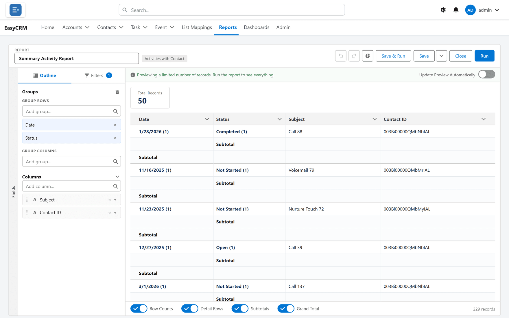
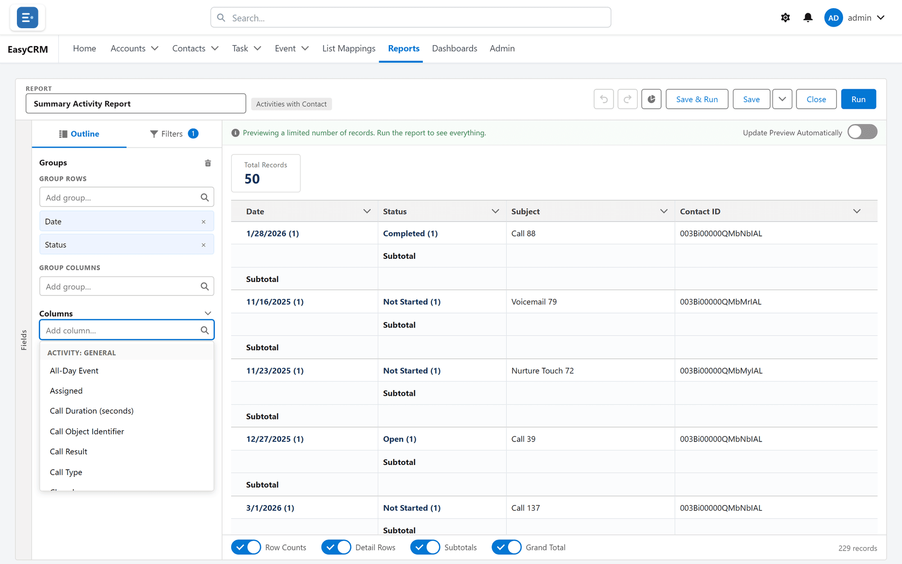
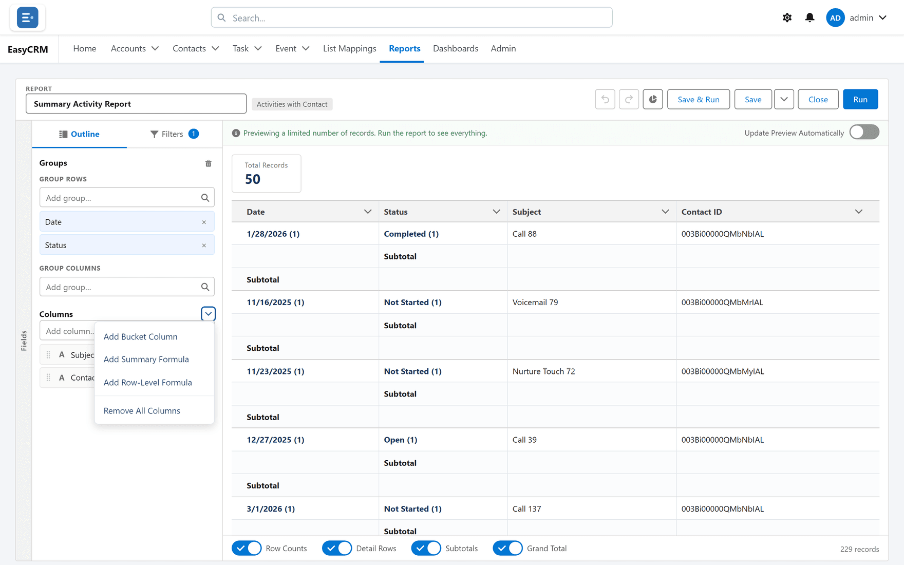
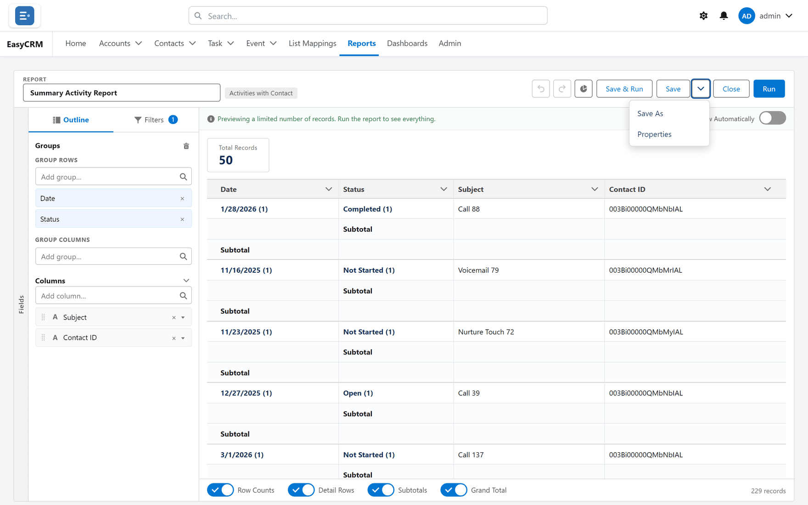

# The report builder

**What it is.** The screen where you decide what a report shows.

**What it does.** You choose which records to include, which columns to show, how to group
them and what to total. A preview updates as you go, so you see the answer before you save.

**Why it helps.** Nobody has to export to a spreadsheet and rebuild the same summary every
week.

## Opening the builder

There are two ways in.

**For a new report** — **Reports** → **New Report** → pick a type. See
[Starting a new report](./report-types.md).

**For an existing report** — **Reports** → a folder → the report's name → **Edit**.

1. Click **Reports** in the top menu.
2. Click the folder, then the report's **name**. It runs.
3. Click **Edit** at the top.

The builder opens. If you only have read access, it does not open; the report says
**You have read-only access to this report. Ask its owner or a Super Admin for edit access, or
use Save As to make your own copy.** — see [Saving](./saving.md#working-on-somebody-elses-report).

## What you are looking at

| Part | Where | What it is for |
|---|---|---|
| **Report name** | Top left | What it will be called. The report type is shown beside it. |
| **Change Report Type** | Top right | Only on a report that has never been saved. See [Report types](./report-types.md#changing-the-type). |
| **Undo** / **Redo** | Top right | Step back or forward. |
| Chart icon (**Add / edit chart**) | Top right | Opens **Chart Properties**. See [Charts](./charts.md). |
| **Save & Run** | Top right | Saves, then shows the full result. |
| **Save** and its arrow (**Save options**) | Top right | Keep it. The arrow holds **Save As** and **Properties**. |
| **Close** | Top right | Leave. You are warned if you have unsaved changes. |
| **Run** | Top right | See the full result **without saving**. |
| **Fields** | Strip down the left edge | Every field you can use, to drag into place. |
| **Outline** | Tab, top left | Your columns and groups. This is where you shape the report. |
| **Filters** | Tab, top left | Which records are included. |
| The preview | The large area on the right | What the report will look like. |
| **Update Preview Automatically** | Above the preview | Off: the preview waits until you refresh it. On: it updates after every change. |
| Switches | Below the preview | **Row Counts**, **Detail Rows**, **Subtotals** (or **Stacked Summaries** on a matrix) and **Grand Total** — saved with the report as how it opens. |

The preview shows a sample, and says so: **Previewing a limited number of records. Run the
report to see everything.** With **Update Preview Automatically** off, once you change something
it reads **To see the latest edits, refresh the preview.** — click its **Refresh**.

Nothing is saved until you click **Save**, so you can experiment freely.

### While the report is still loading

Opening an existing report takes a moment. Until it has loaded, **Save**, **Save & Run** and
**Save options** are greyed out — and if it fails to load, they stay greyed out. That stops a
half-loaded, empty-looking report being saved over the real one. See
[Saving](./saving.md#what-goes-wrong).

<!-- SHOT: report-builder/report-save-disabled-loading.png | The builder opened with Edit on a large report, a moment after opening: preview spinner showing, Save & Run, Save and the Save options arrow greyed out -->

## Adding a column

**Where:** In the portal → the builder → **Outline** → **Add column…**

1. Click the **Outline** tab if you are not already on it.

   

2. Click the **Add column…** box.
3. A list of available fields appears. Type to narrow it.

   

4. Click the field you want.

It appears in the preview straight away.

## Reordering, removing and sorting columns

- **To reorder:** drag a column in the Outline list into a new position.
- **To remove one:** click the **X** (**Remove column**) on it in the Outline.
- **To sort the report:** click a column's name in the preview. Click again to reverse. The sort
  is saved with the report.

Each column heading in the preview has a chevron (**Column options**) with a menu: sorting,
grouping, a bucket column, totals (**Sum**, **Average**, **Max**, **Min**, **Median**),
**Show Unique Count**, **Move Left**, **Move Right** and **Remove Column**. See
[Columns](./columns.md), [Grouping](./grouping.md) and [Totals](./totals.md).

The menu beside the **Columns** heading in the Outline (**Column actions**) adds bucket and
formula columns, or removes every column at once.

## Seeing the whole result

Click **Run** to see the full report, not the sample. It runs exactly what is in the builder —
**it does not save**. On that screen, **Back** brings you back to the builder with your changes
still in place.

Leaving that screen any other way — another tab, the App Launcher, a search — loses your
unsaved changes **without a warning**. If you want to keep them, come back with **Back** and
save, or use **Save & Run** instead.

## Saving your work

| Button | What it does |
|---|---|
| **Save** | Keeps your changes to this report and stays in the builder. **✓ Saved** shows briefly. |
| **Save & Run** | Saves, then shows the full result. |
| **Save options → Save As** | Makes a copy under a new name and leaves the original alone. |
| **Save options → Properties** | Renames the report and sets who it is shared with. |

The first time you save, you are asked for a name and a folder. See
[Saving a report](./saving.md).

**Save As** is the safe way to experiment with somebody else's report: take a copy, change the
copy, leave theirs alone.

## Leaving without saving

Click **Close**. If you have unsaved changes, an **Unsaved Changes** box warns you first:
**You have unsaved changes to this report. If you leave now, those changes will be lost.**
Click **Stay** to go back, or **Leave & Discard** to leave.

Clicking another tab, the App Launcher, a search result, a notification, your profile menu, or
the browser's **Back** or **Forward** asks too: **You have unsaved changes that will be lost.
Leave anyway?** Closing or reloading the browser tab gets your browser's own warning.

The one route with no warning is a **Run** you then leave without coming **Back** — see above.
