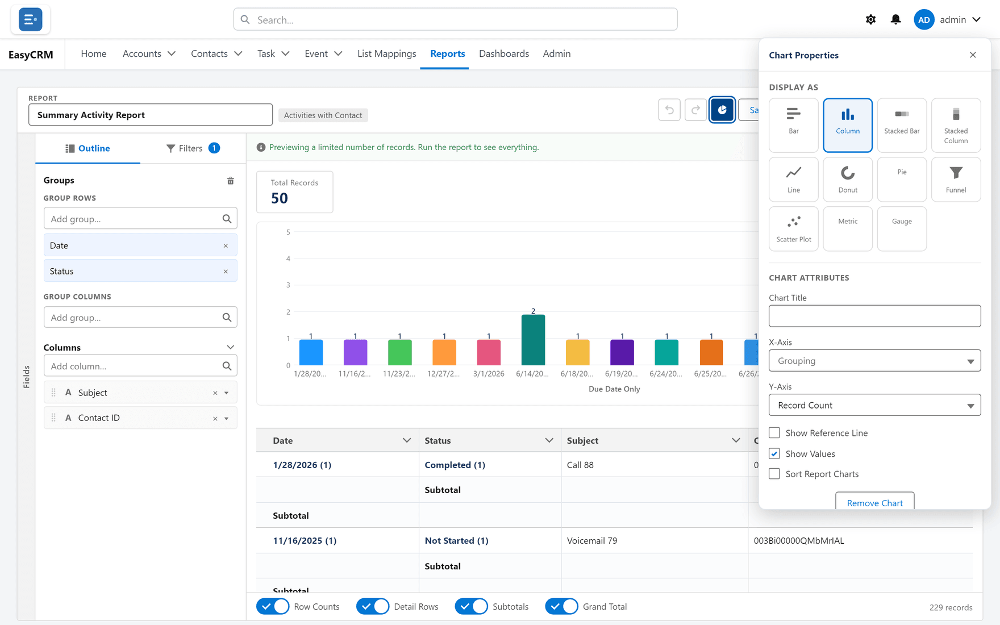

# Charts on a report

**What it is.** A picture of the report, shown above the table — or beside the grid on a matrix
report.

**What it does.** It draws whatever the report has grouped, measured by whatever the report
totals.

**Why it helps.** A trend or an outlier is obvious in a chart and invisible in four hundred
rows.

## A report must be grouped first

A chart plots **groups**. A report with no grouping shows no chart, whatever you choose.

Add a row group first — see [Grouping](./grouping.md).

## Adding a chart

**Where:** In the portal → **Reports** → a folder → the report's name → **Edit** → the chart icon (**Add / edit chart**)

1. Click **Reports** in the top menu.
2. Click the folder, then the report's **name**, then **Edit**.
3. Click the chart icon at the top (**Add / edit chart**). The **Chart Properties** panel opens.

   

4. Under **Display As**, click the chart type.
5. Under **Chart Attributes**, give it a **Chart Title** if you like, and choose what it groups
   by and what it measures — the boxes are named for the chart type, see
   [below](#what-each-type-asks-for).
6. The preview shows the chart straight away. Close the panel with its **X**.
7. Click **Save**.

To change the chart later, click the chart icon again, or the gear on the chart in the preview
(**Chart properties**). **Remove Chart**, at the bottom of the panel, takes it off.

## The chart types

**Display As** offers eleven:

| Type | Best for | Avoid when |
|---|---|---|
| **Bar** | Comparing groups, drawn sideways — good for long group names | — |
| **Column** | Comparing groups, drawn upright | There are dozens of groups |
| **Stacked Bar** / **Stacked Column** | Each group split into parts — a matrix report's column grouping, or several measures | The parts matter more than the whole |
| **Line** | A value changing over time | The groups are not in time order |
| **Donut** / **Pie** | Parts of one whole | There are more than about six slices |
| **Funnel** | Stages that narrow, such as a sales pipeline | The groups are not stages |
| **Scatter Plot** | Whether two totals move together | You have only one total |
| **Metric** | One headline number | You need a breakdown |
| **Gauge** | One number against a dial | There is no sense of "how far" |

A pie chart with twenty slices tells nobody anything. Use a bar chart.

## What each type asks for

| Type | Boxes under **Chart Attributes** |
|---|---|
| **Column**, **Stacked Column**, **Line** | **X-Axis** (a grouping) and **Y-Axis** (a measure) |
| **Bar**, **Stacked Bar** | **Y-Axis** (a grouping) and **X-Axis** (a measure) — the bars lie sideways |
| **Donut**, **Pie** | **Value** (a measure) and **Sliced By** (a grouping) |
| **Funnel** | **Value** and **Color By** |
| **Scatter Plot** | **X-Axis** and **Y-Axis** (two measures) and **Detail** (a grouping) |
| **Metric**, **Gauge** | **Value** |

A measure is **Record Count** or any total the report has, such as "Amount (Sum)". On the bar,
column and line types, **+ Measure** adds more measures once the report has a total.

Each type has a few tick boxes too — **Show Values**, **Show Reference Line**,
**Sort Report Charts**, **Cumulative** (line), **Show Percentages**, **Show Total** (donut),
**Combine Small Groups into "Others"** and **Legend Position** (donut, pie and funnel).

## Sliced by

If a report has more than one grouping — rows or columns — you can choose which one the chart
draws.

That means the same report answers two questions: by owner, or by month, without being
rebuilt.

## Reading a chart

Point at a bar, slice or point and a dark box beside it gives the exact figures:

- the group's name and value — "Call Result" and "Connected";
- the measure and its **full** value — "Record Count" and "1,151", even where the axis shows
  "1.2K";
- on a donut, pie or funnel, its share of the whole too — "(25.88% of 4.4K)";
- on a stacked or matrix chart, which series the segment belongs to;
- on a scatter plot, the group and both of its values;
- on a **Metric**, the number in full; on a **Gauge**, also how far round the dial it is.

The same box appears on dashboard tiles and in the builder's preview.

<!-- SHOT: report-viewer/report-chart-hover.png | A summary report with a Pie chart, the pointer resting on one slice and the dark hover box showing the group name and value, Record Count with its full value and "(…% of …)" -->

## Charts on dashboards

A dashboard tile draws its own chart from the report's data, and does not have to match the
chart on the report. On a dashboard you can also click a bar or slice to open the report
narrowed to that group — see [Running a report](./running.md#opened-by-clicking-a-chart). A
report's own chart is for reading; clicking it does nothing.

See [The dashboard builder](../dashboards/builder.md).
