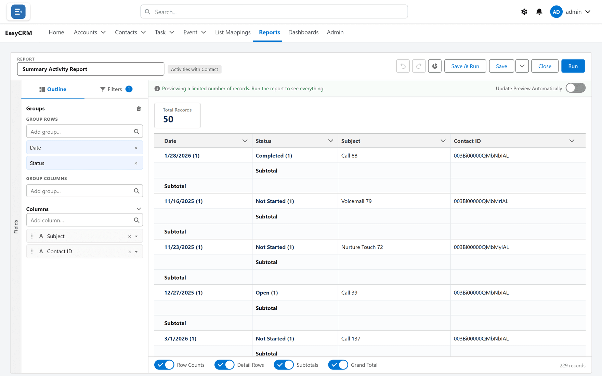
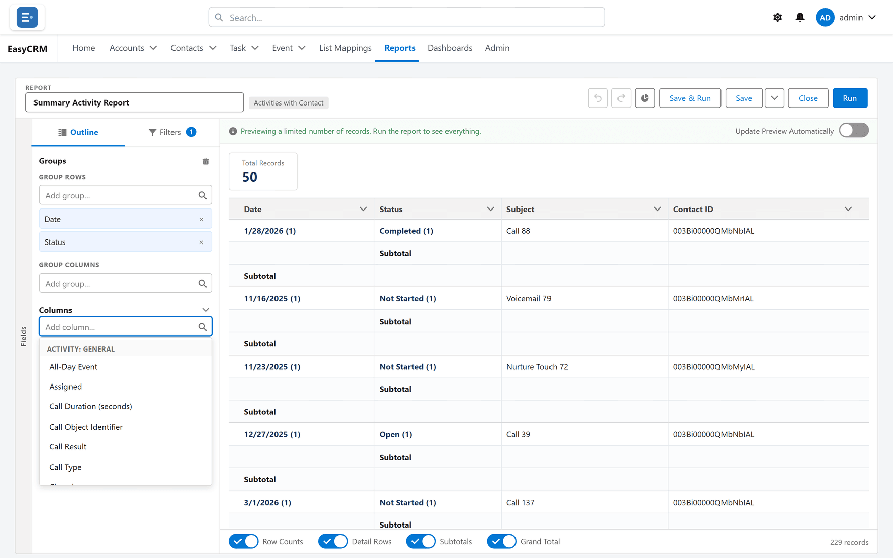
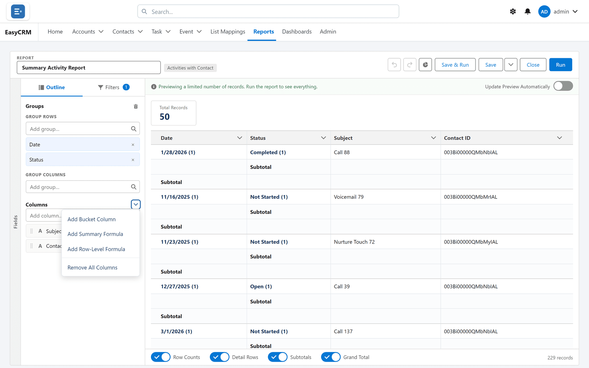

# Columns

## What a column is

One field, shown for every record the report includes. Columns are what the report *shows*;
[filters](./filters.md) decide what it *includes*.

## When you change them

Whenever the report is not answering the question. A report with the wrong columns is usually
not a broken report — it is one nobody has finished.

**When not to:** if you are about to add fifteen columns, you probably want
[grouping and totals](./grouping.md) instead. A wide report people scroll sideways through is
harder to read than a short grouped one.

## Adding a column

**Where:** In the portal → **Reports** → a folder → the report's name → **Edit** → **Outline** → **Add column…**

1. Click **Reports** in the top menu.
2. Click the folder, then the report's **name**. It runs.
3. Click **Edit** at the top. The builder opens.
4. Click the **Outline** tab at the top left if you are not already on it.

   

5. Click the **Add column…** box.
6. A list of available fields appears, sorted into sections. Type to narrow it.

   

7. Click the field you want.

It appears in the preview immediately. Nothing is saved until you click **Save**.

You can also open the **Fields** strip down the left edge of the builder and drag a field onto
the **Add column…** box.

## Which fields are offered

Only fields from the report's [type](./report-types.md). A Contacts report offers contact
fields; a **Contacts & Accounts** report offers contact fields and account fields.

If a field you expect is missing, the usual reasons are:

| Reason | What to do |
|---|---|
| Wrong report type | The type is fixed once the report is saved. See [Report types](./report-types.md). |
| The field is hidden from you | A field you may not read is not offered at all, anywhere in the builder. Ask your administrator. |
| It is on a related record the type does not reach | A different type may pair them. |

### Fields one step further away

On an **Activities** report the field list also holds the contact's fields, and among them the
contact's owner (**Contact Owner**) and, where contacts have record types, the contact's record
type (**Contact Record Type**). They work on an **Activities with Contact** report too, so you can
show activities by whoever owns the contact rather than whoever was assigned the activity.

## Column names

A column carries the name Salesforce gives it in the same kind of report, not the field's own
label. The two often differ, and the name can change from one report type to another:

| Field | The field's label | The column's name |
|---|---|---|
| A contact's phone | Business Phone | **Phone** on a Contacts or Contacts & Accounts report; **Contact: Phone** on an Activities with Contact report |
| A contact's mobile | Mobile Phone | **Mobile** |
| A contact's owner | Owner ID | **Contact Owner** |
| A contact's account | Account ID | **Account Name** |
| A contact's record type | Record Type ID | **Contact Record Type** |
| The account's phone, on a Contacts & Accounts report | Account Phone | **Account: Phone** |
| The account's created date, on a Contacts & Accounts report | Created Date | **Account: Created Date** |

The field list, the outline, the preview, the **Filters** panel and the dashboard pickers all use
the same names, so search the field list for **Phone**, not "Business Phone". A report saved before
picks them up the next time it runs.

Two exceptions keep the field's own label:

- **Custom fields** your company added — Salesforce shows those under their own label too.
- **A renamed field.** If your organisation has renamed a standard field, or the portal runs in a
  language other than English, the column keeps the label the field has.

### Column names on activity reports

Activity reports name these columns the way Salesforce's own activity reports do:

| Column | What it holds |
|---|---|
| **Assigned** | The task's or event's owner. |
| **Name** | The contact or lead it is about. |
| **Related To** | The account, opportunity or other record it is related to. |
| **Date** | A task's due date, or an event's date. |
| **Due Time** | An event's date and time. |
| **Completed Date/Time** | When a task was completed. |
| **Full Comments** | The whole of the Comments field. Searching the field list for "Comments" finds it too. |
| **Call Duration (seconds)** | How long the call lasted. |
| **Call Result** | The call's result. |
| **Activity Type** | The task's or event's Type, on an **Activities** report. On an **Activities with Contact** report the column is **Type**. |

A report brought across from Salesforce may also show **Assigned Alias** and **Created Alias**.

## Reordering

Drag a column in the **Outline** list. The order top-to-bottom there is the order
left-to-right in the report. In the preview, a column heading's menu also has **Move Left** and
**Move Right**.

Put the record's name first. A report whose first column is a date is hard to scan, because
there is nothing to anchor each row to.

## Removing

Any of these:

- In the **Outline**, click the **X** (**Remove column**) on the column.
- In the **Outline**, open the column's own menu (**Column actions**) and click **Remove Column**.
- In the preview, click the chevron beside the column's heading (**Column options**) and click
  **Remove Column**.

**Remove All Columns** clears them in one go. It is in the menu beside the **Columns** heading
in the **Outline** (**Column actions**). Useful when you have inherited a report and want to
start the layout again without losing the filters.

Removing a column never deletes data. It changes what this one report displays, nothing else. A
report you empty on purpose still saves.

## Sorting a report

**Where:** In the portal → the builder → the preview → a column heading

The sort you set here is **saved with the report**: it is the order everybody sees when they
open it.

1. In the preview, click a column's **name** to sort by it. Click it again to reverse.
2. Or click the chevron beside the name (**Column options**) and choose **Sort Ascending** or
   **Sort Descending**.
3. Click **Save**.

People reading the report can sort it differently while they read, but that is never saved —
see [Running a report](./running.md#sorting-and-reshaping-while-you-read), which also explains
exactly how rows are ordered.

Long text fields, bucket columns and row-level formula columns cannot be sorted.

## Long text columns

A long text column (a Description, say) is shown wide, wraps onto several lines and keeps its
line breaks, so a paragraph reads as a paragraph. Shorter text areas wrap too.

## What goes wrong

| Symptom | Cause |
|---|---|
| The column shows but is always empty | The field is genuinely empty on those records. |
| Numbers will not total | It is a text field that looks numeric. Totals need a number field. |
| The report is very wide | Too many columns. Group instead — see [Grouping](./grouping.md). |
| **Sort Ascending** is greyed out | Long text, bucket and row-level formula columns cannot be sorted. On a grouping column, it is greyed out because the groups are already ascending. |
| A column's name is not the field's label | Columns carry Salesforce's report names — see [Column names](#column-names). |
| A colleague sees a column you do not | That field is hidden from you, so every report hides it. You cannot save over a report that uses it — use **Save As**. See [Saving](./saving.md). |

## Where this fits

Columns are one of four things the **Outline** tab holds: columns, row groups, column groups,
and the formula and bucket columns you invent. [The builder](./builder-tour.md) covers the
screen as a whole.
