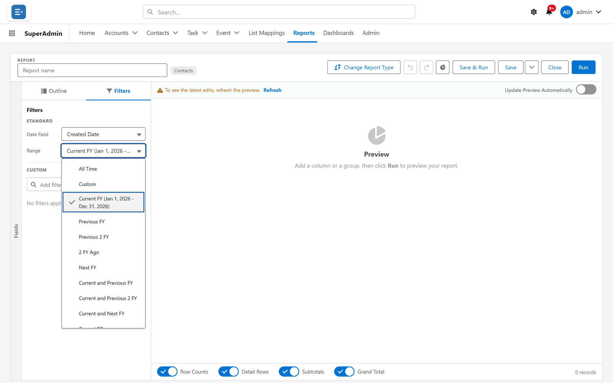

# Date ranges

**What it is.** The **Range** among a report's **Standard** filters: which dates of one date field
the report includes.

**What it does.** You pick a field — Created Date, a task's Date, a contact's account's Created
Date — and a range such as **Current FQ** or **Last 30 Days**. Only records whose date falls inside
the range are counted.

**Why it helps.** A range moves with the calendar, so **Previous CQ** is still right next quarter
without anybody editing the report. Each range has the same name, and covers the same days, as the
range of that name in a Salesforce report, so the two count the same records.

## Choosing a range

**Where:** In the portal → the builder → **Filters** → **Standard** → **Date Field** and **Range**

1. Open the report in the builder and click the **Filters** tab.
2. Under **Standard**, choose the **Date Field**. Every date and date/time field the report offers
   is listed, including one on a related record — an activity's contact, a contact's account.
   **— No date filter —** switches the date filter off.
3. Choose the **Range**: **All Time**, **Custom**, or one of the 49 ranges [below](#every-range),
   in the order Salesforce lists them.
4. The range you chose shows the days it covers today, for example
   **Current and Next FY (Jan 1, 2026 - Dec 31, 2027)**.
5. Click **Save**.

Somebody reading the report can change the range for themselves in its **Filters** panel, under
**Standard**. That change is not saved — see
[Running a report](./running.md#changing-what-it-shows-just-for-now).

## Custom dates

Choose **Custom**, then fill in **Start**, **End** or both. The range then reads:

| You fill in | It reads, for example | It covers |
|---|---|---|
| **Start** only | **On or after Nov 3, 2025** | that day and every day after it |
| **End** only | **On or before Dec 31, 2025** | that day and every day before it |
| Both | **Nov 3, 2025 - Dec 31, 2025** | both days and every day between |
| Neither | **Custom** | every date — no date filter |

Both ends count, on a date/time field too: an **End** of 31 December includes the whole of
31 December.

## Every range

The examples are for Thursday 12 November 2026, with a fiscal year that starts in January and a
week that starts on Sunday.

### Fiscal years

| Range | Covers | On 12 Nov 2026 |
|---|---|---|
| **Current FY** | the fiscal year today falls in | Jan 1 – Dec 31, 2026 |
| **Previous FY** | the fiscal year before the current one | Jan 1 – Dec 31, 2025 |
| **Previous 2 FY** | the two fiscal years before the current one, not the current one | Jan 1, 2024 – Dec 31, 2025 |
| **2 FY Ago** | only the fiscal year two before the current one | Jan 1 – Dec 31, 2024 |
| **Next FY** | the fiscal year after the current one | Jan 1 – Dec 31, 2027 |
| **Current and Previous FY** | the previous fiscal year and the current one | Jan 1, 2025 – Dec 31, 2026 |
| **Current and Previous 2 FY** | the current fiscal year and the two before it | Jan 1, 2024 – Dec 31, 2026 |
| **Current and Next FY** | the current fiscal year and the next one | Jan 1, 2026 – Dec 31, 2027 |

### Fiscal quarters

| Range | Covers | On 12 Nov 2026 |
|---|---|---|
| **Current FQ** | the fiscal quarter today falls in | Oct 1 – Dec 31, 2026 |
| **Current and Next FQ** | the current fiscal quarter and the next one | Oct 1, 2026 – Mar 31, 2027 |
| **Current and Previous FQ** | the previous fiscal quarter and the current one | Jul 1 – Dec 31, 2026 |
| **Next FQ** | the fiscal quarter after the current one | Jan 1 – Mar 31, 2027 |
| **Previous FQ** | the fiscal quarter before the current one | Jul 1 – Sep 30, 2026 |
| **Current and Next 3 FQ** | the current fiscal quarter and the three after it | Oct 1, 2026 – Sep 30, 2027 |

### Calendar years

| Range | Covers | On 12 Nov 2026 |
|---|---|---|
| **Current CY** | this year, 1 January to 31 December | Jan 1 – Dec 31, 2026 |
| **Previous CY** | last year | Jan 1 – Dec 31, 2025 |
| **Previous 2 CY** | the two years before this one, not this one | Jan 1, 2024 – Dec 31, 2025 |
| **2 CY Ago** | only the year two before this one | Jan 1 – Dec 31, 2024 |
| **Next CY** | next year | Jan 1 – Dec 31, 2027 |
| **Current and Previous CY** | last year and this year | Jan 1, 2025 – Dec 31, 2026 |
| **Current and Previous 2 CY** | this year and the two before it | Jan 1, 2024 – Dec 31, 2026 |
| **Current and Next CY** | this year and next year | Jan 1, 2026 – Dec 31, 2027 |

### Calendar quarters

A calendar quarter is January–March, April–June, July–September or October–December.

| Range | Covers | On 12 Nov 2026 |
|---|---|---|
| **Current CQ** | the quarter today falls in | Oct 1 – Dec 31, 2026 |
| **Current and Next CQ** | this quarter and the next one | Oct 1, 2026 – Mar 31, 2027 |
| **Current and Previous CQ** | the previous quarter and this one | Jul 1 – Dec 31, 2026 |
| **Next CQ** | the quarter after this one | Jan 1 – Mar 31, 2027 |
| **Previous CQ** | the quarter before this one | Jul 1 – Sep 30, 2026 |
| **Current and Next 3 CQ** | this quarter and the three after it | Oct 1, 2026 – Sep 30, 2027 |

### Months

| Range | Covers | On 12 Nov 2026 |
|---|---|---|
| **Last Month** | the calendar month before this one | Oct 1 – Oct 31, 2026 |
| **This Month** | this calendar month | Nov 1 – Nov 30, 2026 |
| **Next Month** | the calendar month after this one | Dec 1 – Dec 31, 2026 |
| **Current and Previous Month** | last month and this month | Oct 1 – Nov 30, 2026 |
| **Current and Next Month** | this month and next month | Nov 1 – Dec 31, 2026 |

### Weeks

| Range | Covers | On 12 Nov 2026 |
|---|---|---|
| **Last Week** | the week before this one | Nov 1 – Nov 7, 2026 |
| **This Week** | the week today falls in | Nov 8 – Nov 14, 2026 |
| **Next Week** | the week after this one | Nov 15 – Nov 21, 2026 |

### Days

| Range | Covers | On 12 Nov 2026 |
|---|---|---|
| **Yesterday** | the day before today | Nov 11, 2026 |
| **Today** | today | Nov 12, 2026 |
| **Tomorrow** | the day after today | Nov 13, 2026 |
| **Last 7 Days** | 7 days ending today, today included | Nov 6 – Nov 12, 2026 |
| **Last 30 Days** | 30 days ending today | Oct 14 – Nov 12, 2026 |
| **Last 60 Days** | 60 days ending today | Sep 14 – Nov 12, 2026 |
| **Last 90 Days** | 90 days ending today | Aug 15 – Nov 12, 2026 |
| **Last 120 Days** | 120 days ending today | Jul 16 – Nov 12, 2026 |
| **Next 7 Days** | 7 days starting today, today included | Nov 12 – Nov 18, 2026 |
| **Next 30 Days** | 30 days starting today | Nov 12 – Dec 11, 2026 |
| **Next 60 Days** | 60 days starting today | Nov 12, 2026 – Jan 10, 2027 |
| **Next 90 Days** | 90 days starting today | Nov 12, 2026 – Feb 9, 2027 |
| **Next 120 Days** | 120 days starting today | Nov 12, 2026 – Mar 11, 2027 |

## How the days are worked out

- **Fiscal** ranges (FY and FQ) follow the fiscal year your organisation has set up in Salesforce,
  custom fiscal years included. **Calendar** ranges (CY, CQ, months and weeks) follow the calendar.
- A week starts on the first day of the week for the portal's locale: Sunday for English (United
  States), Monday for English (United Kingdom).
- **Today** is today in the portal's time zone — the one it shows times in. On a date/time field a
  day means that whole day, midnight to midnight, in the same time zone.
- **Last N Days** ends today and **Next N Days** starts today, so each covers exactly N days.
- A **Birthdate** is compared as an ordinary date, year included, as Salesforce's reports compare
  it. **Current CY** on a Birthdate finds people born this year, not people whose birthday falls
  this year.

## Reports saved with older range names

A report whose range was saved under an older name opens with Salesforce's name for it:
**This Year** is now **Current CY**, **Last Year** is **Previous CY**, **This Quarter** is
**Current CQ** and **Last Quarter** is **Previous CQ**.

A range Salesforce does not offer, such as **Last 14 Days**, keeps its own entry at the end of the
list and is read the same way as its neighbours: **Last 14 Days** is the 14 days ending today.

## Relative values in other filters

A [custom filter](./filters.md#date-filters) on a date field, and a
[dashboard filter](../dashboards/filters.md#relative-dates), offer a shorter list of relative
values such as **This Month** or **Last 30 Days**. Those are read the way Salesforce reads a
relative value in a field filter, which is not quite the same as the **Range** on this page:

| Value | In a custom or dashboard filter | As the **Range** |
|---|---|---|
| **Last 7 Days** (and the other "Last … Days") | today and the 7 days before it — eight days | 7 days ending today |
| **Next 30 Days** (dashboard filters only) | the 30 days starting tomorrow | 30 days starting today |
| **This Year**, **This Quarter** | the calendar year or quarter | the same, named **Current CY** and **Current CQ** |
| Any value, on a **Birthdate** | the year is ignored: **This Month** finds this month's birthdays | the year counts |

## What goes wrong

| Symptom | Cause |
|---|---|
| The range shows its name but no dates beside it | The portal could not work the dates out just then. The range itself still applies. |
| **Last 7 Days** as the **Range** finds fewer records than a custom filter's **Last 7 Days** | The **Range** counts 7 days ending today. A custom filter counts today and the 7 days before it. |
| **Current CY** on a Birthdate finds almost nobody | It finds people born this year, not this year's birthdays. |
| An FY range does not match the calendar year | Your organisation's fiscal year starts in another month, or uses custom fiscal periods. |
| A record made close to midnight is counted on the day before or after the one you expected | Days are counted in the portal's time zone, which may not be yours. |

## Where this fits

| | |
|---|---|
| [Report filters](./filters.md) | custom filters, their operators, and locked filters |
| [Filter logic](./filter-logic.md) | combining custom filters — the date range always applies on top |
| [Running a report](./running.md) | changing the range for now, in the **Filters** panel |
| [Dashboard filters](../dashboards/filters.md) | relative dates on a dashboard |
