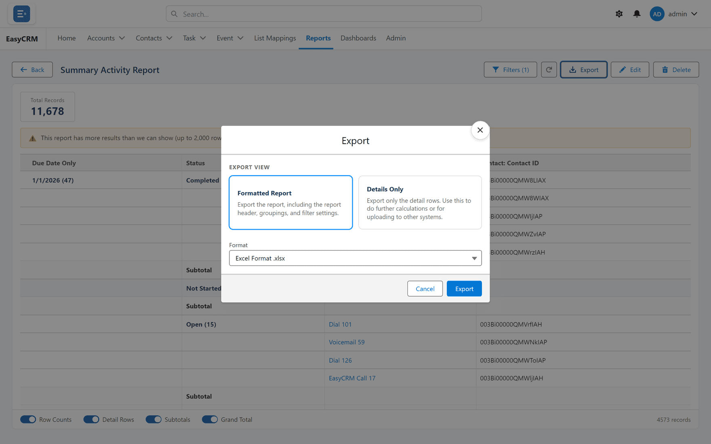
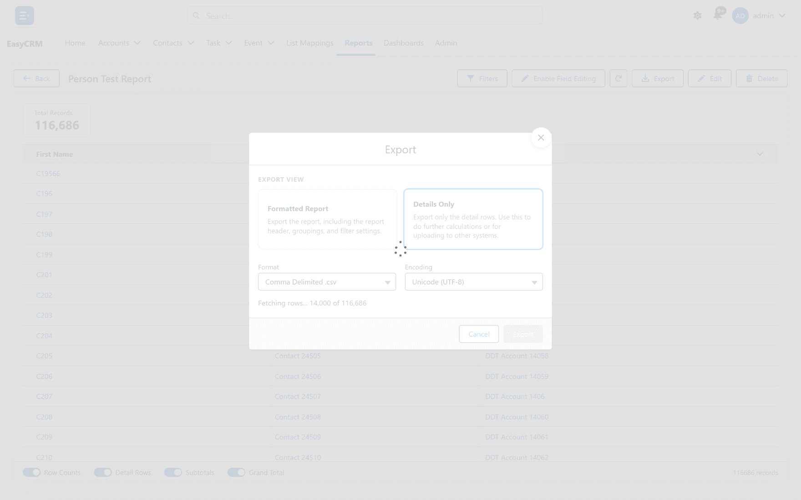

# Exporting a report

**What it is.** Downloading a report as a spreadsheet file.

**What it does.** It writes the report to a file you can open in Excel or Google Sheets.

**Why it helps.** For sending to somebody without a portal login, or for working on the
numbers somewhere else.

## Exporting

**Where:** In the portal → **Reports** → a folder → the report's name → **Export**

1. Click **Reports** in the top menu.
2. Click the folder, then the report's **name**. It runs.
3. Click **Export** at the top. The **Export** box opens.
4. Under **Export View**, choose **Formatted Report** or **Details Only**.

   

5. Choose a **Format**.
6. For a **Comma Delimited .csv** file, choose an **Encoding** too.
7. Click **Export**.

The file downloads through your browser, like any other download, named after the report.

**Export** is not offered on the result of a **Run** from the builder — save the report first.

## The two kinds

| Kind | What you get | Formats | Use it when |
|---|---|---|---|
| **Formatted Report** | The report as it is laid out — title, groups, subtotals and totals. | **Excel Format .xlsx** | It is the finished thing. |
| **Details Only** | Just the records, in rows and columns, no grouping. | **Excel Format .xlsx**, **Excel Format .xls**, **Comma Delimited .csv** | It is a starting point for more work. |

**Details Only** is nearly always the right choice if the spreadsheet is going to be sorted,
filtered or pivoted. Group headings get in the way of all three. On a matrix report it exports
the records behind the grid.

### Encodings for a CSV file

| Encoding | Choose it when |
|---|---|
| **Unicode (UTF-8)** | Almost always. The default. |
| **ISO-8859-1 (General US & Western European)** | An older system that cannot read UTF-8. |
| **Unicode (UTF-16)** | The program receiving it asks for UTF-16. |

## What gets exported

**The report as it was saved — not what is on your screen.**

None of these reach the file:

- filter values you changed in the **Filters** panel;
- sorting, grouping or removing columns while reading;
- a filter added by clicking a dashboard chart;
- a dashboard's filters, when you opened the report from a dashboard;
- values you have staged with field editing but not saved.

So if you narrowed the report before exporting, the file is **not** narrowed. To export a
narrower set, change the report in the builder (or **Save As** a copy with the filters you want)
and export that.

## Big reports

**Details Only**, and a **Formatted Report** of a tabular report, export every row — up to:

| Format | Most rows |
|---|---|
| **Excel Format .xlsx** or **.xls** | 1,048,575 — the most an Excel sheet holds |
| **Comma Delimited .csv** | 5,000,000 |

A large export takes a while. The box shows how far it has got —
**Fetching rows... 24,000 of 116,686** — then **Building the file...**. **Export** is greyed out
while it runs, so a second click cannot start a second export. Closing the box stops it.

When the file is ready it downloads by itself and the box closes. If your browser blocks that,
the box stays open and says **Your export is ready** — with the number of rows, when it knows
it — and a **Download file** link. Click the link.

A **Formatted Report** of a summary or matrix report is built by the portal's server instead.
Your browser may open a new tab briefly to download it. If the report is too big to total in one
go, its exact totals are worked out first, in steps, and then the file is built, so the file's
totals are exact too. That takes longer.

## What the messages mean

| Message | What it means |
|---|---|
| **This export holds the first N rows - the most an Excel sheet can hold. Choose CSV for more.** | The report has more rows than Excel allows. Export again as **Comma Delimited .csv** to get them all. |
| **This export holds the first N rows - the most this browser export allows.** | A CSV reached its 5,000,000-row limit. Add a filter to the report and export in parts. |
| **Some rows could not be read past the first page, so this export may be incomplete.** | Part of the report could not be read while exporting. Export again; if it repeats, narrow the report. |
| **Your export is ready (N rows).** or **Your export is ready.** | Your browser blocked the automatic download. Click **Download file**. |
| **The exact totals could not be finished. Please try the export again.** | A **Formatted Report** of a big summary or matrix report could not finish its totals. Export again. |

## A word about what leaves the portal

An exported file is an ordinary spreadsheet. Nothing in it is protected any more — no sharing
rules, no permissions. Anybody who gets the file sees everything in it.

Think about that before exporting anything with personal data, and prefer sharing the report
itself where you can — see [Sharing a report](./sharing.md).

## What goes wrong

| Symptom | Cause |
|---|---|
| The file has more rows than you were looking at | Export uses the saved report, not your on-screen filters, sorts, chart click or dashboard filters. |
| The file stops at 1,048,575 rows | That is the most an Excel sheet holds. Choose **Comma Delimited .csv**. |
| Accented letters look wrong in the CSV | The program opening it expected another encoding. Export again with a different **Encoding**. |
| There is no **Export** button | You are looking at an unsaved **Run** from the builder. Save the report first. |
