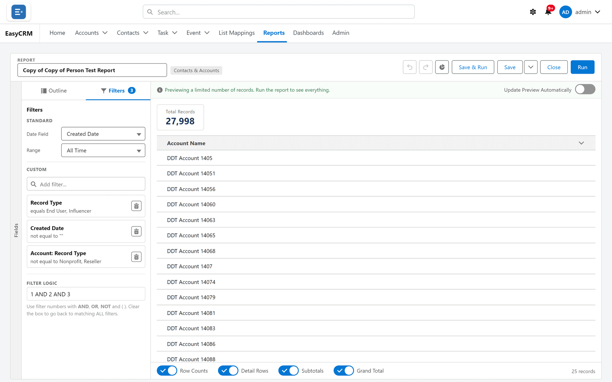
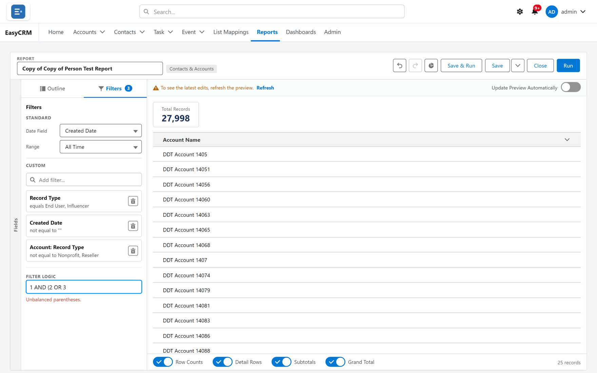

# Filter logic

## What it is

A rule that says how your filters combine. By default every filter must match. Filter logic
lets you say "either of these" or "this but not that".

## When you need it

The moment a question contains **or**, or **except**.

"Open opportunities in the North **or** the West." "Every account **except** the ones we
already contacted." Neither is expressible with filters alone, because filters are joined with
*and*.

**When not to:** if all your conditions must be true, leave it alone. A rule you did not need is
a rule somebody has to understand later.

## The Filter Logic box

There is no button to press. The **Filter Logic** box sits below your filters in the
**Filters** tab as soon as the report has a filter.

- With two or more filters and nothing typed, the box is filled in with what happens anyway —
  `1 AND 2 AND 3`. Left as it is, it is not saved into the report, so a filter you add later is
  still included.
- Type into the box and the rule is yours. It stays exactly as you typed it. That filled-in text
  is real text in the box, so **clear it first**: clicking in and typing adds to it, and
  `1 AND 2 AND 3` followed by your rule cannot be read.
- Typing just `OR` means any one filter will do.
- Below it: **Use filter numbers with AND, OR, NOT and ( ). Clear the box to go back to matching
  ALL filters.**

## Writing a rule

**Where:** In the portal → **Reports** → a folder → the report's name → **Edit** → **Filters** → **Filter Logic**

1. Open the report in the builder.
2. Click the **Filters** tab.
3. Add the filters you need first. Each takes a number, shown on its card, in the order you add
   it.
4. Click in the **Filter Logic** box below them and delete what is in it.
5. Type a rule using those numbers.

If the rule cannot be read, a message replaces the hint under the box — see
[What goes wrong](#what-goes-wrong). Save the report to keep the rule.

## The operators

| Operator | Means | Example |
|---|---|---|
| **AND** | Both must be true | `1 AND 2` |
| **OR** | Either will do | `1 OR 2` |
| **NOT** | Must not be true | `1 AND NOT 2` |
| **( )** | Do this part first | `1 AND (2 OR 3)` |

Brackets work exactly as they do in arithmetic, and they matter just as much:

| Rule | Means |
|---|---|
| `1 AND 2 OR 3` | Ambiguous. Avoid writing this. |
| `(1 AND 2) OR 3` | Both 1 and 2 — or else 3 on its own. |
| `1 AND (2 OR 3)` | 1 always, plus either 2 or 3. |

**Bracket anything with an OR in it.** It costs nothing and removes the ambiguity.

The [standard filters](./filters.md#standard-filters) — the date range, and on activity reports
**Show** and **Type** — always apply on top of the rule. They have no numbers.

## A worked example

You want open opportunities, in the North or the West, that are not already marked lost.

| # | Filter |
|---|---|
| 1 | Stage equals Open |
| 2 | Region equals North |
| 3 | Region equals West |
| 4 | Status equals Lost |

Rule: `1 AND (2 OR 3) AND NOT 4`

## A shortcut worth knowing

For several values of the **same field**, you usually do not need logic at all. One filter
with several values — Region equals North, West — matches any of them.

Reach for filter logic when the OR spans **different fields**.

## Filter logic and hidden fields

If a report with filter logic filters on a field that is hidden from somebody, the report
cannot simply leave that filter out for them, so it refuses to run for that person with
**Invalid Report. You cannot run this report because its formulas or filters are invalid or it
references fields that are inaccessible to you. Please contact your administrator to update the
report.** Without filter logic, the filter is just left out. See
[Running a report](./running.md#fields-you-are-not-allowed-to-see).

## What goes wrong

| Symptom | Cause |
|---|---|
| **Unbalanced parentheses.** | A bracket is opened and not closed, or closed and never opened. |
| **Filter 4 doesn't exist (you have 3).** | A number with no matching filter — usually after deleting one. Renumber the rule. |
| **Unexpected "XOR" in filter logic.** | Something that is not a filter number, **AND**, **OR**, **NOT** or a bracket. |
| Far more records than expected | An unbracketed OR. `1 AND 2 OR 3` often means "or everything in 3". |
| Far fewer than expected | ANDs that cannot all be true at once — Region equals North AND Region equals West. |
| The rule stops working | A filter was removed and the numbers shifted. Logic does not renumber itself. |

**Delete a filter, re-read the rule.** That is the single most common way a working report
quietly starts returning the wrong set.

## Where this fits

Filter logic refines what [Filters](./filters.md) include. The same AND/OR/NOT grammar is used
when [filtering a list](../records/filtering.md), so learning it once covers both.
