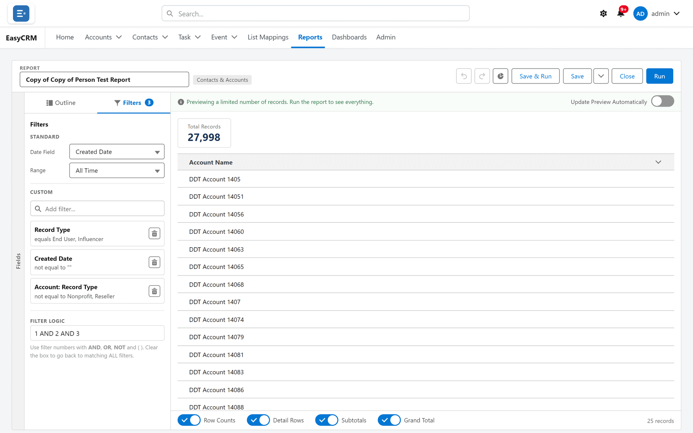
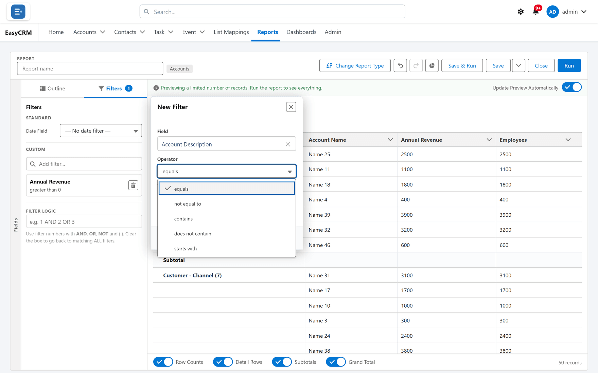
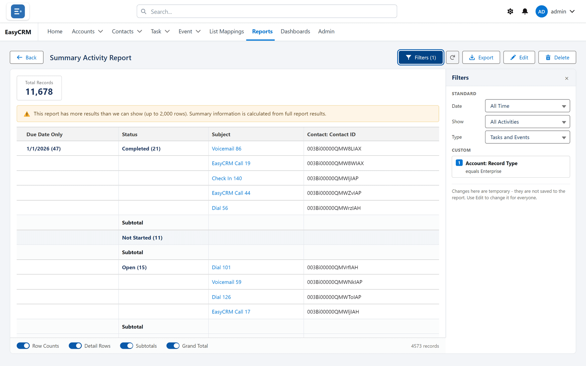

# Report filters

**What they are.** The rules that decide which records a report includes.

**What they do.** A filter keeps the rows you want and drops the rest, before any grouping or
totalling happens.

**Why it helps.** A report with no filters answers "everything". Most useful questions are
narrower: this quarter, this owner, this status.

## Adding a filter

**Where:** In the portal → the builder → **Filters** → **Add filter...**

1. Open the report in the builder — see [The report builder](./builder-tour.md).
2. Click the **Filters** tab at the top left.

   

3. Click the **Add filter...** box under **Custom** and type part of the field's name.
4. Click the field. The **New Filter** box opens with that field chosen.
5. Choose the **Operator** — how to compare: equals, contains, greater than, and so on.
6. Set the **Value** — what to compare it to. For a picklist or record type, tick one or more
   values in the list (**Search values...** narrows it); several ticked values mean *any of
   these*.
7. Tick **Locked** if readers must not change this filter — see [Locked filters](#locked-filters).
8. Click **Apply**.

The filter appears as a card, and the preview re-runs with fewer records.

By default a record must match **every** filter you add.

A report can have up to **20** filters. Adding a 21st is refused: **A report can have at most 20
filters, the same limit Salesforce enforces.**

### Changing or removing one

- Click the filter's card. The **Edit Filter** box opens. Change it and click **Apply**. To
  filter on a different field, click the **✕** beside the field's name (**Clear field**) and
  pick another.
- Click the bin on a card (**Remove**) to delete that filter.

## Standard filters

Above the **Custom** filters sit the **Standard** ones every report has:

| Filter | Choices |
|---|---|
| **Date Field** | Any date field on the report, or **— No date filter —**. |
| **Range** | **All Time**, **Custom…** (two dates of your own), fiscal and calendar years, quarters, months and weeks, **Today**, **Yesterday**, and **Last 7 Days** to **Last 90 Days**. |
| **Show** (Activities only) | **All Activities**, **Open**, **Completed**. |
| **Type** (Activities only) | **Tasks and Events**, **Tasks only**, **Events only**. |

Standard filters always apply. [Filter logic](./filter-logic.md) only combines the custom ones.

## Filter logic

Each custom filter has a number — 1, 2, 3 — in the order you added them. The **Filter Logic**
box below the filters says how they combine: type a rule such as `1 AND (2 OR 3)`. Leave it
blank and every filter must match. See [Filter logic](./filter-logic.md).

## Date filters

A custom filter on a date offers ranges that move with time: **Today**, **Yesterday**,
**This Week**, **Last Week**, **This Month**, **Last Month**, **This Quarter**,
**Last Quarter**, **This Year**, **Last Year**, and **Last 7 Days**, **Last 14 Days**,
**Last 30 Days** or **Last 90 Days**. "Last quarter" stays correct next month without anybody
editing the report.

Choose **Specific date…** when you need an exact date that should not move.

## Which operators each kind of field has

| Field | Operators |
|---|---|
| Text | equals, not equal to, less than, greater than, less or equal, greater or equal, contains, does not contain, starts with |
| Picklist | equals, not equal to, contains, does not contain, starts with |
| Multi-select picklist | equals, not equal to, includes, excludes |
| Long text and rich text | equals, not equal to, contains, does not contain, starts with — see [below](#long-text-fields) |
| Number, currency, percent, date, date/time | equals, not equal to, less than, greater than, less or equal, greater or equal |
| Time | the same six. Type a time such as 08:30 or 2:15 PM. |
| Checkbox | equals, not equal to |
| Lookup | equals, not equal to, contains, does not contain |
| Record type | equals, not equal to |
| Record ID | equals, not equal to, starts with |

**includes** on a multi-select picklist matches a record holding *any* of the values you give;
**excludes** matches a record holding *none* of them. An older filter saved with "contains" on
a multi-select field now reads as **includes**, and "does not contain" as **excludes**.

An encrypted field Salesforce cannot filter is not offered as a filter at all.

## Long text fields

You can filter on long text fields — a Description, an activity's Comments (**Full Comments**),
or a long text field your company added — exactly as Salesforce's own reports do:

- Only the **start** of the text is compared: the first 1,000 characters of a standard field,
  the first 255 of a custom one. A word further in than that is not found.
- **Capitals are ignored.**
- **equals** compares that whole opening stretch with your value, so it rarely matches
  anything but short text. **contains** is usually what you want.
- A **blank** value with **equals** finds records where the field is empty; with **not equal
  to**, records where it is not.
- Several values separated by commas: **equals**, **contains** and **starts with** match *any*
  of them; **not equal to** and **does not contain** match *none* of them.
- A **rich text** field is compared as its underlying formatting code, the first 254
  characters. On rich text, **equals** and **starts with** a value match nothing, as in
  Salesforce. Use **contains**.

Salesforce's database cannot search long text, so the portal checks each record itself. Up
to 40,000 records matching the report's *other* filters, it does so as the report runs. Above
that,
the portal keeps a prepared copy of the field's text so it can still answer; the first report to
need one takes noticeably longer while it is prepared. A Super Admin can switch prepared copies
off — see [Long text filters on large reports](../../admin/operations/long-text-filters.md).
With them off, such a report is refused instead (see below).

## Filtering a report while you read it

You do not have to open the builder to narrow a report you are looking at.

1. Open the report.
2. Click **Filters**.
3. Click a filter's card, change its value, and click **Apply**.

This changes only your view, and only until you leave the page. The saved report is untouched.
See [Running a report](./running.md#changing-what-it-shows-just-for-now).

## Locked filters

Some filters are set by whoever built the report and cannot be changed or removed by anybody
reading it. They are how a report meant for one company stays limited to that company.

To lock one, tick **Locked** in its **New Filter** or **Edit Filter** box — "A locked filter
can't be changed when the report is viewed." The card then shows a padlock.

If a filter will not change while you are reading a report, it is locked. Ask whoever owns the
report.

## What goes wrong

| Message | What it means |
|---|---|
| **A report can have at most 20 filters, the same limit Salesforce enforces.** | Remove a filter, or combine several values into one filter. |
| **This report filters on "…", and it is a long text field, which Salesforce's database cannot search, so the portal checks each record itself. More than 40,000 records match the report's other filters, which is more than it can check at once. Add a filter that narrows the report (a date range, record type or owner, for example) and run it again.** | Prepared copies are switched off and too many records need checking. Add a narrowing filter. (The number can be lower than 40,000 when the report is already reading a lot.) |
| **This report has more filters on long text fields than the portal can apply at once (20). Remove some of them, or combine them, and run it again.** | Too many long text filters in one report. |
| **This report filters on "…" across more records than one request can read, so the portal is getting a quick way to check them ready. Run the report again in a few seconds.** | A prepared copy was not ready yet. Run it again shortly. |
| **The filter on "…" uses "…", which can't be used on a long text field. Salesforce allows "equals", "not equal to", "contains", "does not contain" or "starts with" here - edit the filter and pick one of those.** | Usually a report brought across from Salesforce. Edit the filter and pick one of those operators. |
| **"…" is an encrypted field. Salesforce does not allow filtering on encrypted fields, so this filter cannot run - remove it from the report.** | Remove that filter. |
| **The filter on "…" has "…", which isn't a time. Use a time such as 08:30 or 2:15 PM.** | Retype the time. |
| **The filter on "…" uses "…" with several times. It takes one time - edit the filter and keep one.** | Only **equals** and **not equal to** take a list of times. |
| **The filter on "…" has "…", which isn't a record ID. A record ID is 15 or 18 characters long, such as 001D000000IqhSL - or use "starts with" for part of one.** | Paste the whole ID, or use **starts with**. |
| **The filter on "…" uses "…", which can't be used on a date field.** (or a number field, a checkbox, a time field, a multi-select picklist, a record ID) — followed by the operators allowed | The operator does not suit that kind of field. Edit the filter and pick one of those listed. |
| **This report could not run: Salesforce rejected one of its filters or columns (…). Check the report's filters, or remove the one named here, and run it again.** | Salesforce refused part of the report. The detail in brackets names it. |
