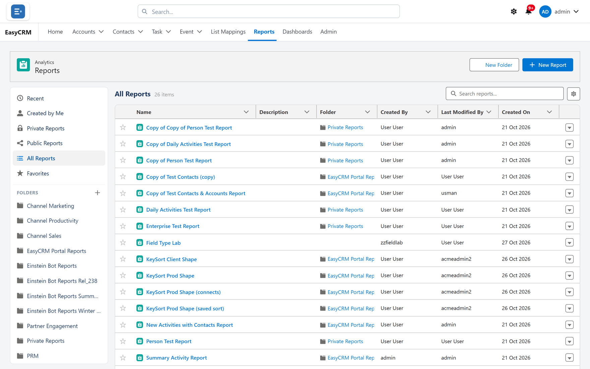

# Finding a report

**What a report is.** A saved question about your data.

**What it does.** It gathers the records matching your rules and shows them, grouped and
totalled however you chose.

**Why it helps.** You build it once and open it whenever you need the answer. It reads your data
when it runs. To open quickly, the portal may show a result it worked out within the last 24 hours
(unless your administrator has set reports to always run live). Refresh the report to get the
latest numbers. See [Running a report](./running.md).

## Opening the reports area

**Where:** In the portal → **Reports** in the top menu

1. Click **Reports** in the row of tabs across the top.
2. The reports area opens on **Recent**.

<!-- SHOT-RETAKE: ../../img/shots/analytics/reports-list.png | the list now has a gear (Select Fields to Display) beside the search box, which this capture lacks. Retake: Reports tab, All Reports selected, list sorted by Name, one report starred, gear visible -->

The **Dashboards** tab works the same way. Everything on this page applies there too. The
differences are the names (**Private Dashboards**, **All Dashboards** and so on) and that the
**Report Type** and **Chart Type** columns are not offered.

## What you are looking at

The screen has two parts.

**On the left: views, then folders.** The views at the top are fixed ways of filtering the list.
Below them, under **Folders**, are the folders you can see. If you can see none, it says
**No folders yet**.

| View | What it lists |
|---|---|
| **Recent** | Every report you can open, newest change first. It is sorted by when the report was last modified, not by when you opened it. |
| **Created by Me** | Reports you own. |
| **Private Reports** | Reports you can open whose **Shared (visible to all portal users)** box is unticked. |
| **Public Reports** | Reports you can open whose **Shared (visible to all portal users)** box is ticked. |
| **All Reports** | Every report you can open, A–Z by name. It holds the same reports as **Recent**. |
| **Favorites** | Reports you have starred. |
| A folder | Reports you can open that are saved in that folder. |

A Super Admin can open every report, so their **Private Reports** view lists everybody's
private reports, not only their own.

**Private Reports** and **Public Reports** only check the **Shared** box. A report shared with
your company through its **Visibility** setting still shows under **Private Reports**. See
[Sharing a report](./sharing.md).

**On the right: the list** for the view or folder you picked. Its name and a count, such as
**21 items**, sit above it.

## Searching

Type in the **Search reports...** box above the list.

- It matches the name **or** the description.
- It searches only the view or folder you are in. To search everything, pick **All Reports**
  first.
- The count above the list changes to the number of matches.

## The list's columns

The first column is the star and the last is the row menu (▾). The columns in between are yours
to choose. By default they are **Name**, **Description**, **Folder**, **Created By**,
**Last Modified By** and **Created On**.

| Column | Shows |
|---|---|
| **Name** | The report's name, as a link. It is always shown. |
| **Description** | The description set in **Edit Properties**. |
| **Folder** | The folder, as a link. Click it to jump to that folder. |
| **Report Type** | The object the report is built on, as Salesforce names it (for example **Contact** or **Activity**). Reports tab only. |
| **Chart Type** | The report's chart, or **Table** when it has none. Reports tab only. |
| **Owner** | The portal username of the person who owns it. |
| **Visibility** | **Public** or **Private**: whether the **Shared** box is ticked. |
| **Created By** | The person who created it. This is a portal user, or a Salesforce user for a report that came from Salesforce. |
| **Last Modified By** | The person who last changed it. |
| **Created On** | The day it was created, for example Oct 30, 2026. Dates follow your browser's language. |
| **Last Modified On** | The day it was last changed. |

## Choosing which columns show

**Where:** In the portal → **Reports** → the gear beside the search box

1. Click the gear (**Select Fields to Display**). A box of the same name opens.
2. Move fields between **Available** and **Selected**.
3. Put them in order. *The order in "Selected" sets the column order. Use the arrows to reorder.*
4. Click **Apply**.

<!-- SHOT: analytics/list-columns-popover.png | Reports tab signed in as an Admin, gear clicked, "Select Fields to Display" box open with Owner and Visibility moved into Selected and the "Save as default columns for all users" tick visible -->

**Name** cannot be removed.

**Admins and Super Admins** also see **Save as default columns for all users**. Tick it before
**Apply** and the columns become the default for everybody, with the message
**Default columns saved for all users.**

Which columns a person sees:

1. their own choice, if they have made one in this browser
2. otherwise the default an admin saved
3. otherwise the built-in set above

So an admin's default does not override anyone who has already chosen their own.

## Sorting and widening columns

- **To sort:** click a column header. Click it again to reverse the order. Blank values always go
  last.
- **To widen or narrow:** drag the edge of a column header.

Until you click a header, **Recent** is sorted newest change first and every other view is sorted
A–Z by name. Once you click a header, that sort applies in **every** view, including **Recent**,
until you click a different one.

## What is remembered, and where

| What | Kept | So |
|---|---|---|
| Your columns, your sort, your column widths | In this browser, for you, separately for Reports and Dashboards | On another computer or browser you start from the admin default |
| The admin's default columns | On the server | Everyone who has not chosen their own sees it, everywhere |
| Your stars | On your portal user | They follow you to any browser |

## Opening a report

1. Click a view or folder on the left.
2. Click the report's **name**.

The name is a real link. Ctrl+click it, or click it with the middle mouse button, to open the
report in a new browser tab. **Open** in the row menu does the same as a plain click.

See [Running a report](./running.md).

## Starring a report you use often

1. Find the report in the list.
2. Click the **star** in the first column (tooltip **Favorite**). The row menu's **Favorite** does
   the same.
3. It now appears under **Favorites** on the left.

Click the star again to remove it. The menu item is labelled **Favorite** either way. It switches
the star on or off.

Stars are saved on your portal user, so they follow you to any computer.

## The row menu

Click ▾ at the end of a row.

<!-- SHOT: analytics/list-row-menu.png | Reports tab, All Reports, the ▾ row menu open on one report showing Open, Edit, Edit Properties, Clone, Favorite, Delete -->

| Item | What it does |
|---|---|
| **Open** | Opens the report. |
| **Edit** | Opens it in the builder. You need edit access. Otherwise a message says you have read-only access. |
| **Edit Properties** | Changes the name, description, folder and **Shared** box. See [Folders](./folders.md#moving-a-report-into-a-folder). |
| **Clone** | Opens the builder on a new, unsaved copy named "<name> (copy)". Read access is enough. The copy is yours and starts private. Nothing is stored until you save it. |
| **Favorite** | Turns the star on or off. |
| **Delete** | Asks **Delete this report?** in a browser box. **OK** deletes it for everybody. You need edit access. |

If you only have read access, **Delete** is refused with:
**You have read-only access to this report, so it cannot be deleted. Ask its owner or a Super Admin.**

## Reports synced from Salesforce

Below the list, both tabs can show a section headed **Synced from Salesforce**. It holds cards
for Salesforce reports that an administrator added to the portal as a snapshot. On the
**Dashboards** tab you see only the ones they also marked for the dashboard.

Each card shows the report's name, **Updated** with the date and time of its last refresh, and
the stored result as a bar, column or pie chart or a table. If there is nothing to draw it says
**No data.**

These cards are a picture taken in Salesforce, not live reports. They do not open, they do not
follow the folders or views on the left, and every portal user sees the same cards. When nothing
has been synced, the section does not appear at all.

## Making a folder

Only Admins and Super Admins can make folders. See [Folders](./folders.md#making-a-folder).

## If you cannot find a report somebody mentioned

The list only ever shows reports you can open. If the report is not under **All Reports**, it
has not been shared with you. Being in a folder you can see does not share a report with you.

Ask the report's owner to set its **Visibility** to **My company**. Then ask an Admin at your
company to share it with you. See [Sharing a report](./sharing.md).

## What goes wrong

| Symptom | Cause |
|---|---|
| **Recent** does not show the report I opened this morning | **Recent** is sorted by when a report was last *changed*, not opened. Star the ones you use. |
| **Recent** is not newest first | You clicked a column header earlier, and that sort now applies everywhere. Click **Last Modified On** (twice, for newest first). |
| Search finds nothing, and the screen says **No reports yet. Click “New Report” to build one.** | That message appears whenever the list is empty, including when a search has no match. Clear the search box, or move to **All Reports**. |
| My columns are back to the default | You are in a different browser, or the browser's stored data was cleared. Your columns are kept per browser. |
| There is no **New Folder** button | Only Admins and Super Admins can make folders. |
| A report shows under **Private Reports** although my company can see it | Those two views only check the **Shared** box, not the company **Visibility** setting. |
| **Delete** or **Edit** says I have read-only access | It was shared with you for reading. Use **Clone** to make your own copy. |

## Where this fits

| | |
|---|---|
| [Running a report](./running.md) | what happens once it opens |
| [Folders](./folders.md) | making folders and moving reports between them |
| [Sharing a report](./sharing.md) | who else can find it |
| [Viewing a dashboard](../dashboards/viewing.md) | the Dashboards tab, once a dashboard is open |
