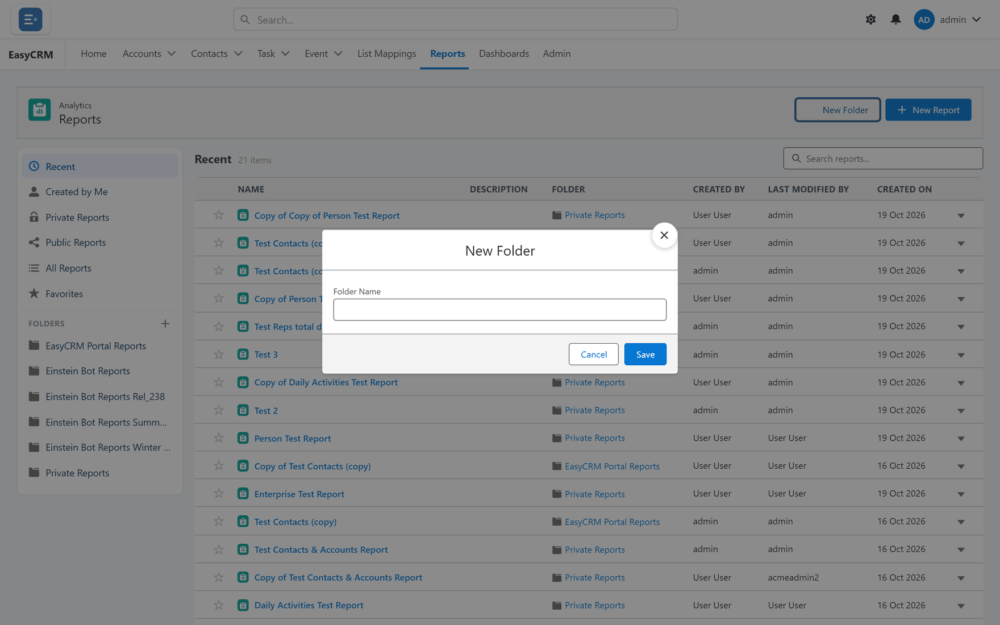
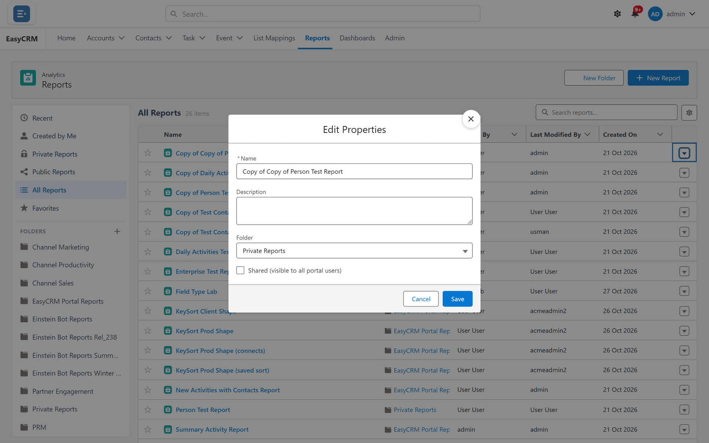

# Folders

**What it is.** Folders hold reports and dashboards so a long list can be sorted into groups.

**What it does.** A report or dashboard sits in one folder, or in none. Clicking a folder on the
left lists what is in it.

**What it does not do.** A folder does not decide who can open what is in it. Each report or
dashboard has its own access: its owner, whatever has been shared, and its **Shared** box. See
[Sharing a report](./sharing.md). A folder only groups things.

## The views and the folders on the left

**Where:** In the portal → **Reports** (or **Dashboards**) → the panel on the left

The top of the panel holds fixed views: **Recent**, **Created by Me**, **Private Reports**,
**Public Reports**, **All Reports** and **Favorites**. They are not folders. They filter the
list. [Finding a report](./finding.md#what-you-are-looking-at) explains each one.

Below them, under **Folders**, are the real folders. Reports and dashboards keep separate
folder lists, so a folder made on the Reports tab does not appear on the Dashboards tab.

## Who sees a folder

| You are | You see |
|---|---|
| A Super Admin | Every folder. |
| Anybody else | A folder only when it holds at least one report or dashboard you can open, or it has been shared with you as a whole. |

So a folder can look different to two people. You may see five reports in it while a colleague
sees two.

A brand-new, empty folder made by an Admin who is not a Super Admin is still listed right after
they make it. It disappears from their list the next time the list reloads, and comes back once
something they can open is saved into it.

## Making a folder

**Where:** In the portal → **Reports** (or **Dashboards**) → **New Folder**

Only **Admins** and **Super Admins** can make folders. Nobody else sees the button.

1. Click **New Folder** at the top, or the **+** beside **Folders** on the left.
2. Type a **Folder Name**.

   

3. Click **Save**.

The list switches to the new folder, which is empty.

- Leave the name blank and **Save** does nothing.
- Folder names are shared across the whole portal. There is one folder called "Sales" for
  everybody, not one per company.
- Making a folder shares nothing. Each report you put in it keeps exactly the access it had.

## Moving a report into a folder

**Where:** In the portal → **Reports** → the report's row menu (▾) → **Edit Properties**

1. Click **Reports** in the top menu.
2. Find the report and click ▾ at the end of its row.
3. Click **Edit Properties**.

   

4. Change the **Folder**. Pick **— No folder —** to take it out of every folder.
5. Click **Save**.

The same dialog changes the **Name**, the **Description** and the
**Shared (visible to all portal users)** box. You need edit access to the report. A blank name is
refused with **Enter a name.**

Dashboards move the same way, from the Dashboards list. The builder also asks for a folder the
first time a report or dashboard is saved, and on **Save As**.

**Moving changes who can find it in a folder, not who can open it.** The report's own access goes
with it. There is one exception. If an administrator once shared a whole folder, that share
covers only what is in the folder, so a report moved out of it stops being covered.

## Renaming or deleting a folder

The portal cannot rename or delete a folder.

- **To rename one:** make a new folder with the right name and move each report or dashboard
  into it.
- **An empty folder** stays in a Super Admin's list. Other people stop seeing it once it holds
  nothing they can open.

## "Private Reports" is only a name

When you save a report for the first time, the **Folder** box starts on a folder called
**Private Reports**. That is an ordinary folder that happens to have that name:

- It does not make the report private. Who can open a report never depends on its folder.
- Anybody who can open a report in it can see the folder.
- A Super Admin sees every report in it, from everybody.

It is also not the same thing as the **Private Reports** view at the top of the left-hand
panel. That view lists reports whose **Shared** box is unticked, wherever they are filed. A report
in the **Private Reports** folder with its **Shared** box ticked shows under **Public Reports**.

## Naming folders

Name them for the audience or the subject — "Sales — Monthly", "Support". Avoid names like
"New folder 2", which tell nobody anything when there are twenty of them.

Remember that one name serves the whole portal. In a portal several companies share, a name that
suits only one company still appears to everybody who has something in it.

## What goes wrong

| Symptom | Cause |
|---|---|
| There is no **New Folder** button | Only Admins and Super Admins can make folders. |
| The folder I just made has gone | It is empty, and you are not a Super Admin. A folder appears once something you can open is saved in it. |
| A colleague cannot see a report I filed in our team folder | Filing shares nothing. Share the report itself. See [Sharing a report](./sharing.md). |
| I moved a report into **Private Reports** and people can still open it | The folder name does nothing. Untick **Shared** in **Edit Properties**, and change its **Visibility**. See [Sharing a report](./sharing.md). |
| **Edit Properties** is refused with a read-only message | You can open the report but not change it. Ask its owner. |
| I cannot rename the folder | The portal has no rename. Make a new folder and move things into it. |

## Where this fits

| | |
|---|---|
| [Finding a report](./finding.md) | the views, the list and the row menu |
| [Sharing a report](./sharing.md) | what actually decides who can open it |
| [Reports and Dashboards](../../admin/data/report-folders.md) | the administrator's sharing screen |
