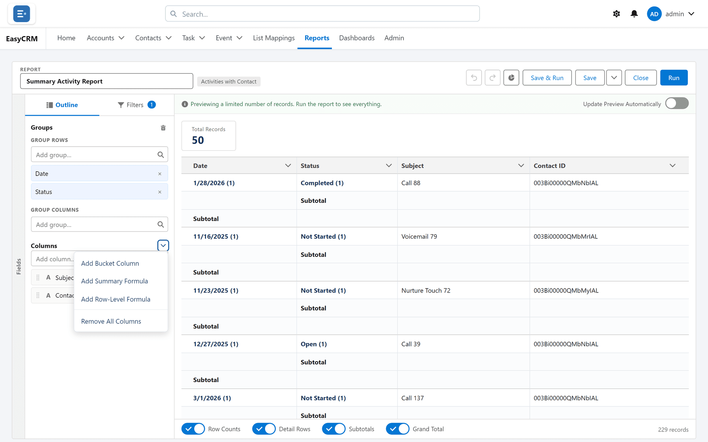

# Formula columns

**What it is.** A column that calculates its own value instead of reading a field.

**What it does.** You write a short expression and the report works out the answer — for every
row, or for every group.

**Why it helps.** Percentages, differences and ratios stop being something you do afterwards
in a spreadsheet. The report is the finished answer.

There are two kinds, and the difference matters more than anything else on this page.

## Row-level formula — calculates per record

**Where:** In the portal → **Reports** → a folder → the report's name → **Edit** → **Outline** → the arrow beside **Columns** (**Column actions**) → **Add Row-Level Formula**

1. Open the report in the builder.
2. In the **Outline** tab, click the arrow beside the **Columns** heading (**Column actions**).
3. Choose **Add Row-Level Formula**. The **Edit Row-Level Formula Column** box opens.
4. Type a **Column Name**, and a **Description** if it helps.
5. Choose the **Formula Output Type** — **Number**, **Currency**, **Percent**, **Text**,
   **Date**, **Date/Time** or **Checkbox** — and the **Decimal Points**.
6. Write the expression in **Formula**. The **Fields** and **Functions** lists on the left
   insert what you click (**Insert**); the buttons above the box add + - * / ^ and brackets.
7. Click **Validate** to check it.
8. Click **Apply**.

Use it for things that are true of a single record: days between two dates, a value times a
rate, two fields added together.

A report can have up to **2** row-level formulas: **A report can have at most 2 row-level
formulas, the same limit Salesforce enforces.**

## Summary formula — calculates per group

**Where:** In the portal → **Reports** → a folder → the report's name → **Edit** → **Outline** → the arrow beside **Columns** (**Column actions**) → **Add Summary Formula**

1. Open the report in the builder.
2. Click the arrow beside the **Columns** heading (**Column actions**).
3. Choose **Add Summary Formula**. The **Edit Summary-Level Formula Column** box opens. (The
   **Create Formula** link under **Summary Formulas** in the **Fields** strip opens it too.)
4. Name it, choose **Number**, **Currency** or **Percent**, and write the expression using the
   report's totals — pick a field and **Select an Option** (Sum, Average, and so on) before
   clicking **Insert**.
5. Choose **How to apply this formula**:
   - **All Summary Levels** — on every group and the grand total, or
   - **Selected Groups** — then pick the **Row Group** (and **Column Group** on a matrix) it
     belongs to.
6. Click **Apply**.

A report can have up to **5** summary formulas: **A report can have at most 5 summary formulas,
the same limit Salesforce enforces.**

Use it for things that only make sense across several records: a percentage of a total, a
conversion rate, an average of averages.

A summary formula needs the report to be **grouped**. With no groups there is nothing to
summarise.

## Which one do I want?

Ask whether the answer makes sense for one record on its own.

| Question | Makes sense for one record? | Use |
|---|---|---|
| How many days old is this? | Yes | **Row-level** |
| Value times commission rate | Yes | **Row-level** |
| What share of the month's total is this rep? | No | **Summary** |
| Win rate | No | **Summary** |

Choosing the wrong one is the usual reason a formula shows a plausible but wrong number.

## Percentages

A formula returning 0.25 is shown as 25%. Set the column's format to percent and let the
report do the conversion — do not multiply by 100 yourself as well, or you will get 2500%.

## Editing or removing one

In the **Outline**, click the formula column's name to edit it, or open its menu
(**Column actions**) and choose **Edit Row-Level Formula Column** or
**Edit Summary Formula Column**. To remove it, click its **X** (**Remove column**) or choose
**Remove Column** from the same menu. Nothing outside this report is affected.

A row-level formula column cannot be sorted, and cannot be [edited in a running
report](./editing.md) — it is calculated, not stored.
