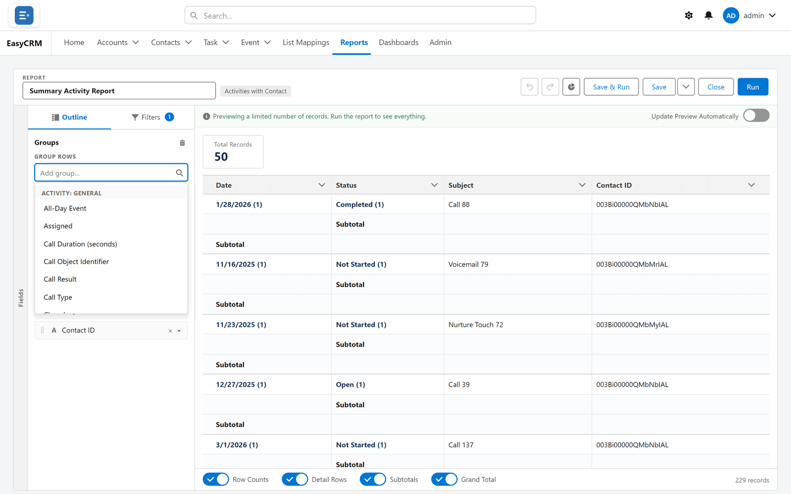
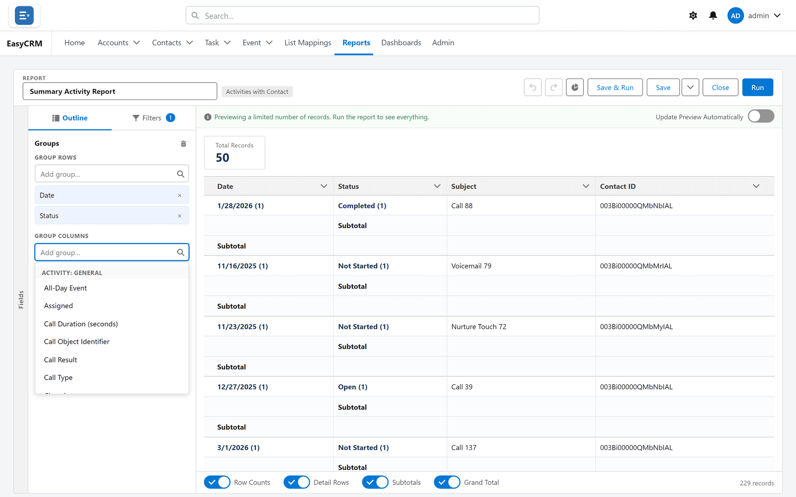

# Grouping

## What grouping is

Gathering rows that share a value, so they appear together under one heading with their own
subtotal.

It is the single step that turns a list into an answer. "Show me the accounts" is a list.
"How many accounts per owner" is a grouping.

## When to use it

When the question contains the words *per*, *by*, or *each*. Per rep. By month. Each region.

**When not to:** when somebody needs the records themselves — to work through them, or to
export and manipulate. Grouping gets in the way of both. Leave it ungrouped and let them
[export details only](./exporting.md).

## Grouping rows

**Where:** In the portal → **Reports** → a folder → the report's name → **Edit** → **Outline** → **Add group…** under **Group Rows**

1. Open the report in the builder.
2. Click the **Outline** tab.
3. Find the **Group Rows** area and click the **Add group…** box under it.
4. Pick the field to group by.

   

The preview changes shape. Instead of a flat list you get one block per value, each with a
subtotal, and a grand total at the bottom.

You can also group from the preview: click the chevron beside a column's heading
(**Column options**) and choose **Group Rows by This Field**.

### Grouping further

Add a second group and each block is broken down inside itself — owner, then within each
owner, by stage. A summary report can have up to **three** row groupings.

### Removing a group

Click the small cross beside it, or the bin beside **Groups** (**Remove all groups**) to clear
them all at once.

## Grouping across the top as well

**Where:** In the portal → **Reports** → a folder → the report's name → **Edit** → **Outline** → **Add group…** under **Group Columns**

This makes the report a **matrix**: groups down the side *and* across the top, with a figure
in every cell.

1. In the **Outline** tab, find **Group Columns**.
2. Click the **Add group…** box under it.
3. Pick a field.

   

Owner down the side and month across the top gives you "how much did each rep do each month"
in one screen.

A matrix can have up to **two** column groupings and up to **two** row groupings. A summary
report with three row groupings has to lose one before it can become a matrix.

## The limits, and what the builder says

| Limit | Message |
|---|---|
| A summary report: 3 row groupings | **This report groups by at most 3 rows.** |
| A matrix: 2 row groupings | **This report groups by at most 2 rows.** |
| A matrix: 2 column groupings | **A matrix report groups by at most 2 columns.** |
| Adding a column grouping to a report with 3 row groupings | **A matrix report groups by at most 2 rows — remove a row grouping first.** |

In the preview's column menus, the grouping items are simply greyed out once a limit is
reached.

## How the rows are ordered

- Groups are in order of their value, A first.
- [Sorting](./columns.md#sorting-a-report) a summary report orders the **detail rows inside
  each group**.
- Sorting **descending by the grouping column** itself reverses the order of the groups.

## Reading a grouped report

On a summary report the records sit under their group headings. Switch **Detail Rows** off at
the bottom of the report to see only the groups and their totals.

On a matrix report the records are listed in a **Details** pane docked below the grid. Click a
figure in the grid to narrow the Details to that cell. See
[Running a report](./running.md#matrix-reports-the-details-pane).

## Choosing what to group by

| Good grouping fields | Why |
|---|---|
| Owner, team, region | Few values, each meaningful |
| Stage, status, type | Naturally categorical |
| Month, quarter | Time, in sensible buckets |

| Poor grouping fields | Why |
|---|---|
| Anything unique, like a record name | One group per record — worse than no grouping |
| A free-text field | "London", "london" and "London " become three groups |
| An exact date | 365 groups a year. Group by month instead |

If the field you want to group by has too many values, invent your own categories with a
[bucket column](./buckets.md).

## The three shapes

You never pick the shape from a menu. It follows from what you group.

| Groups | Shape | Looks like |
|---|---|---|
| None | **Tabular** | A plain list |
| Rows only | **Summary** | Blocks with subtotals |
| Rows and columns | **Matrix** | A grid |

## What goes wrong

| Symptom | Cause |
|---|---|
| Hundreds of groups with one row each | Grouped by something nearly unique. |
| Values that should be one group are several | Free text with inconsistent spelling or spacing. |
| Subtotals are blank | Nothing is being totalled yet. See [Totals](./totals.md). |
| The chart option does nothing | A chart needs a grouping. Add one first. |
| **This report groups by at most 3 rows.** | A summary report already has three row groupings. Remove one first. |
| **A matrix report groups by at most 2 columns.** | The matrix already has two column groupings. |

## Where this fits

Grouping produces the subtotals that [Totals](./totals.md) fill in, and the groups that
[Charts](./charts.md) plot. A [summary formula](./formulas.md) also needs a grouping to
calculate against.
