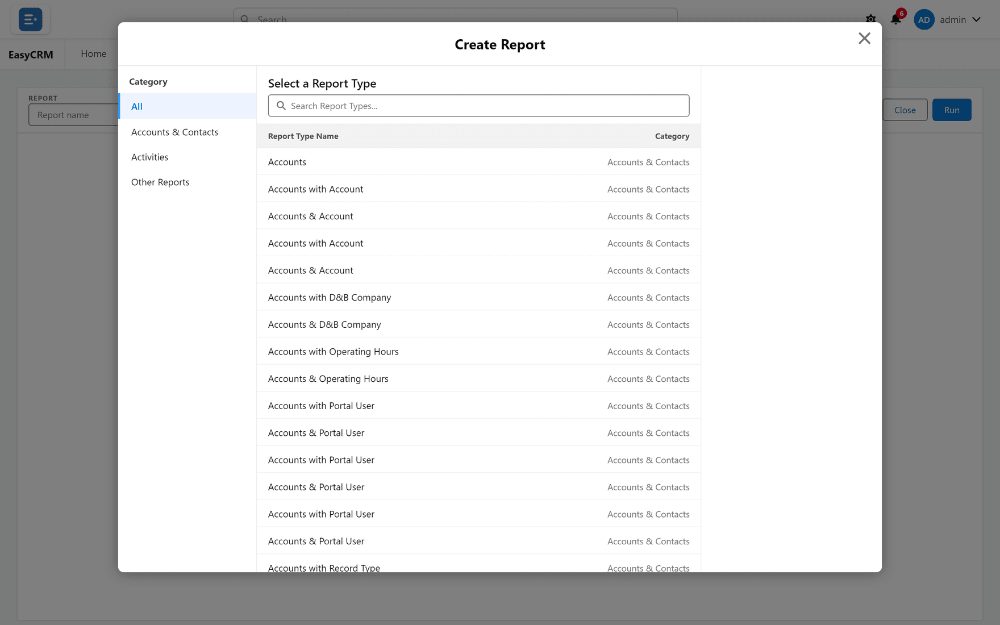
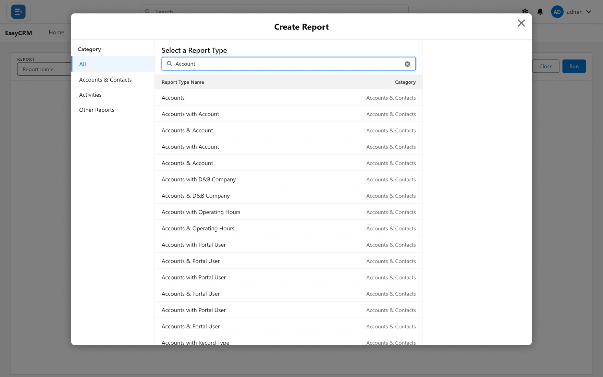
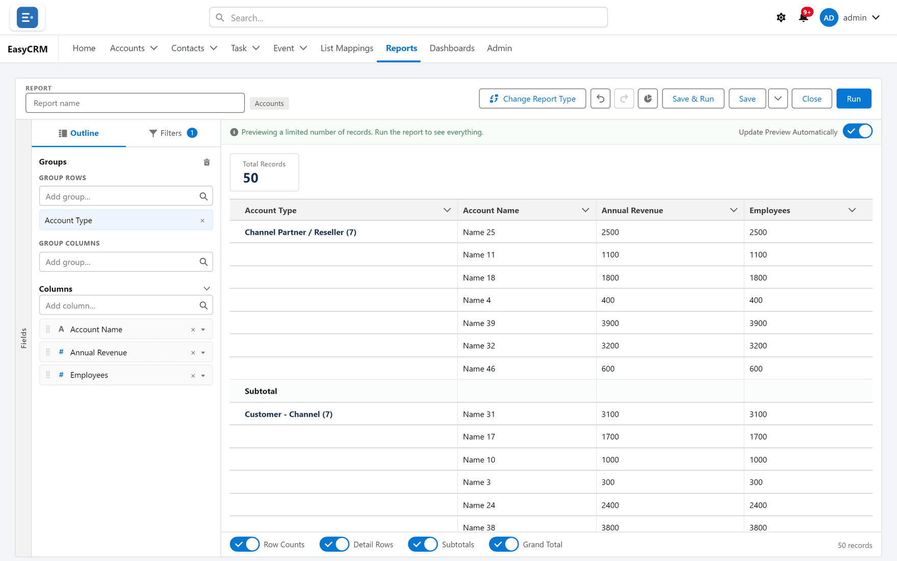

# Starting a new report

**What it is.** The first question a new report asks: what is this report about?

**What it does.** The **report type** decides which records the report can include and which
fields you can use.

**Why it matters.** The report type is fixed once the report has been saved. Choosing the
wrong one means starting again, so it is worth a moment's thought.

## Starting one

**Where:** In the portal → **Reports** → **New Report**

1. Click **Reports** in the top menu.
2. Click **New Report** at the top right.
3. The **Create Report** box opens.

   

4. Pick a **Category** on the left to shorten the list, or type into **Search Report Types...**.

   

5. Click the type you want. On the right, **Details** shows the **Objects Used in Report Type**.
6. Click **Start Report** (or double-click the type).
7. The builder opens, empty and ready.

See [The report builder](./builder-tour.md) for what to do next.

## Choosing the right type

The type is named after the records it covers. Each tab you can read has a type of its own,
and **Activities** covers tasks and events together.

| Type | Gives you |
|---|---|
| **Accounts** | Accounts, and account fields only. |
| **Contacts** | Contacts, and contact fields only. |
| **Contacts & Accounts** | Contacts with their account's fields too — one row per contact. |

If you need fields from two kinds of record in the same report, you must pick a type that
pairs them. You cannot add the second one later.

### Which pairs exist

A paired type always starts from the record that **points to** the other — the contact, which
points to its account; the activity, which points to its contact. There is a pair for each
lookup on the first record (except the owner and the created-by and last-modified-by users).

So there is **no "Accounts with Contacts" type**. A report starts from contacts and brings in
their account, never the other way round. One consequence: a report of *accounts that have no
contact* cannot be built this way.

## "with" versus "with or without"

Each pair comes in two versions, and the difference matters.

| Type | What it includes |
|---|---|
| **Contacts & Accounts** | Only contacts that have an account. |
| **Contacts with or without Account** | Every contact, whether or not it has an account. |
| **Activities with Contact** | Only activities that have a contact. |
| **Activities with or without Contact** | Every activity, with a contact or not. |
| *Records* **with** *related record* — for example **Opportunities with Account** | Only records that have the related one. |
| *Records* **&** *related record* — for example **Opportunities & Account** | Every record, whether or not it has the related one. |

Watch the names: **&** means "only those with an account" in **Contacts & Accounts**, but
"with or without" in every other pair.

Pick the **with or without** version when you want to find the gaps — contacts nobody has
linked to an account, for example. Pick the **with** version when a record is only interesting
if it has the other thing.

Choosing the **with** version by accident is the usual reason a report shows fewer records than
expected.

## Changing the type

**Change Report Type** appears at the top of the builder **only on a report that has never been
saved** — a new report, or a copy made with **Clone** before its first save. Once a report is
saved, its type is fixed: build a new report instead.

Choosing a new type there **clears the whole report** — columns, groups, filters, formulas and
sort — **without asking first**, and **Undo** cannot bring them back. Change the type before you
build, not after.
