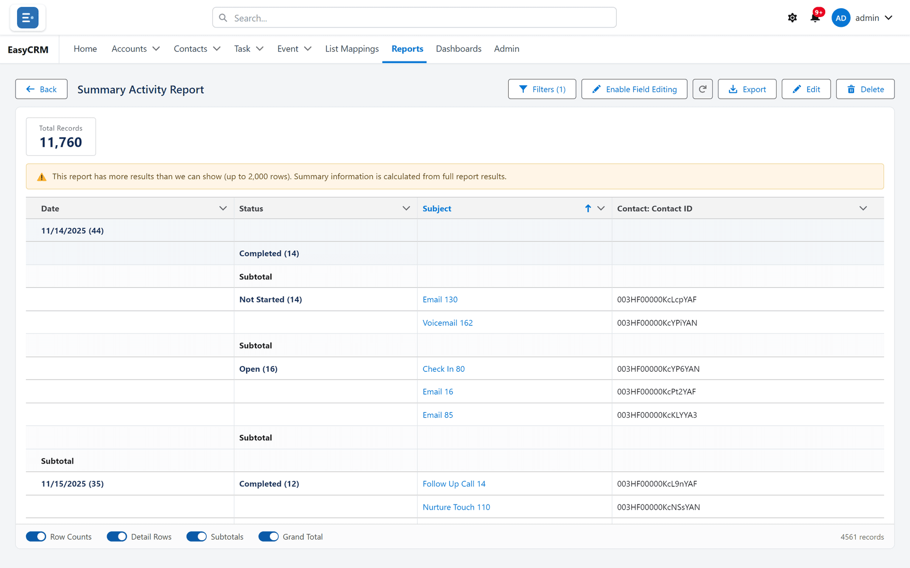
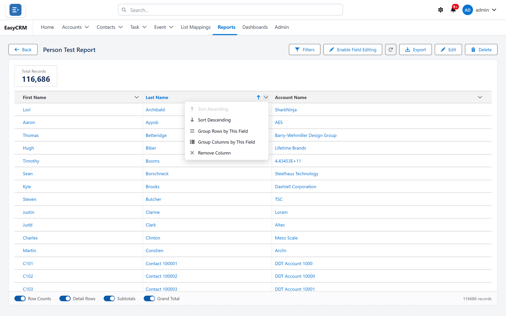
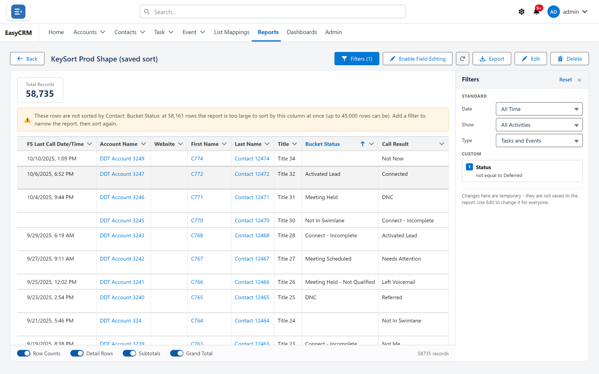
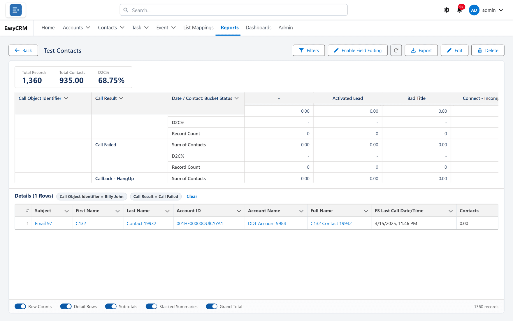
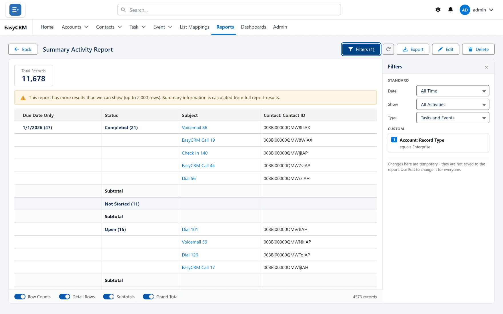
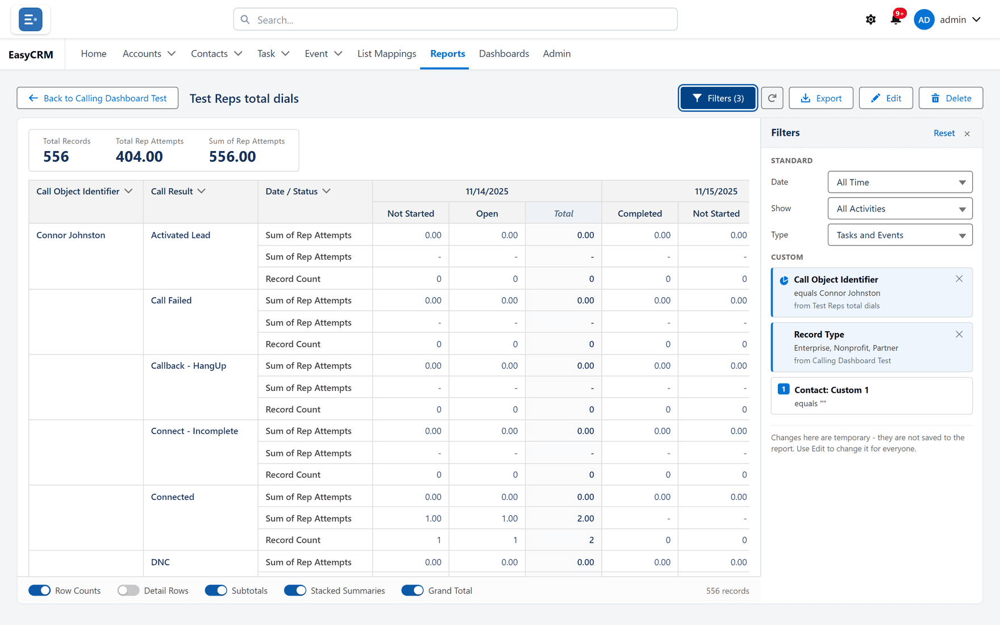

# Running a report

**What it is.** Opening a saved report to see its answer.

**Why it helps.** A report reads your live data rather than a copy somebody exported. To open
quickly, the portal keeps a report's last result for up to a day; **Refresh** works it out again
from scratch whenever you need the very latest numbers.

## Running one

**Where:** In the portal → **Reports** → a folder → the report's name

1. Click **Reports** in the top menu.
2. Click the folder the report is in, on the left.
3. Click the report's **name**.
4. It runs. Large reports take a few seconds.

## What you are looking at

- **Across the top:** **Back**, the report's name, and the buttons **Filters**,
  **Enable Field Editing** (when the report has rows you can
  [edit](./editing.md)), the refresh icon (**Refresh**), **Export**, **Edit** and **Delete**.
- **Total Records**, and any grand totals the report has, in boxes above the table.
- A chart above the table, if the report has one. On a matrix report it sits beside the grid.
  Point at a bar or slice to see its exact figures — see [Charts](./charts.md#reading-a-chart).
- The table itself. If the report is grouped, each group has a heading and a subtotal.
- **Blue text is clickable.** A record's name or record ID opens that record in a new browser
  tab, so the report stays where it was. On a matrix report, a row grouping by a lookup (an
  owner, an account) or by a record ID makes each group's name a link to that record too. Email
  addresses and phone numbers open your mail or phone app.
- **An empty value is shown as -**, as Salesforce shows it: a group of records with nothing in the
  grouped field is the **-** group.
- **Switches along the bottom**, and on the right how many records the report found.

Columns are named as Salesforce names them in the same kind of report — see
[Columns](./columns.md#column-names).

### The switches along the bottom

| Switch | Turns on or off |
|---|---|
| **Row Counts** | The number of records beside each group heading. |
| **Detail Rows** | The records themselves. Off, you see only the groups and their totals. |
| **Subtotals** | The subtotal rows. |
| **Stacked Summaries** | Matrix reports only: several totals stacked in one cell, or set side by side. |
| **Grand Total** | The total row. |

They change only what you are looking at. The report opens with them set the way its author
saved them.

### Large reports

- A long tabular report loads 200 rows at a time. Scroll to the bottom and the next 200 load.
- A summary report with more than 2,000 records shows no more than 2,000 rows and says so:
  **This report has more results than we can show (up to 2,000 rows). Summary information is
  calculated from full report results.** The totals still count every record.
- With **Detail Rows** on, such a summary shows its **first 2,000 records in group order**, as
  Salesforce's own report does, and only the groups those records reach. The last group shown can
  be cut short. Its subtotal, like every other, still counts all of its records.
- A matrix report with more than 2,000 records shows the same notice, and its **Detail Rows**
  switch is turned off and greyed out. The figures in the grid still count every record.
- A matrix with two row groupings shows at most **2,000 rows**: each outer group counts as one
  row, and so does each row inside it. They are the first 2,000 in grouping order, as Salesforce
  shows them. A group cut short still shows its whole subtotal.
- A report too big to total in one go is totalled in several steps behind the spinner, so its
  numbers are exact. It takes longer to open.

## Sorting and reshaping while you read

**Where:** In the portal → an open report → a column heading

- **Click a column's name** to sort by it, smallest or A first. Click it again to reverse. An
  arrow beside the name shows which column is sorted.
- **A column the report is grouped by always shows an arrow**, because its groups are always in
  order — ascending, unless the report is sorted descending by it. So the first click on a
  grouping column's name turns it descending.
- A report has one sort. Sorting by another column puts every grouping back to ascending.
- **Click the chevron** beside the name (**Column options**) for a menu:

| Item | What it does |
|---|---|
| **Sort Ascending** / **Sort Descending** | Sorts by this column. On a grouping column, the direction it already has is greyed out. |
| **Group Rows by This Field** | Groups the report by it. A tabular report becomes a summary. |
| **Group Columns by This Field** | Groups across the top. The report becomes a matrix. |
| **Remove Column** | Takes the column off the report you are looking at. |
| **Remove Group** | Shown instead of **Remove Column** on a column the report is grouped by. |

The two grouping items are greyed out once the report already has two row groupings (or two
column groupings).

On a matrix report the grouping headings have their own menu: **Sort Ascending**,
**Sort Descending**, **Group Rows by This Field**, **Group Columns by This Field**,
**Make a Detail Column** and **Remove Group**. Each column grouping has a heading row of its own,
its name followed by →. Click a grouping's name to sort by it: the first click lists its groups
descending, the next ascending again, and an arrow marks the grouping the report is sorted by.
The column headings in the **Details** pane have the same menu as a tabular report.

At high browser zoom these menus move to stay inside the window, and scroll if they still do not
fit.

**None of this is saved.** It changes only what you are looking at. Open the report again and it
is back as saved, for you and for everybody else. To sort a report for good, set the sort in the
builder — see [Columns](./columns.md#sorting-a-report).

### Columns you cannot sort

Long text fields (a Description, an activity's Comments), bucket columns and row-level formula
columns cannot be sorted: their names are not clickable and the two **Sort** items are greyed
out. A row-level formula column has no menu at all.

### How a sort orders the rows

- **Every row is sorted**, not just those on screen. Rows loaded as you scroll carry on in the
  same order.
- **Blanks come first when you sort ascending, and last when you sort descending**, as in
  Salesforce. (A checkbox is never blank.)
- Rows with the same value keep a fixed order (by record ID), so nothing jumps about between
  pages.
- **Text ignores capitals.** A **picklist sorts in its own order** — the order its values are
  set up in — not alphabetically.
- On a combination report such as **Contacts & Accounts**, a lookup column sorts by the name it
  shows. On a report about one kind of record, a lookup column (an owner, say) sorts by the
  record behind it, so it will not look alphabetical.
- On a **summary report**, a sort orders the detail rows inside each group. Sorting
  **descending by a grouping column** reverses the order of its groups exactly: an inner grouping
  is reversed inside each outer group, and the **-** group moves from first to last. The same
  goes for a matrix's row and column groupings. How groups are ordered to begin with is on
  [Grouping](./grouping.md#how-the-rows-are-ordered).
- Some sorts have to read every row first: on an **Activities** report, sorting by a contact or
  account column or by a field only tasks have; on an **Activities with Contact** report, sorting
  by a contact column. Up to 45,000 rows they are exact. Above that the rows are shown unsorted,
  and the report says so: **These rows are not sorted by** *column*: **at** *N* **rows the report
  is too large to sort by this column at once (up to 45,000 rows can be). Add a filter to narrow
  the report, then sort again.**
- A very large Activities summary may show: **These detail rows are not sorted: the report is
  too large to sort them in one run. Add a filter to narrow the report, then sort again.**

## Matrix reports: the Details pane

With **Detail Rows** on, a matrix report lists its records in a **Details** pane docked below
the grid, headed **Details (N Rows)**.

- The grid and the Details each scroll on their own, and the Details' column headings stay in
  view.
- The Details load 200 rows at a time as you scroll down.
- **Click a figure in the grid** to narrow the Details to that cell. The pane's heading then
  names what it is narrowed to — "Stage = Prospecting", or "Stage = -" for the empty group —
  with a **Clear** button beside it.
- Before narrowing, the pane loads any Details rows it has not loaded yet, so none of the cell's
  records is missed. Meanwhile the heading reads **Details (… Rows)** and
  **Loading all rows for this cell…**.
- A grid groups text that differs only in capitals as one group, and the Details match the cell
  the same way: a record spelled "engineering" is listed under the "Engineering" cell.
- On a phone-sized screen the Details simply follow the grid instead of docking.

You can [edit values](./editing.md) in the Details rows.

<!-- SHOT-RETAKE: ../../img/shots/report-viewer/report-matrix-details-pane.png | the grid's header is now one row per column grouping (e.g. "Date →" above "Contact: Bucket Status →", each with its own ▾), and a nested matrix's subtotal rows read "Subtotal" in bold; recapture the same matrix narrowed to one cell, Details pane showing its chips and Clear -->

## Changing what it shows, just for now

**Where:** In the portal → an open report → **Filters**

1. With the report open, click **Filters**.
2. The panel opens beside the report, showing the report's filters as numbered cards.

   

3. Click a filter's card. A small editor opens headed **Filter by** and the field's name.
4. Change the **Operator** or the **Value**.
5. Click **Apply**. The report re-runs with your change.

**This does not change the saved report.** The panel says so: **Changes here are temporary -
they are not saved to the report. Use Edit to change it for everyone.** Everybody else still
sees the report as it was saved. **Reset** puts the filters back as saved.

If the report has a date filter, its range sits at the top of the panel, under **Standard**,
beside the date field's name. Pick another range there, or **Custom** and your own dates — see
[Date ranges](./date-ranges.md).

You can change values and operators here, but not add or remove filters. The report's
**Filter Logic** is shown but cannot be changed.

Some filters are **locked** by whoever built the report. They show a padlock — "Locked by the
report author - can't be changed here" — and do not open. That is how a report meant for one
company stays limited to it.

To change the report permanently, click **Edit** — see
[The report builder](./builder-tour.md).

## Fields you are not allowed to see

If an administrator has hidden a field from you, every report hides it from you too: its column,
any grouping, sort or total on it, formulas and bucket columns built on it, and the chart if the
chart is grouped or measured by it. A column reached through a hidden lookup goes too — the
account's name disappears if the contact's account lookup is hidden from you.

A **filter** on a hidden field is quietly left out, so you may see more rows than a colleague
does. If the report uses [filter logic](./filter-logic.md), it cannot leave one out, so it
refuses to run:

**Invalid Report. You cannot run this report because its formulas or filters are invalid or it
references fields that are inaccessible to you. Please contact your administrator to update the
report.**

The saved report is never changed. Everybody else sees it exactly as before.

## A report opened from a dashboard

**Where:** A dashboard → a tile's **View Report (…)** link, a **Metric** or **Gauge** tile, or a
segment of a chart

The report opens on the **Reports** tab already narrowed by the values selected on the
dashboard's filters, so its numbers match the tile. It stays behind the loading spinner until
the narrowed result is ready.

- The button at the top left reads **Back to** and the dashboard's name. It returns you to the
  dashboard with its filters as you left them.
- **Filters (n)** counts the dashboard's filters too. In the panel, under **Custom**, each one has
  its own card: a dashboard icon, the filter's name, the values chosen, and "from" the
  dashboard's name. Pointing at it says **Applied by the dashboard this report was opened from**.
- These cards cannot be edited. The **✕** on any of them ("Remove the dashboard's filters and
  show the whole report") removes them all.
- Several values chosen on one dashboard filter match **any** of them. Different dashboard
  filters must **all** match, on top of the report's own filters.
- Only filters the dashboard applies to this report's tile come across. One it cannot apply here
  is left out, with no card.
- The page address carries them, so refreshing the page, the browser's **Back** and **Forward**,
  or a copied link open the report narrowed the same way. Rows loaded as you scroll and the
  matrix Details stay narrowed too.

**Export does not use them** — see [Exporting](./exporting.md#what-gets-exported).

### Opened by clicking a chart

Clicking a bar, slice or point on a dashboard chart opens the report narrowed to that group as
well. It gets its own card under **Custom**: a chart icon, the field's name, **equals** and the
value, and "from" the tile's title.

- Click the card to change it: an editor headed **Filter by** and the field's name, with
  **Operator**, **Value**, **Cancel** and **Apply**.
- Its **✕** ("Remove this filter and show the whole report") takes it off.
- It is not part of the report's filter logic, and it is gone when you next open the report
  from the list.

A click that cannot be written as one exact filter opens the **whole** report instead, with a
note across the top saying why. Dismiss it with its **✕**.

| Note | What it means |
|---|---|
| **Showing the full report — “-” stands for an empty value (or the text “-”), which a chart click cannot filter on.** | You clicked the **-** group. |
| **Showing the full report — “Others” stands for several values, not one.** | You clicked the group that combines the small values. |
| **Showing the full report — this chart is grouped by something the report cannot filter on directly.** | The chart's grouping is not a field the report can filter. |
| **Showing the full report — a date/time grouping cannot be written as one filter value.** | The chart is grouped by a date and time. |
| **Showing the full report — this date group could not be read as a single date.** | The date label could not be turned back into a date. |
| **Showing the full report — two values on this field share the label “…”.** | Two picklist values have the same label, so the click is ambiguous. |
| **Showing the full report — this group is not a plain number.** | The number label could not be read as a number. |
| **Showing the full report — a value containing a comma is read as a list of values.** | The value has a comma in it. |
| **Filtered by** *field* **only — the "…" series cannot be filtered from a chart yet, so this shows the whole group.** | You clicked one segment of a stacked bar. The report is narrowed to the whole bar, not that segment. |

## Getting the very latest numbers

Click the refresh icon (**Refresh**). To open quickly, a report reuses its last result for up to
a day, so use **Refresh** when something has just changed and you need to see it. Refresh works
the report out again from your live data.

An administrator can make a company's reports always run live instead — see
[Companies](../../admin/companies/index.md). They are then always current, but slower to open.

## Deleting a report

1. Open the report.
2. Click **Delete** at the top.
3. Your browser asks **Delete this report?** Click **OK**.

You return to the list. If you only have read access, the portal refuses: **You have read-only
access to this report, so it cannot be deleted. Ask its owner or a Super Admin.**

## A run from the builder is not saved

Clicking **Run** in the builder shows the full result of the report as it stands in the
builder, saved or not. On that screen there is only **Back** — no **Export**, **Edit** or
**Delete**, because there is no saved report behind it yet.

**Back** returns you to the builder with your changes still in place. Leaving any other way —
another tab, the App Launcher, a search — loses those changes **without a warning**.

## Taking it away with you

Click **Export** to download it as a spreadsheet — see [Exporting a report](./exporting.md).

## What goes wrong

| Symptom | Cause |
|---|---|
| The numbers look out of date | The report reused its last result, which can be up to a day old. Click **Refresh**. |
| A sort or grouping you set has gone | Sorting and regrouping on this screen are never saved. Set them in the builder. |
| **Detail Rows** is greyed out | A matrix report with more than 2,000 records. The grid's totals are still exact. |
| **These rows are not sorted by …** | More than 45,000 rows for a sort that has to read every row. Add a filter, then sort again. |
| A grouping column shows a sort arrow nobody set | Groupings are always in order, ascending unless the report is sorted descending by them. Clicking the name turns it descending. |
| A big summary stops part-way through a group | With **Detail Rows** on it shows its first 2,000 records and only the groups they reach, as Salesforce does. The subtotals and grand total still count everything. Switch **Detail Rows** off to see the groups alone. |
| **This report could not finish its exact totals this time. Please run it again in a minute.** | A report totalled in steps did not finish. Open it again shortly. |
| **This report needs to be run again.** | The steps a big report was being totalled in were no longer available. Click **Refresh**, or open the report again. |
| A sorted lookup column does not look sorted | On a report about one kind of record, a lookup column sorts by the record behind it, not by the name it shows. |
| **Invalid Report. You cannot run this report …** | The report uses filter logic and filters on a field hidden from you. Ask your administrator. |
| A column a colleague sees is missing for you | That field is hidden from you, so every report hides it. |
| You see more rows than a colleague | A filter on a field hidden from you was left out. |
| A filter will not open | It is locked by the report's author. |

## Where this fits

From here you can [edit values](./editing.md), [export](./exporting.md), or open the
[builder](./builder-tour.md) with **Edit**. To find a report in the first place, see
[Finding a report](./finding.md).
