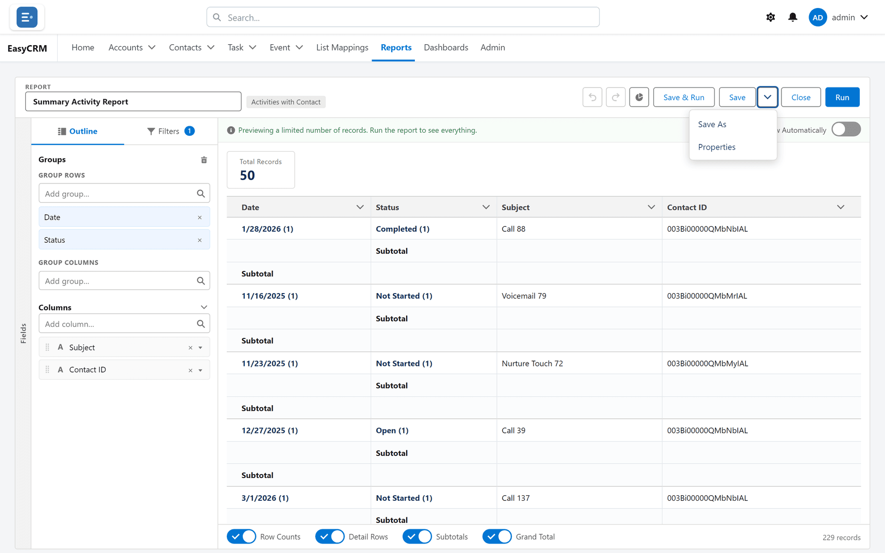

# Saving a report

## What saving does

Stores the *question* — the type, columns, groups, totals, filters and chart. Not the answer.
Anyone opening it later re-runs it against live data.

## Nothing is saved until you say so

The builder changes nothing while you work. The preview updates, **Undo** and **Redo** step
through your changes, and none of it reaches anybody else until you click **Save**.

That makes the builder safe to explore in. It also means closing the tab loses everything.

## The three ways to save

**Where:** In the portal → **Reports** → a folder → the report's name → **Edit** → **Save**, **Save & Run**, or **Save options**

| Button | What it does | Use it when |
|---|---|---|
| **Save** | Keeps your changes to this report | You own it and the change is wanted |
| **Save & Run** | Saves, then shows the full result | You want to check it against real volume |
| **Save options → Save As** | A copy under a new name | The report is somebody else's, or you are experimenting |

### Saving for the first time, step by step

1. Click **Reports** in the top menu.
2. Click the folder, then the report's **name**, then **Edit** — or click **New Report** if you
   are starting from nothing.
3. Build the report, and watch the preview until it answers the question you meant to ask.
4. Click **Save**.
5. Type a **Report Name**. Make it say what the report answers — see
   [naming](#naming-so-somebody-else-can-find-it) below.
6. Add a **Description** if anybody other than you will open it. One line is enough.
7. Choose a **Folder**. This is the part that decides who can find the report, so it is worth a
   moment — see [Report folders](./folders.md).
8. Click **Save**.

The first time you save, you are asked for a **name** and a **folder**.

## Save As is the one to reach for

If the report is not yours, **Save As** is almost always correct. It takes a copy, leaves the
original alone, and nobody else's dashboard changes under them.

Remember that a **Save** on a shared report changes it for everybody it is shared with — and
for every dashboard tile reading from it. There is no "just for me".

## Naming so somebody else can find it

The name is what people see in a folder of thirty. Say what it answers.

| Good | Poor |
|---|---|
| Open opportunities by owner — this quarter | Report 4 |
| Accounts with no activity in 60 days | Test copy |
| Monthly task completion by team | Sarah's report (final) v2 |

## Closing without saving

Click **Close**. If you have unsaved changes you are warned first, so you cannot lose work by
clicking the wrong thing.

## What goes wrong

| Symptom | Cause |
|---|---|
| "A report with that name already exists" | Names are unique within a folder. Rename, or pick another folder. |
| Save is refused | You have read-only access. Use **Save As**. |
| Your changes vanished | The tab was closed, or **Close** was taken past the warning. |
| Somebody else's dashboard changed | You used **Save** on a shared report. Use **Save As** next time. |

## Where this fits

A saved report lands in a [folder](./folders.md), and the folder decides who can see it. Once
saved it can be [shared](./sharing.md), [exported](./exporting.md), or
used as the source for a [dashboard tile](../dashboards/builder.md).
