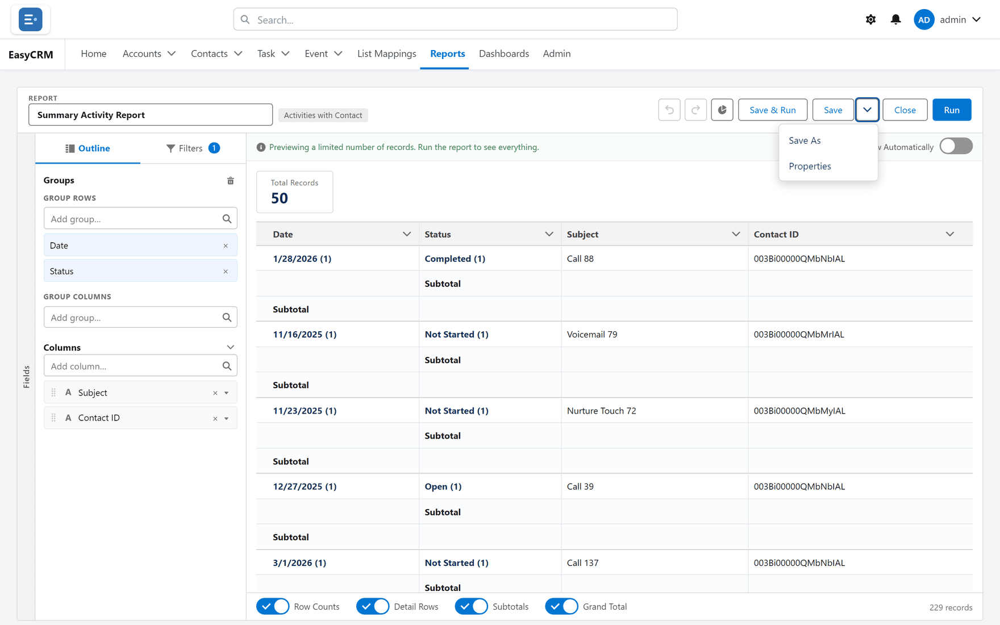

# Saving a report

## What saving does

Stores the *question* — the type, columns, groups, totals, filters, sort and chart. Not the
answer. Anyone opening it later runs it against your data.

## Nothing is saved until you say so

The builder changes nothing while you work. The preview updates, **Undo** and **Redo** step
through your changes, and none of it reaches anybody else until you click **Save**.

That makes the builder safe to explore in. It also means leaving without saving loses
everything — the builder warns you first, see [Closing without saving](#closing-without-saving).

## The ways to save

**Where:** In the portal → **Reports** → a folder → the report's name → **Edit** → **Save**, **Save & Run**, or **Save options**

| Button | What it does | Use it when |
|---|---|---|
| **Save** | Keeps your changes and stays in the builder. **✓ Saved** shows for a moment. | You own it and the change is wanted |
| **Save & Run** | Saves, then shows the full result | You want to check it against real volume |
| **Save options → Save As** | A copy under a new name, which then opens | The report is somebody else's, or you are experimenting |
| **Save options → Properties** | Renames the report and sets who it is shared with | See [below](#properties) |

### Saving for the first time, step by step

1. Click **Reports** in the top menu.
2. Click **New Report** and pick a type — or open an existing report and click **Edit**.
3. Build the report, and watch the preview until it answers the question you meant to ask.
4. Click **Save**. The **Save Report** box opens.
5. Type a **Report Name**. Make it say what the report answers — see
   [naming](#naming-so-somebody-else-can-find-it) below.
6. Choose a **Folder**. It starts on **Private Reports**. The folder decides where people find
   the report, so it is worth a moment — see [Report folders](./folders.md).
7. Click **Save**.

The first time you save, you are asked for a **name** and a **folder**. After that, **Save**
just saves.

**Save As** opens the same box, headed **Save Report As**, with the name filled in as the
original's name followed by "(copy)". Change it, choose a folder and click **Save**. The copy
opens; the original is untouched.

### Names must be unique

No two reports you can see may share a name — in any folder, and whatever the capitals. If
the name is taken you see **A report named "…" already exists. Choose a different name.** and
nothing is saved.

## Properties

**Where:** In the portal → the builder → the arrow beside **Save** (**Save options**) → **Properties**

The **Report Properties** box holds:

- **Report Name** — renames the report. The same unique-name rule applies.
- **Report type** — shown, not changeable.
- **Visibility** — **Only me (private)**, or **My company** if you belong to a company. With
  **My company** you choose **Company access**: **Read** or **Edit**. Your company's admins can
  then see it and re-share it to the rest of your team.

Click **Apply**, then **Save** — the change takes effect when you save. Only the report's owner
(or a Super Admin) can change who a report is shared with. See
[Sharing a report](./sharing.md).

**Save** touches the sharing only when you changed **Visibility**. Somebody with edit access who is
not the owner can therefore save the report as usual. If they did change **Visibility**, the report
still saves and the builder says the sharing part was refused:
**Only the report owner can change who it is shared with. The report itself was saved.**

## Save As is the one to reach for

If the report is not yours, **Save As** is almost always correct. It takes a copy, leaves the
original alone, and nobody else's dashboard changes under them.

Remember that a **Save** on a shared report changes it for everybody it is shared with — and
for every dashboard tile reading from it. There is no "just for me".

## Working on somebody else's report

If you only have read access, **Edit** does not open the builder. The report shows
**You have read-only access to this report. Ask its owner or a Super Admin for edit access, or
use Save As to make your own copy.**

**Save As** lives inside the builder, which you cannot open on this report. To make your own
copy, go back to the report list, open the report's row menu and click **Clone**. The builder
opens on a new, unsaved copy named after the original with "(copy)"; your first **Save** asks
for a name and a folder.

If a report uses fields hidden from you, you can open it in the builder, but you cannot save
over it: **This report uses fields you don't have access to, so you can't save over it. Use Save
As to save your own copy.** Your view of it leaves those fields out, and saving that view would
remove them for everybody. **Save As** works.

## Naming so somebody else can find it

The name is what people see in a folder of thirty. Say what it answers.

| Good | Poor |
|---|---|
| Open opportunities by owner — this quarter | Report 4 |
| Accounts with no activity in 60 days | Test copy |
| Monthly task completion by team | Sarah's report (final) v2 |

## Closing without saving

Click **Close**. If you have unsaved changes, the **Unsaved Changes** box warns you first:
**You have unsaved changes to this report. If you leave now, those changes will be lost.**
**Stay** keeps you in the builder; **Leave & Discard** leaves.

Leaving by another route — another tab, a search, the browser's **Back** — asks too: **You have
unsaved changes that will be lost. Leave anyway?** The one exception is **Run**: it does not
save, and leaving its result any way other than **Back** loses your changes without a warning.
See [The report builder](./builder-tour.md#seeing-the-whole-result).

## What goes wrong

| Symptom | Cause |
|---|---|
| **Save**, **Save & Run** and **Save options** are greyed out | The report has not finished loading — or it failed to load, in which case they stay greyed out. This stops a half-loaded report being saved over the real one. |
| **The report is still loading. Save again in a moment.** | You saved before the report had loaded. Wait, then save again. |
| **This report had not finished loading, so saving it would have removed all of its columns. Nothing was saved. Wait for the report to load, then save again.** | The same protection, checked by the server. Nothing changed. Removing every column on purpose, once the report has loaded, still saves. |
| **A report named "…" already exists. Choose a different name.** | Names are unique across every report you can see, not just within a folder. Choose another. |
| **Enter a name.** | The name box is empty. |
| **You have read-only access to this report. …** | You may read it but not change it. Use **Clone** from the report list to make your own copy. |
| **This report uses fields you don't have access to, so you can't save over it. Use Save As to save your own copy.** | Some of its fields are hidden from you. Use **Save As**. |
| **Only the report owner can change who it is shared with. The report itself was saved.** | You changed **Visibility** on a report you do not own. Your other changes are saved; the sharing is as it was. |
| Your changes vanished | The tab was closed, **Leave & Discard** was clicked, or you left a **Run** without coming **Back**. |
| Somebody else's dashboard changed | You used **Save** on a shared report. Use **Save As** next time. |

## Where this fits

A saved report lands in a [folder](./folders.md), and the folder decides who can find it. Once
saved it can be [shared](./sharing.md), [exported](./exporting.md), or
used as the source for a [dashboard tile](../dashboards/builder.md).
