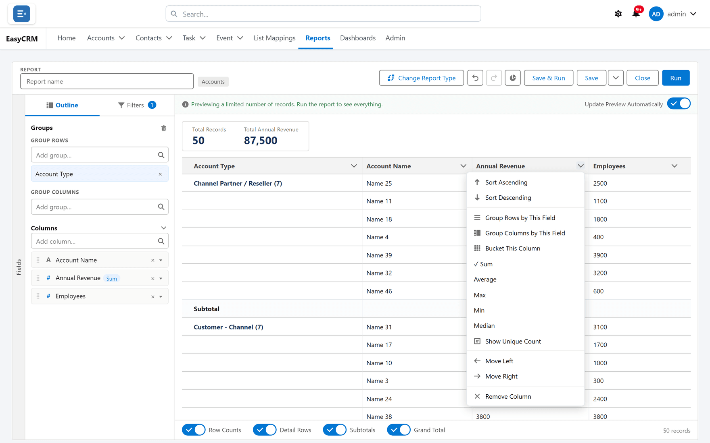

# Totals

## What a total is

A number column added up — once for each group, and once for the whole report.

[Grouping](./grouping.md) decides how rows gather. Totals decide what gets calculated for each
gathering.

## When to use it

Any time the answer is a quantity rather than a list. Totals are what make a grouped report
worth reading — without them you have headings over rows, and the reader does the arithmetic.

**When not to:** on an identifier that happens to be numeric. The sum of your account numbers
means nothing, and printing it invites somebody to believe it does.

## Adding a total

**Where:** In the portal → **Reports** → a folder → the report's name → **Edit** → the preview → the column heading's chevron (**Column options**)

1. Open the report in the builder.
2. In the preview, find the number column you want.
3. Click the chevron beside its heading (**Column options**).
4. Click **Sum**, **Average**, **Max**, **Min** or **Median**. A tick shows which are on; click
   one again to take it off.

The total now appears on every group heading and at the bottom of the report.

Two other routes in the **Outline** do the same:

- Click a number column's name (it says **Summarize** when you point at it). The **Edit Column**
  box lists **Sum**, **Average**, **Max**, **Min** and **Median** as tick boxes. Tick what you
  want and click **Apply**.
- Open the column's own menu (**Column actions**): under **Summarize** it offers **Sum**,
  **Average**, **Max** and **Min**.

The totals you have chosen are listed beside the column's name in the Outline.

## The five options

| Option | Gives you | Reach for it when |
|---|---|---|
| **Sum** | Everything added together | The quantity accumulates — value, hours, count |
| **Average** | The mean | You are comparing groups of different sizes |
| **Min** | The smallest value | Finding the earliest, cheapest or worst |
| **Max** | The largest value | Finding the latest, biggest or best |
| **Median** | The middle value | A few very large records would drag an average up |

You can pick more than one. Sum and Average together is common: the total tells you volume,
the average tells you whether one large record is carrying it.

## Choosing between Sum and Average

This is the choice people get wrong, and it changes the conclusion.

**Sum** answers "how much altogether". It rewards groups that are simply bigger.

**Average** answers "how much typically". It lets a small team look as good as a large one.

If you are comparing people or regions of different sizes, a Sum ranking mostly measures
headcount. Show both and the picture is honest.

**Median** is the honest "typical" when the values are lopsided — one enormous deal among
many small ones.

## Counting different values

**Show Unique Count**, in the same **Column options** menu, counts how many *different* values a
column has in each group — how many different accounts a rep's tasks touched, say, rather than
how many tasks. It works on any column except a bucket column, number or not.

A report can show up to **three** unique counts. Once three are on, the item is greyed out on
the other columns. **Hide Unique Count** takes one off.

## Totals and record counts

Every grouped report shows a **record count** per group whether or not you total anything. If
the question is "how many", you do not need a total at all — the count is already there.

## What goes wrong

| Symptom | Cause |
|---|---|
| The option is not offered | It is not a number field. Text that looks numeric cannot be totalled. |
| **Show Unique Count** is greyed out | Three columns already show one. Hide one first. |
| The total is far too large | A matrix counts each record once per cell it belongs to. Check the grouping. |
| Average looks wrong | It averages the records, not the subtotals. An average of averages is not the same number. |
| The grand total is not the sum of groups | Some records fall outside every group, or a filter changed after the groups were set. |

## Where this fits

A total is the input a [chart](./charts.md) plots, and the figure a
[summary formula](./formulas.md) calculates from. A dashboard **Metric** tile is usually a
report with one total on it — see [Dashboard tiles](../dashboards/builder.md).
