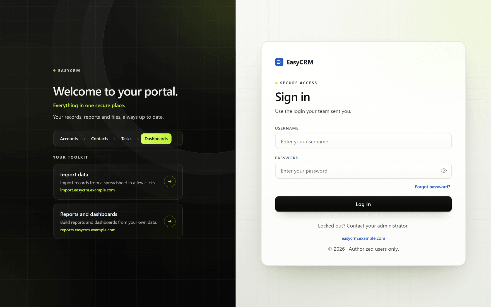
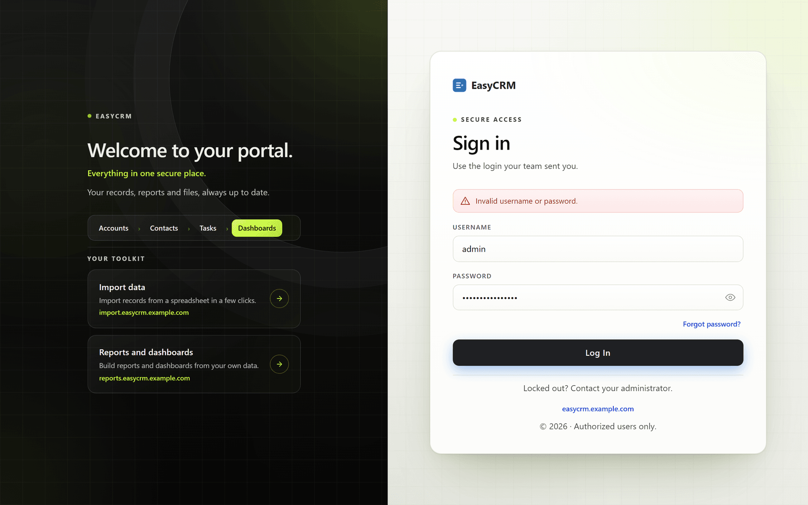
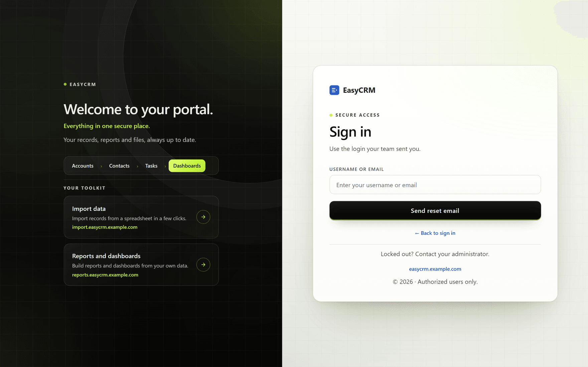

# Signing in

**What it is.** How you get into the portal.

**What you need.** A username and a password. Your administrator sends these to you by email
when your account is created.

**What you do not need.** Anything installed. The portal runs in your normal web browser —
Chrome, Edge, Firefox or Safari — on a computer, tablet or phone.

## Signing in for the first time

**Where:** the web address your administrator sent you

1. Open your web browser.
2. Type in the web address your administrator gave you, and press Enter.
3. The sign-in page opens. It has two halves: your company's picture on the left, and the
   sign-in box on the right.

   

4. Click the **Username** box and type your username.

   Your username is usually short, like `jsmith`. It is **not** your email address, unless
   your administrator set it up that way.

5. Click the **Password** box and type your password.

   The password is hidden as you type. Click the small eye symbol at the right of the box if
   you want to check what you have typed.

6. Click **Log In**. It reads **Signing in…** for a moment.

You are now in the portal, usually on the home page.

## If your password does not work

A message appears in red above the boxes.

| Message | What it means |
|---|---|
| **Invalid username or password.** | One of the two is wrong. The portal does not say which, on purpose. |
| **Enter your username and password.** | One of the boxes is empty. |
| **Account temporarily locked until 3:45 PM.** | Five wrong passwords in a row. See below. |
| **This account is inactive.** | Your account has been switched off. Ask your administrator. |
| **Your profile is inactive. Contact your administrator.** | The profile your account belongs to has been switched off. |
| **Login is not allowed at this time under your profile's login hours.** | Your profile only allows sign-in at certain hours. Try again within them. |
| **Login from your current network is not allowed under your profile.** | Your profile only allows sign-in from certain networks — for example, the office. |

For **Invalid username or password.**, nearly always it is one of these:

- A typing mistake. Click the eye symbol and check the password.
- **Caps Lock** is on. Passwords care about capital letters.
- An extra space at the start or end, from copying and pasting.

Try again carefully. If it still fails, use **Forgot password?** below — before you reach five
attempts.

## After five wrong passwords

Five wrong passwords in a row lock the account for **15 minutes**. The message names the time
the lock ends — **Account temporarily locked until 3:45 PM.**, for example. While it is locked,
even the right password is refused.

The portal emails the address on your account once, when the lock starts, so you know it
happened.

To get back in, any one of these works:

- Wait until the time in the message, then sign in normally.
- Use **Forgot password?** below. Setting a new password also lifts the lock.
- Ask your administrator to set a new password for you, which lifts it too.

A successful sign-in clears the count of wrong attempts.

## One session per person

You can be signed in in one place at a time. Signing in on another computer, or in another
browser, ends the session you had before. The first window stops working: what you do there is
refused with **Your session has expired. Please log in again.**

Tabs of the same browser are different: they share one session, so you can have several portal
tabs open at once.

## How long you stay signed in

A session lasts two hours. Five minutes before the end the portal warns you, and you can choose
**Stay signed in** for two more hours, up to 12 hours after you signed in. If the time does run
out, you can sign in again on top of the page without losing your work. See
[Staying signed in](./session.md).

## If you forget your password

**Where:** sign-in page → **Forgot password?**

1. On the sign-in page, click **Forgot password?** under the password box.
2. The page changes to **Reset your password** — **Enter your username or email and we'll send
   you a new password.**

   

3. Type your username, or the email address your account uses, in **Username or email**.
4. Click **Send reset email**.
5. The page says **We've emailed a new password to the address on file. Check your inbox (and
   spam folder).**
6. Click **← Back to sign in**, and sign in with the new password from the email.

Your old password stops working the moment the reset is sent — only the new one will do.

Then change it to something you will remember — see
[Changing your password](../account/password.md).

| Message | What it means |
|---|---|
| **Enter your username or email.** | The box was empty. |
| **We couldn't find an account for that username or email. Please check it and try again.** | Nothing matches what you typed. |
| **That account is inactive. Contact your administrator for help.** | Your account is switched off, so no reset is sent. |
| **That account has no email address on file. Contact your administrator to reset your password.** | There is nowhere to send it. Your administrator can set a new password for you. |

**If no email arrives**, check your spam folder first. If it is not there, your administrator
can set a new password for you directly.

## Signing out

**Where:** In the portal → your name (top right) → **Log Out**

1. Click your name in the top right corner of the screen.
2. Click **Log Out**.

If a report or dashboard you are building has unsaved changes, the portal first asks **You have
unsaved changes that will be lost. Leave anyway?**

Signing out in one tab signs you out of every portal tab in that browser.

Always sign out on a shared or public computer.
