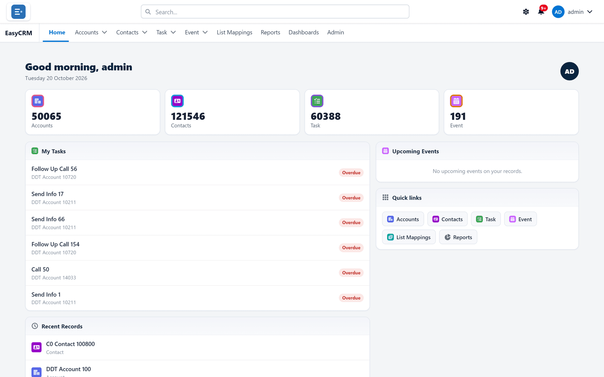
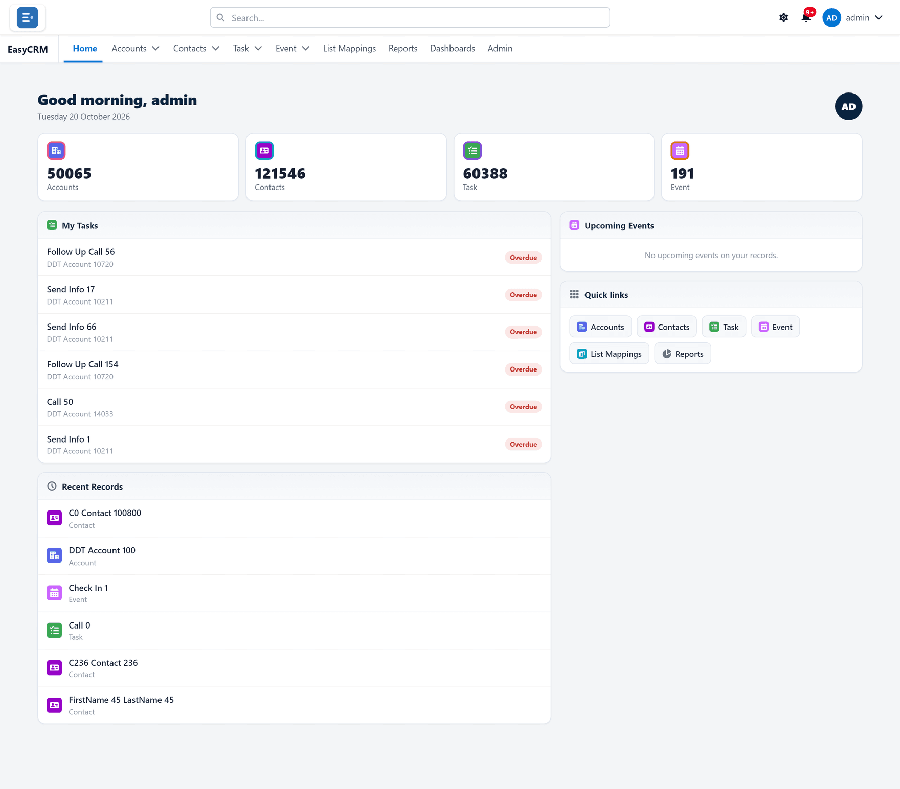
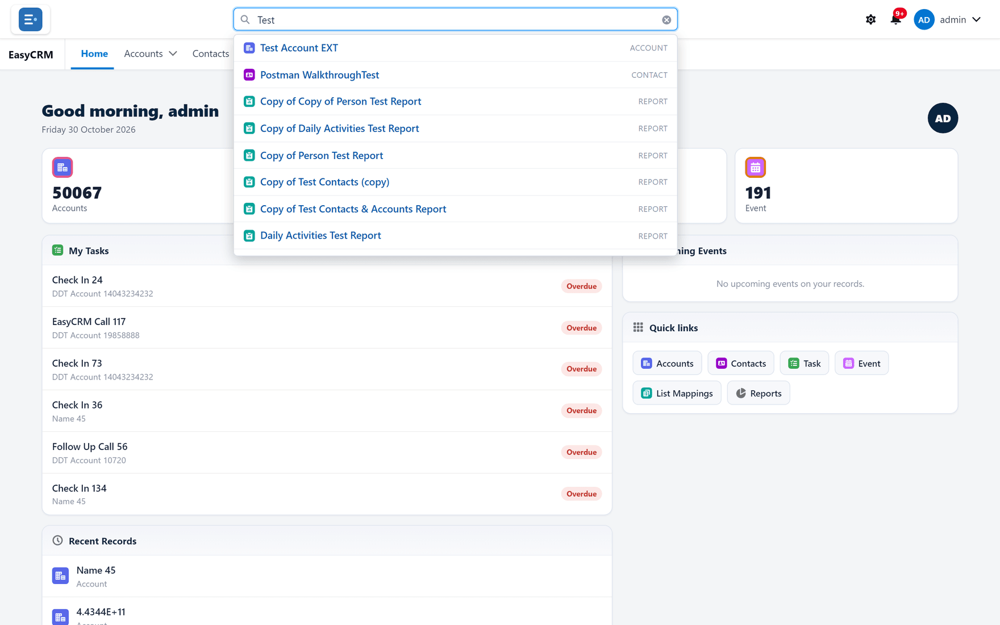
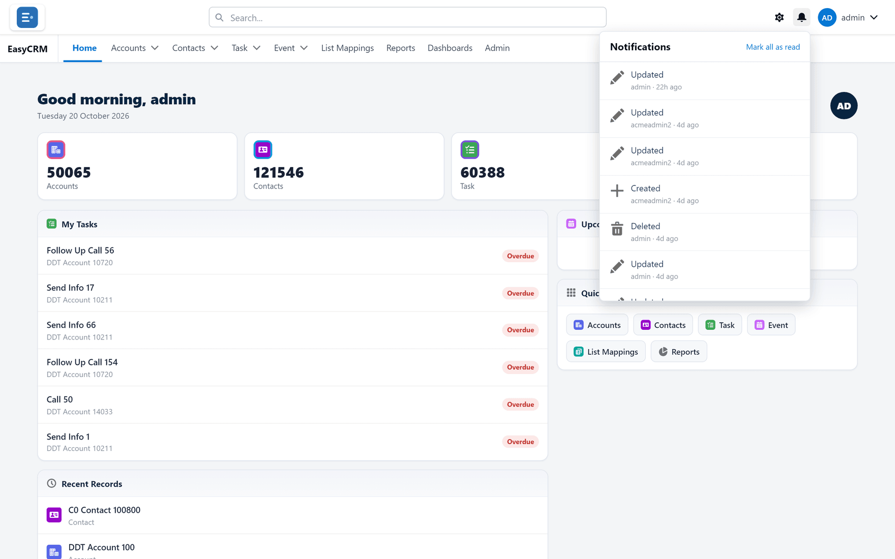
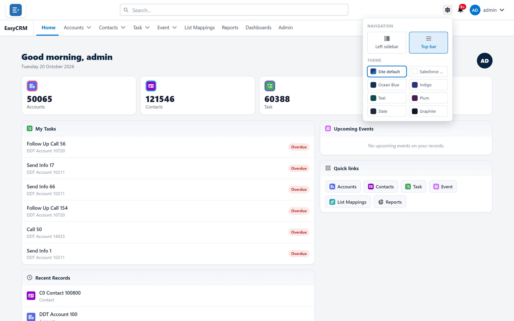
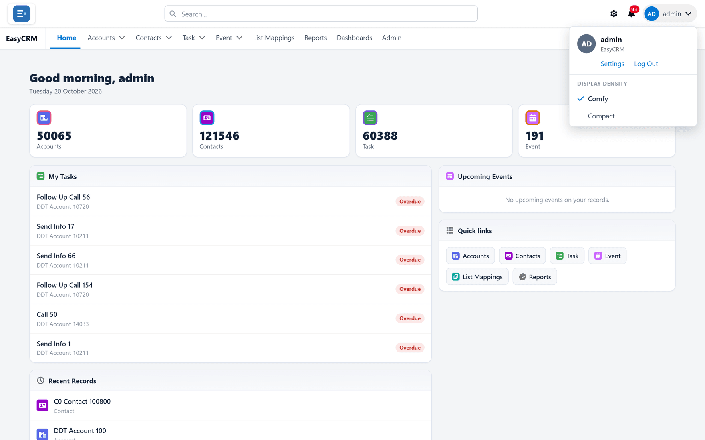

# Getting around

**What it is.** The bar across the top of the screen, which is the same on every page, and the
home page you land on.

**Why it matters.** Once you know these few controls you can reach anything in the portal.
This is the one page worth reading properly before anything else.

## The two rows at the top

The very top row, from left to right:

| What you see | Where it is | What it does |
|---|---|---|
| Your company's logo | Far left | Shows whose portal this is. Clicking it does nothing — use **Home** to go back to the home page. |
| **Search...** | Middle | Finds records, reports and dashboards by name. See [Searching](../records/searching.md). |
| A clock reading **Session ends in** | Right, only in the last 5 minutes of your session | Opens the sign-out warning. See [Staying signed in](./session.md). |
| A gear symbol | Right | **View settings** — changes how the portal looks **to you**. |
| A bell | Right | Your notifications. A red number means unread ones. |
| Your name | Far right | **Settings**, **Log Out**, and row spacing. |

The second row starts with the **App Launcher** — a square of nine dots — and the name of the app
you are in, if your administrator has set up apps for you. After that come your **tabs**: the
main sections — **Home**, then one tab per kind of record (**Accounts**, **Contacts**, **Task**,
**Event**), then **Reports**, **Dashboards**, and **Admin** if you are an administrator.

The tab you are on is underlined.

**Your tabs may not match this picture.** Your administrator chooses which tabs your company
sees, which apps you have, and whether there is a **Home** tab at all; your role affects it too.
See [What you can see](./what-you-can-see.md).

## The menu on each tab

**Where:** In the portal → the small arrow beside a tab's name

Each record tab — **Accounts**, for example — has a small arrow beside its name. Click it for a
short menu:

| Item | What it does |
|---|---|
| **New Account** | Opens the window for adding one. See [Adding a record](../records/creating.md). |
| **Recent Records** | Up to five records of this kind that you opened lately. Click one to open it. |
| **Recent Lists** → **All Accounts** | Opens the full list. |

<!-- SHOT: shell/tab-menu.png | Top bar layout, the Accounts tab's arrow clicked: menu showing New Account, Recent Records with a few names, Recent Lists → All Accounts -->

When there are more tabs than fit across the screen, the ones on the right fold into **More** at
the end of the row. Click **More** to reach them.

## The App Launcher

**Where:** In the portal → the nine-dot square at the start of the tab row

It is there only when your administrator has given you at least one app. An app is a set of
tabs for one kind of work.

1. Click the nine-dot square.
2. The **App Launcher** opens, with a **Search apps and items...** box and up to three sections:

   | Section | What it holds |
   |---|---|
   | **Files** | The files area. This is the way into it — see [Files](../files/index.md). |
   | **Apps** | Your apps. Click one to switch to its tabs; you land on its home page. |
   | **Items** | Your record tabs. Type in the search box to look across every kind of record you can read. |

3. Click what you want.

<!-- SHOT: shell/app-launcher.png | Top bar layout, a user with two apps, App Launcher open showing the search box and the Files, Apps and Items sections -->

The portal remembers which app you were in, in this browser.

In the **Left sidebar** layout the nine-dot square sits at the far left of the top row instead,
and lists only your apps.

## The left sidebar layout

If you chose **Left sidebar** under the gear, the tabs run down the left side:

- A narrow strip labelled **Menu** shows or hides the sidebar.
- **Home** is at the top, then your record tabs. If there are many, the rest are behind
  **Show more (N)**; **Show less** folds them away again.
- Each record tab has a small icon on its right, **Open in new tab**.
- **Reports**, **Dashboards** and **Admin** sit at the bottom.

## When an administrator is using your account

If an administrator uses **Log in as** to see the portal as you see it, a banner stays across the
top of every page for them: **You are logged in as** *username*. **Everything you do is recorded
as them.**, with **Return to my account**. It cannot be closed. See
[Seeing the portal as somebody else](../../admin/users/login-as.md).

## Leaving with unsaved changes

If you are building a report or a dashboard and try to go somewhere else before saving, the
portal asks **You have unsaved changes that will be lost. Leave anyway?** Choose **Cancel** to
stay and save.

Only the report and dashboard builders ask this (and, for administrators, the sign-in page
designer). Leaving a list with unsaved list edits loses them without a question — see
[Editing in a list](../records/list-editing.md).

## The home page

The home page shows things that concern the records you work with. From the top:

| Part | What it shows |
|---|---|
| The greeting | **Good morning**, **Good afternoon** or **Good evening** with your username, today's date, and your company. |
| An announcement | A message from your administrator, when there is one. |
| The number tiles | How many records of each kind you can see. Click one to open that list. |
| **My Tasks** | Up to six **open** tasks on the 20 records you opened most recently, soonest first. |
| **Recent Records** | The six records you opened most recently. Click one to open it. |
| **Upcoming Events** | Up to six events from today onwards on those same recent records, with their date and time. |
| **Quick links** | Shortcuts to up to eight of the portal's tabs, plus **Reports**. |

Here is the whole page:

**My Tasks is not "tasks assigned to me".** It lists open tasks on the records you have been
looking at, whoever they are for. Each one carries a badge:

| Badge | Means |
|---|---|
| **Overdue** | The due date has passed. |
| **Today** | Due today. |
| **Upcoming** | Due later. |
| **Open** | No due date. |

The rows in **My Tasks** and **Upcoming Events** are not links. To work on one, open its record
from **Recent Records** or the tab.

When there is nothing to show, the cards say **No open tasks on your recent records.**, **No
upcoming events on your records.** and **Records you open will appear here.** On a new account
that is normal: open a few records and they fill up.

**Your home page may differ.** Your administrator chooses which cards appear, and can give each
app its own home page — see [Home](../../admin/appearance/home.md). An administrator can also
hide the **Home** tab for the whole portal; you then start on your first tab instead.

## Searching for anything

**Where:** In the portal → **Search...** at the top → type → click a result

1. Click the **Search...** box in the middle of the top bar.
2. Type at least two letters of a name. You do not need the whole thing.
3. Results appear underneath as you type, each with its kind on the right.

   

4. Click a result to open it.

Search looks across every kind of record you are allowed to see, and your reports and dashboards,
so it is the quickest way to find something when you are not sure where it lives. More on
[Searching](../records/searching.md).

## Your notifications

**Where:** In the portal → the bell (top right)

The bell lists the latest changes to records made in the portal: records created, edited,
deleted, and given a new owner.

| Your role | Whose changes you see |
|---|---|
| **Standard** | Your own. |
| **Admin** | Yours, the people you manage, and the Standard users at your company. |
| **Super Admin** | Everybody's. |

1. Click the bell in the top right.
2. The list opens, newest first — up to the latest 25. Each entry says what happened
   (**Created**, **Updated**, **Deleted**, **Owner changed**), the record's name, who did it, and
   how long ago (**5m ago**, for example).

   

3. Click one to open the record it refers to. Deleted records cannot be opened.

The red number on the bell is how many you have not read; above nine it shows **9+**. Opening
the bell marks everything as read; **Mark all as read** at the top of the list does the same.
When the list is empty, it says **You're all caught up.**

What you have read is remembered in this browser, so on another computer the same entries can
show as unread.

## Changing how the portal looks

**Where:** In the portal → the gear (top right)

1. Click the gear symbol in the top right.
2. The panel opens.

   

3. Under **Navigation**, choose where the menu sits:
   - **Top bar** — tabs across the top, as in these pictures.
   - **Left sidebar** — tabs down the left side.
4. Under **Theme**, click a colour.

Each choice takes effect the moment you click it — there is no **Save** button. Click anywhere
outside the panel to close it.

**This changes only what you see.** Nobody else is affected, and no data changes. More on
[How the portal looks](../account/display.md).

## Your account menu

**Where:** In the portal → your name (top right)

1. Click your name in the top right.

   

2. From here you can reach:

| Item | What it does |
|---|---|
| **Settings** | Your profile and your password. |
| **Log Out** | Signs you out. |
| **Display Density** — **Comfy** / **Compact** | How much space rows take up. **Compact** fits more on screen. |
